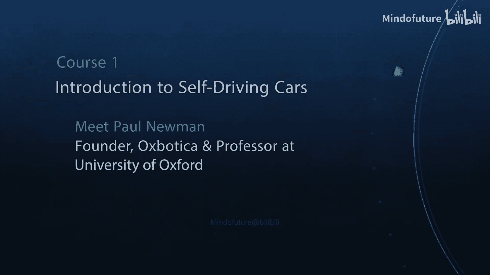

# 008：认识奥博提卡创始人、牛津大学教授保罗·纽曼

在本节课中，我们将通过牛津大学教授、奥博提卡公司创始人保罗·纽曼的分享，了解自动驾驶领域的发展历程、核心挑战以及未来愿景。我们将探讨为何自动驾驶技术至关重要，以及智能车辆与智能基础设施之间的关系。

---

我是保罗·纽曼，我是奥博提卡公司的首席技术官兼创始人，同时也是牛津大学的信息工程学教授。

我记得自己开始对自动驾驶车辆和自主系统产生兴趣的那一天。那是在悉尼，当时我刚开始攻读博士学位，正在和一位博士生交谈。他向我介绍了一个名为“SLAM”的问题。这个问题是：一辆车能否在没有人提供地图的情况下，自己弄清楚它在世界中的位置，并且能否自己构建那张地图？我当时就知道，这是我想要研究的所有问题中最核心的一个。我记得那天是1996年3月19日，我真正发现这里存在一个重大问题。从那以后，这个问题从未过时。虽然我们现在已经知道如何解决这些问题。

但我一直是一名工程师，致力于构建事物。当我发现将软件和机械事物结合起来是最令人兴奋的构建方式时，我就投身其中了，而这几乎就是机器人的定义。

因此，我从未真正失去这份热情，大概从九岁开始尝试编程非常基础的计算机，直到现在每天所做的工作，这份激动从未离开过我。

那么，我们在奥博提卡做什么呢？我们构建使自动驾驶车辆实现自主的软件。我们从最底层的传感器开始，一路向上，贯穿整个软件栈，包括规划、定位、控制、感知，直至车队管理系统。我们构建的是使整个车队实现自主运行的完整软件环境。

这就是我们构建的东西。同时，我在大学里也进行开发工作。

我是牛津机器人研究所的所长，在那里我也拥有很棒的生活。在那里，我研究的是自主系统和机器人技术中那些非常、非常困难的问题，这些问题可能是未来十年才会遇到的。

以下是那些处于萌芽状态的研究问题，关于机器、智能以及机器学习，我们希望在未来五到十年内将其应用于我们的车辆中。

因此，我拥有非常优越的生活。那么，我为什么如此关心自动驾驶汽车呢？

因为目前的交通系统已经过时，并且存在缺陷。

道路上80%的事故都是由注意力不集中引起的。机器绝不会做的一件事就是感到无聊。我们目前完全没有解决这个问题。

我们目前的驾驶方式是低效的。随着我们年龄增长，身体变得虚弱，我们最需要的是保持与社会的联系。而如果我们说：“哦，很抱歉，你视力下降了，不能开车了。你癫痫发作了，不能开车了。”那么，整个我们如何驾驶自己、如何移动我们自身（无论是人类本身还是货物）的体系就显得非常不合理。

这套体系源自马车时代。如果我们拥有现在的技术，我们绝不会那样做。所以这是不合理的，而软件和算法将改变这一切。

我绝对相信，自动驾驶技术将使更多的物体（人和货物）移动得更高效、更安全。

这里存在一个问题：车辆本身应该是独立智能的，还是应该利用智能基础设施？

那么，什么是智能基础设施？例如，一个交通灯可以告诉你：“我即将变红，这是我的位置。”或者一个环岛可以告诉你：“这是车辆的位置，你的空位即将到来。”我们可以设想无数种方法来为我们的城市配备智能设备。

所以我的观点是，车辆本身需要足够智能，能够在不依赖基础设施的情况下运行。如果提供了智能基础设施，当然可以在信任它的情况下使用它，但这涉及到网络安全等一系列问题。

因此，我的观点是，车辆本身必须足够智能，就像你作为司机一样。你可以看交通灯，可以看车道线，你不需要前面的车告诉你前面有车，因为你可以看到它。因为如果基础设施被移除，你仍然希望拥有能够自动驾驶的车辆。它可以被基础设施增强，但我认为不应该依赖它。因为如果你解决了这个问题，那么你就真正掌握了在任何地方实现全交通自主的可能性。这可能需要一些时间，但你正朝着这个方向前进，并且不依赖于昂贵、定制的专用基础设施。在我看来，为自动驾驶汽车打造的昂贵、定制的专用基础设施，其名称就是“城市”。

---

在本节课中，我们一起学习了保罗·纽曼教授进入自动驾驶领域的契机，了解了SLAM（同步定位与建图）这一核心问题的提出。我们探讨了奥博提卡公司的业务范围，即构建从底层传感器到高层车队管理的完整自动驾驶软件栈。更重要的是，我们分析了自动驾驶技术对于解决当前交通系统缺陷（如事故率高、效率低下、社会隔离）的重大意义，并明确了智能车辆应具备独立运行能力，而非过度依赖智能基础设施的核心观点。这为理解自动驾驶系统的自主性和鲁棒性奠定了重要基础。