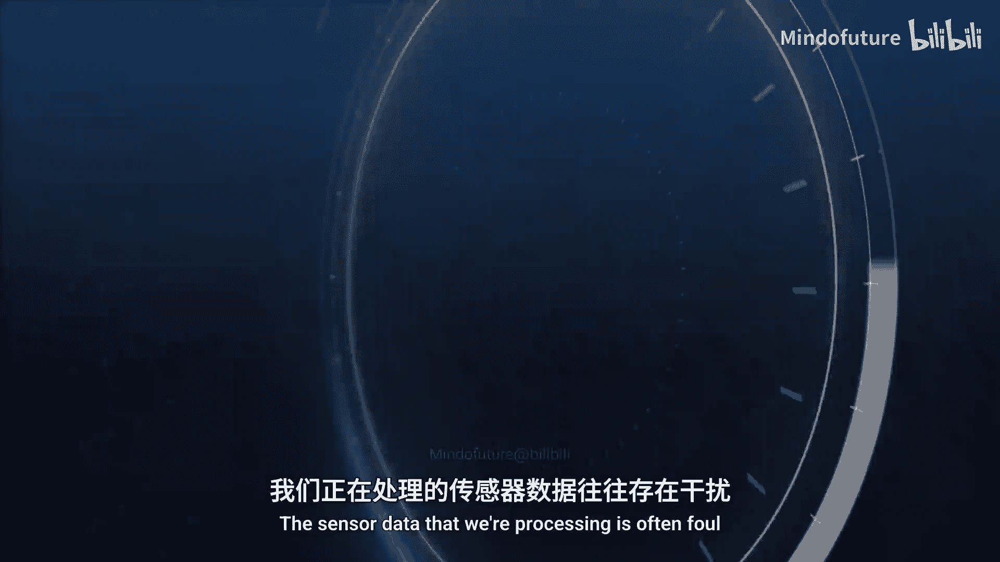

# 009：状态估计的重要性

在本节课中，我们将探讨状态估计对于自动驾驶汽车为何至关重要。我们将了解状态估计要解决的核心问题，以及为什么这个问题在实际中充满挑战。

## 状态估计的核心作用 🎯

状态估计之所以对自动驾驶汽车至关重要，一个直接的原因是：你需要知道自己的位置，而你所能获得的全部输入就是传感器数据。因此，状态估计问题可以简单地表述为：**给定所有这些输入的传感器数据，我在哪里？** 你的状态就是“你在哪里”这个问题的答案，而你必须估计它，因为传感器（例如摄像头）并不会直接告诉你答案。如果我有一张世界的图片，我必须从那张图片中推断出我的位置、我的运动方式、我的速度有多快、我正在以多快的速度转弯。这些都是状态估计问题。

因此，你需要利用那些传感器数据。你可能还有一些先验信息，例如关于10毫秒前你的运动速度的信念，你可以将这些信息整合进去。但如果你不能进行状态估计，你就无法处理传感器数据。可以说，这是最根本的问题之一。

## 状态估计的挑战性 ⚠️

我们已经达成共识，状态估计非常重要。如果它同时也是一个简单的问题，那岂不是很好？不幸的是，它相当困难。为什么？因为我们需要处理、并用来回答“我在哪里”、“我如何运动”、“那边那个个体将要做什么（因为我对它的速度有个估计）”等问题的传感器数据，常常是有缺陷的。

---

**本节课总结**

本节课中，我们一起学习了状态估计在自动驾驶中的核心地位。我们明确了状态估计要解决的根本问题：**根据传感器数据推断自身的位置、速度和运动状态**。同时，我们也认识到这个任务充满挑战，主要因为输入的传感器数据本身可能存在缺陷和噪声。理解这些是深入学习后续具体状态估计算法的基础。