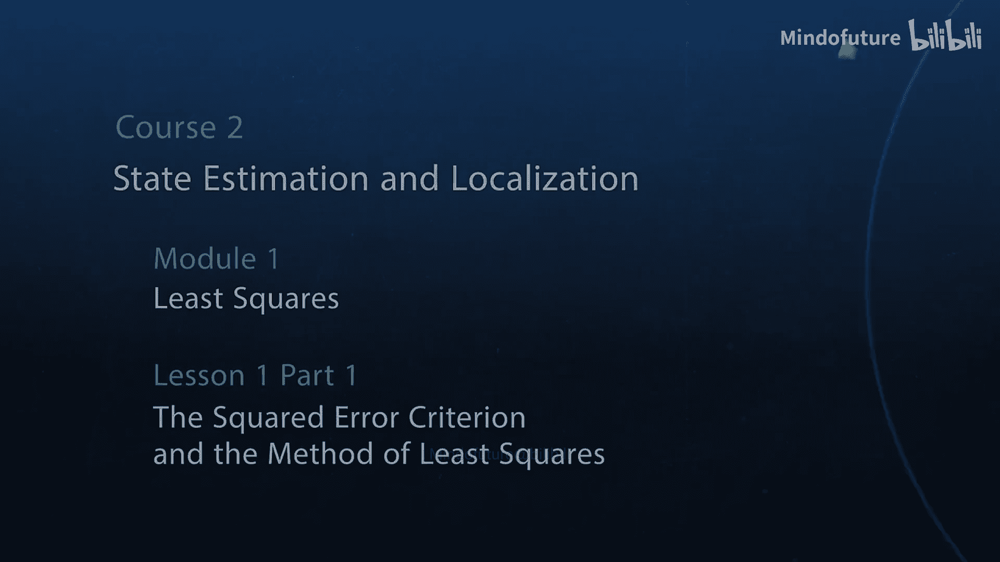
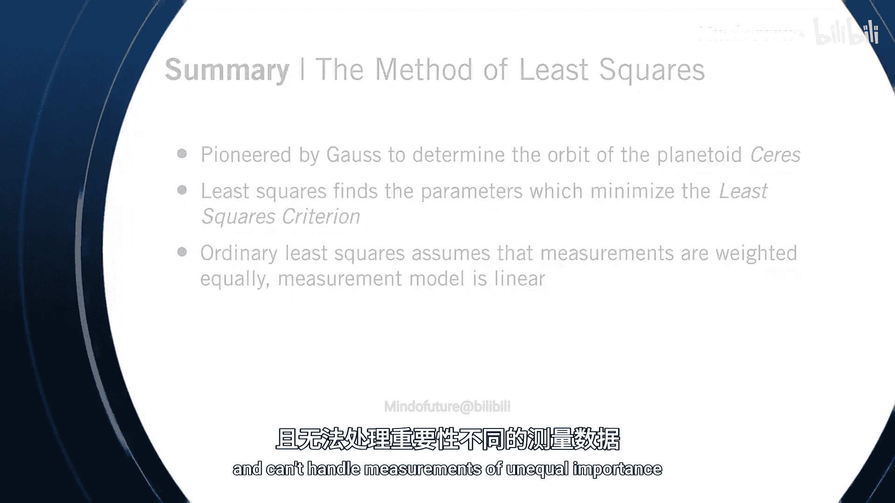

自动驾驶汽车的状态估计和定位：1.1：平方误差准则与最小二乘法 🚗

在本节课中，我们将学习状态估计的基础方法——最小二乘法。我们将了解其历史背景，学习如何通过最小化平方误差来估计未知参数，并推导出求解所需的关键方程。

---

最小二乘法可以追溯到18世纪末，远早于汽车的概念出现。1801年1月1日，意大利牧师兼天文学家朱塞佩·皮亚齐在夜空中发现了一个新的天体——即现在被称为谷神星的小行星。

皮亚齐在40天内对该天体进行了24次望远镜观测，之后它便消失在太阳的光芒中。由于谷神星直径仅约900公里，再次找到它极具挑战性。为了帮助重新定位谷神星，被誉为“数学王子”的卡尔·弗里德里希·高斯，基于皮亚齐发表的观测数据，使用最小二乘法精确估计了谷神星的轨道参数。

高斯在1809年发表了该方法，但他声称早在1795年就已提出，早于勒让德的工作。高斯将这种方法总结为：一个未知参数的最可能值，是使观测值与期望值之间的误差平方和最小的那个值。

为了说明其工作原理，我们来看一个简单的例子。

假设你正在尝试测量一辆自动驾驶汽车驱动系统中一个简单电阻的阻值（单位：欧姆）。为此，你使用实验室里一个相对廉价的万用表。现在，假设你按顺序收集了以下四个独立的测量值。

如果你以前学习过电路，可能会记得图中所示的这种碳膜电阻的阻值是通过色环编码的。这个电阻的标称阻值是1千欧。然而，由于多种因素，其真实阻值可能与标称值存在差异。在本例中，电阻有一个金色环，表示其阻值最多可偏差5%。此外，我们假设我们的万用表质量特别差，并且测量人员也不够仔细。

目前，我们可以将这种噪声视为等同于一般误差。但在本模块后续课程中，我们将从概率角度重新探讨如何解释这种噪声。

对于这四个测量值中的每一个，我们定义一个标量噪声项，该噪声项独立于其他噪声项。从统计学角度，在这种情况下我们会说噪声是独立同分布的，我们稍后会详细讨论这一点。

接下来，我们定义每个测量值与我们电阻真实值 **x** 之间的误差。但请记住，我们还不知道 **x** 是多少。为了找到 **x**，我们计算这些误差的平方，从而得到一个关于我们的测量值和未知电阻值的方程。

定义了这些误差后，最小二乘法指出，我们要寻找的电阻值——即 **x** 的最佳估计值——是使平方误差准则（有时也称为平方误差成本函数或损失函数）最小的那个值。

为了最小化平方误差准则，我们将用矩阵符号重写我们的误差。当我们需要处理成百上千个测量值时，这将特别有用。

我们将定义一个误差向量 **E**，它是我们的观测值（堆叠成向量 **Y**）、一个称为雅可比矩阵的矩阵 **H** 以及我们的真实电阻值 **x** 的函数。**H** 的维度是 **M × N**，其中 **M** 是测量值的数量，**N** 是我们希望估计的未知数或参数的数量。通常，这是一个矩形矩阵，在线性情况下很容易写出。在后续课程讨论非线性估计时，计算它将需要更多的数学推导。

请注意，这里的 **x** 是一个标量。稍后我们会看到，它也可以是一个包含多个未知数的向量。

有了这些定义，我们可以将平方误差准则转换为向量符号表示如下。

展开括号，我们得到了这个看起来有些复杂的表达式。那么现在该怎么办呢？请记住，我们需要相对于真实电阻 **x** 来最小化平方误差。根据微积分知识，我们可以通过对误差函数关于未知数 **x** 求导，并将导数设为零来实现这一点。

让我们照此操作。我们需要使用一些标准的矩阵表达式。重新整理后，我们得到了所谓的正规方程，它可以写成一个单一的矩阵公式。

我们可以求解这些方程来找到 **x̂**，即最小化我们平方误差准则的电阻值。

这个表达式有唯一解，当且仅当 **HᵀH** 非奇异，换句话说，如果该矩阵有逆矩阵。如果我们有 **M** 个测量值和 **n** 个未知参数，**HᵀH** 将是 **n × n** 矩阵。该矩阵可逆的充要条件是 **M ≥ N**，因此我们至少需要与未知数一样多的测量值才能推导出最小二乘解。这通常不是问题。事实上，我们常常面临处理过多测量值的挑战。尽管如此，在使用该公式时，你应该记住这个限制。

回到我们特定的电阻问题，让我们填入变量。

一旦我们有了这些量，剩下的就是代入计算了。这个表达式很容易编码实现，你将在模块作业中看到。

请注意，这个表达式简化为我们四个测量值的算术平均值。也许你一直认为应该这样做。现在，我们有了使用算术平均值的另一个理由：它最小化了简单的最小二乘准则。

最后，我们应该注意我们做出的两个重要假设。首先，我们假设了我们的测量模型是线性的。这是一个非常重要的假设，在复杂系统中经常被打破。我们将在后续课程中讨论非线性测量模型。其次，我们假设了所有测量值在我们的误差方程中具有相等的权重。换句话说，我们假设我们同等关心每一个测量值。

---

在本节课中，我们一起学习了最小二乘法由卡尔·弗里德里希·高斯首创，并被他用于精确预测名为谷神星的新行星状天体的轨道。我们看到了如何通过最小化最小二乘准则来求解感兴趣的参数值。我们还注意到，普通最小二乘法假设了一个线性测量模型，并且无法处理重要性不等的测量值。

在下一个视频中，我们将把最小二乘法扩展到加权最小二乘法，该方法能够考虑重要性不同的测量值。