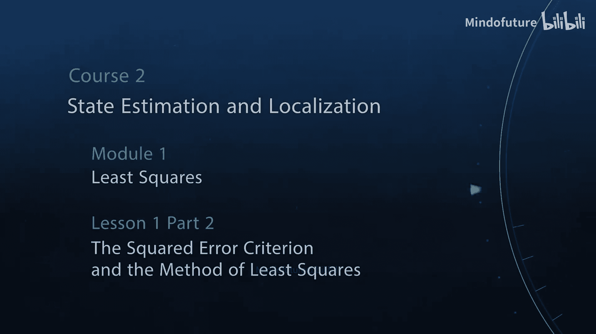

# 011：平方误差准则与最小二乘法

在本节课中，我们将要学习如何处理质量不同的测量数据。我们将从上一节讨论的普通最小二乘法出发，引入加权最小二乘法，并推导其核心公式。通过本课，你将能够理解如何为不同质量的测量值分配不同的权重，从而获得更准确的参数估计。

## 概述

在上一节视频中，我们学习了如何使用最小二乘法，根据一组含有噪声的测量值来求解电阻的更准确值。本节视频中，我们将探讨一个问题：如果我们怀疑某些测量值的质量优于其他测量值，我们应该怎么做？

通过本节的学习，你将能够推导并最小化加权最小二乘准则，这种方法允许我们处理具有不同质量的测量值，并将其与上一节讨论的普通最小二乘法进行比较。

## 引入加权的原因

我们可能希望更信任某些测量值的一个原因是，它们可能来自更好的传感器。例如，我们的一部分电阻测量值可能来自比其它测量仪昂贵得多的万用表。

此外，从现在开始，我们也将放弃只估计一个参数的假设，转而推导更通用的正规方程。这将使我们能够制定一种同时估计多个参数的方法。例如，如果我们想同时估计多个电阻值。

## 通用模型与假设

让我们从使用以下通用符号开始。

我们将有一组 **M** 个测量值，它们通过一个线性模型与一组 **N** 个未知参数相关联：

**z = Hx + v**

这里，**H** 是雅可比矩阵，其形式和元素将取决于具体问题。

解释普通最小二乘法的一种方式是，我们隐含地假设每个噪声项 **v_i** 在测量之间是独立的随机变量，并且具有相等的方差（或标准差，如果你更喜欢的话），即上一节提到的独立同分布。

## 加权最小二乘准则

如果我们假设每个噪声项具有不同的方差，我们可以如下定义我们的噪声协方差矩阵 **R**：

**R = E[vv^T] = diag(σ₁², σ₂², ..., σ_M²)**

基于这个定义，我们可以定义加权最小二乘准则 **J_wls**：

**J_wls(x) = (z - Hx)^T R^{-1} (z - Hx)**

展开这个表达式，我们可以看到为什么称之为加权最小二乘：

**J_wls(x) = Σ_{i=1}^{M} ( (z_i - h_i^T x)² / σ_i² )**

现在，每个平方误差项都由相应测量值关联的方差的倒数进行加权。换句话说，噪声的方差越低，其关联的误差项在损失函数中的权重就越大。我们更关心来自低噪声测量的误差，因为这些测量应该更能告诉我们未知参数的真实值。

## 与普通最小二乘法的关系

在我们了解如何最小化这个新的加权准则之前，让我们看看如果将所有噪声标准差设置为相同的值 **σ** 会发生什么。

在这种情况下，我们可以将分母中的方差因子提取出来：

**J_wls(x) = (1/σ²) * Σ_{i=1}^{M} (z_i - h_i^T x)² = (1/σ²) * J_ols(x)**

由于 **σ²** 项是常数，它不会影响最小化过程。这意味着在方差相等的情况下，最小化我们加权最小二乘准则的参数也将最小化我们的普通最小二乘准则，正如我们所预期的那样。

## 最小化加权准则

回到我们的加权最小二乘准则，我们采用与之前相同的方法来最小化它：求导。在一般情况下，我们的粗体向量 **x** 中有 **n** 个未知参数，这个导数实际上是一个梯度：

**∇_x J_wls = -2 H^T R^{-1} (z - Hx)**

将梯度设为零向量，然后求解我们的最佳或最优参数向量 **x̂**：

**H^T R^{-1} H x̂ = H^T R^{-1} z**

这导出了另一组正规方程，这次称为加权正规方程。

## 应用示例

让我们看一个加权最小二乘法如何工作的例子。

我们将采用之前收集的相同数据，但现在假设最后两个测量值实际上是用噪声方差小得多的万用表测量的。

请注意，这里列出的数字是标准差，这就是它们以欧姆为单位的原因。为了在我们的公式中使用它们，我们需要对它们进行平方以获得方差。

定义我们的变量，然后评估我们的加权最小二乘解，我们可以看到最终得到的电阻值更接近更精确的万用表测量的值，正如预期的那样。

## 方法总结

以下是普通最小二乘法和加权最小二乘法的快速总结。

通过使用加权最小二乘法，我们可以改变每个测量值对最终估计的重要性。重要的是要能够熟练处理不同的测量方差，以及有时相关的测量值。自动驾驶汽车将搭载许多不同且复杂的传感器，我们需要确保正确建模我们的误差源。

## 本节总结

本节课中我们一起学习了加权最小二乘法。我们讨论了某些测量值可能来自具有更好噪声特性的传感器，因此应在我们的最小二乘准则中赋予更大的权重。基于这种直觉，我们推导了加权最小二乘准则以及相关的加权正规方程，求解该方程可以得到一组常数参数的加权最小二乘估计。

在下一节视频中，我们将研究如何修改最小二乘法以递归方式工作。即基于测量流计算最优估计，而无需事先获取整个数据集。当我们研究状态估计或估计随时间连续变化的量的问题时，这将非常重要。

