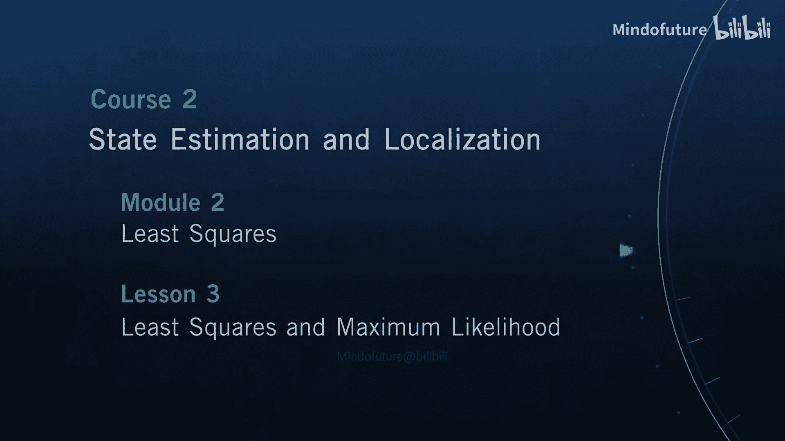
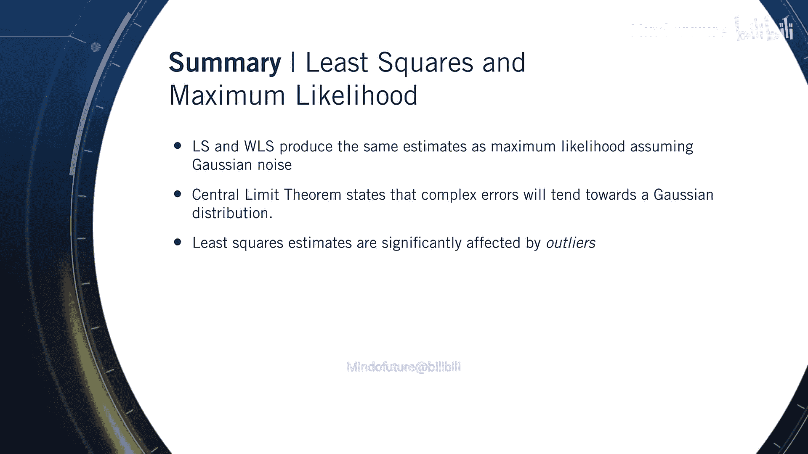

**自动驾驶汽车的状态估计和定位：1.3：最小二乘法与最大似然估计法的联系**

欢迎来到第一模块的最后一课。我们将通过讨论一个重要的联系来结束本模块，这将有助于加深对最小二乘法的理解。

具体来说，在本课结束时，你将能够阐述最小二乘法与高斯随机变量最大似然估计之间的联系。

让我们首先回顾本模块第一个视频中提到的最小二乘准则。我们通过确定能使测量误差平方和最小化的值，来找到一些未知但恒定参数的最佳估计。

但我们可以问，为什么是误差的平方？为什么不是立方误差、平方根误差或其他形式？这实际上是一个相当深刻的问题，有一个完整的稳健统计学领域专门研究它。确实可以使用不同的误差函数，但我们将讨论平方误差具有吸引力和相关性的两个原因。

第一个原因很简单。平方误差允许我们通过相对直接的代数运算来求解最优参数。如果测量模型是线性的，最小化平方误差准则就相当于求解一个线性方程组。

第二个原因与概率有关，并且在高斯噪声的假设下，最小二乘法与最大似然估计器之间存在深刻的联系。正如你可能猜到的，这种联系最初是由高斯以一种特定形式推导出来的，因此它涉及高斯随机变量（或等价的高斯噪声）也就不足为奇了。

为了理解这一基本联系，让我们首先讨论最大似然估计。

我们可以不写损失函数，而是通过提问“哪些参数最可能产生我们记录到的测量值？”来探讨最优参数估计问题。为了简单起见，我们将坚持使用单个标量参数来建立直觉。

例如，让我们再次看看测量电阻的例子。根据我们对概率的了解，如果我们有四个可能的未知电阻参数值 \(X_A\) 到 \(X_D\)，并且每个值都会产生以下关于我们测量值 \(y\) 的条件概率。那么，给定测量值 \(y_{meas}\)，哪个值能使条件似然最大化？没错，是 \(X_A\)。在测量位置处，最高的概率密度由绿色曲线给出，这意味着 \(X_A\) 是给定此测量值的最可能参数值。

现在，如果我们采用简单的测量模型，并通过假设加性噪声的密度，可以将其转换为概率密度。未知参数 \(X\) 成为该密度的均值，方差就是我们的噪声方差。回想一下，高斯随机变量的概率密度由以下公式给出：

\[
p(y) = \frac{1}{\sqrt{2\pi\sigma^2}} \exp\left(-\frac{(y - \mu)^2}{2\sigma^2}\right)
\]

这意味着我们可以将单次测量的测量似然表示如下：

\[
p(y|X) = \frac{1}{\sqrt{2\pi\sigma^2}} \exp\left(-\frac{(y - X)^2}{2\sigma^2}\right)
\]

如果我们有多个独立测量，每个测量具有相同的噪声方差，我们可以简单地将多个高斯分布相乘，结果得到另一个高斯分布。

我们尝试关于均值参数 \(\hat{X}\) 最大化这个似然。为此，我们将使用优化中常用的一种技术：不直接最大化似然，而是取其对数并最大化该对数。由于似然总是一个正数，并且因为对数是一个单调递增函数，这不会影响最终结果，这非常方便。

将对数应用于此似然后，我们看到出现了一些看起来很像误差平方和的东西：

\[
\log p(y_1, ..., y_N|X) = C - \frac{1}{2\sigma^2} \sum_{i=1}^{N} (y_i - X)^2
\]

表达式中的常数 \(C\) 指的是不依赖于 \(X\) 的项，我们可以安全地忽略它们。

最后一步是认识到，函数 \(f\) 的 \(\arg\max\) 与函数 \(-f\) 的 \(\arg\min\) 相同。利用这个事实，我们可以将似然最大化问题转化为误差平方和的最小化问题。

看，最小化误差平方和等价于最大化一组测量的似然，前提是假设测量值被具有相同方差的加性独立高斯噪声所破坏。

此外，如果我们保持相同的假设，但改变每次测量的高斯噪声方差，我们可以得到与加权最小二乘法视频中看到的相同准则。

因此，在这两种情况下，对于加性高斯噪声，最大似然估计给出的结果等同于我们之前推导的最小二乘或加权最小二乘解。

那么，为什么这个结果如此重要？我们的自动驾驶汽车将不得不处理许多许多误差源，其中一些非常难以建模。然而，中心极限定理告诉我们，当所有这些误差结合在一起时，它们可以合理地用一个单一的高斯误差分布来建模。我们希望以概率方式对系统进行建模，同时保持计算的简洁性。如果我们的误差是高斯分布的，那么感兴趣参数的最佳最大似然估计正是我们已经熟悉的最小二乘解，非常简单。

最后，让我们讨论一下这种方法的一个重要注意事项。当我们使用最小二乘法时，测量异常值会对我们的最终估计产生显著影响。

要理解原因，请考虑在高斯分布下，一个距离均值两个标准差的样本出现的概率小于5%。因此，如果我们的测量数据中存在一些异常值，最大似然法以及等价的最小二乘法会赋予这些测量值很大的重要性。因此，我们参数的估计值会被这些异常值强烈地拉偏。我们的最优方法会发生偏斜，使得异常测量值看起来更可能发生。

这种情况可能发生在使用自动驾驶车辆传感器数据的许多估计器中。例如，异常值可能来自走在激光雷达扫描中间的人，或者来自不良的GPS信号。考虑我们的电阻示例，一个可能来自简单事故的异常测量值，会将最终估计值显著拉离无异常值情况下的结果。

我们始终需要警惕异常值，并尽可能在盲目应用最大似然法或最小二乘法之前量化误差分布。

既然我们已经推导出最大似然估计与最小二乘法之间的联系，我们现在就可以将递归最小二乘估计器扩展到完整的卡尔曼滤波器——20世纪最著名的算法之一。

**总结一下**，我们了解到，在高斯噪声的假设下，最小二乘法和加权最小二乘法产生的估计与最大似然估计相同。这一点尤其重要，因为许多复杂的噪声源在相加时往往会趋向于高斯分布。然而，始终需要警惕可能显著影响最终估计值的异常测量。

在下一个模块中，我们将看看如何将我们学到的关于最小二乘法和参数估计的知识，扩展到可能具有更复杂非线性模型的持续变化的状态。我们下次见。

