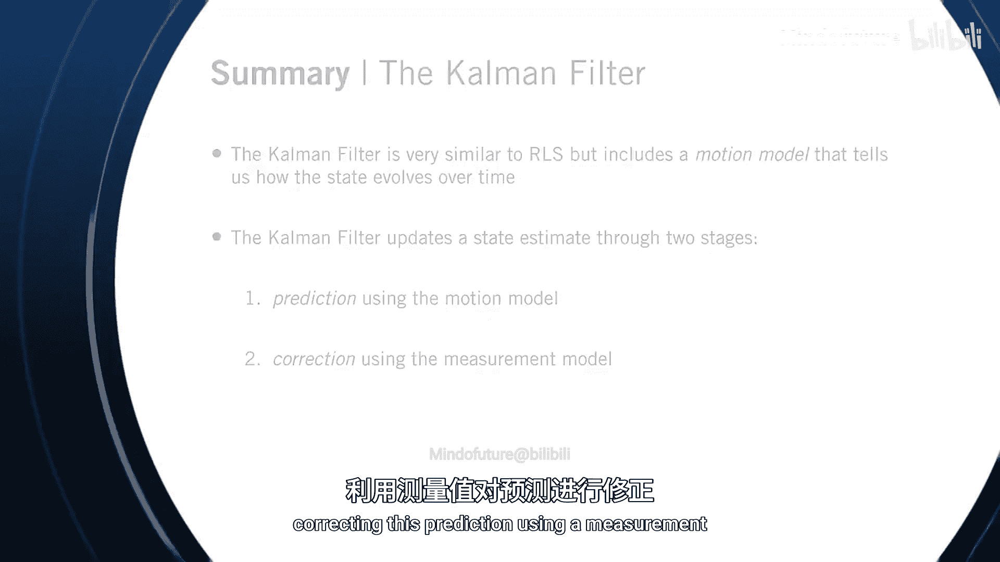

# 014：线性卡尔曼滤波

欢迎回来。在本模块中，我们将学习工程领域最著名的算法之一：卡尔曼滤波。在当今先进的机器学习世界中，卡尔曼滤波仍然是一个重要工具，用于融合来自多个传感器的测量数据，以实时估计机器人系统（如自动驾驶汽车）的状态。在本模块中，我们将了解卡尔曼滤波的一些历史，并介绍其基本的线性公式。我们将阐述为何卡尔曼滤波是最佳线性无偏估计器，然后通过线性化将线性公式扩展到非线性系统。讨论这种线性化方法的局限性。最后，通过无迹变换介绍一种现代替代线性化的方法。

在本节课结束时，你将能够：将卡尔曼滤波描述为一个分两个阶段（预测和校正）工作的状态估计器。理解运动模型和测量模型之间的区别。然后在一个简单的一维定位示例中使用卡尔曼滤波公式。

让我们从一点历史开始。卡尔曼滤波算法由匈牙利裔教授兼工程师鲁道夫·E·卡尔曼于1960年发表，当时他在马里兰州巴尔的摩的高级研究所工作。多年后，在2009年，美国总统巴拉克·奥巴马授予卡尔曼国家科学奖章，以表彰他在卡尔曼滤波及其他控制工程领域的贡献。1960年发表后，卡尔曼滤波被美国国家航空航天局采用，用于阿波罗制导计算机。正是这项开创性的创新，在成功将阿波罗飞船送上月球以及我们在另一个世界迈出第一步的过程中发挥了关键作用。该滤波器帮助阿波罗飞船精确地绕月轨道飞行。美国国家航空航天局艾姆斯研究中心的工程师们采用了卡尔曼的线性理论，并将其扩展到非线性模型。我们将在接下来的模块中探讨这个具体的扩展。但首先，让我们谈谈基本的线性卡尔曼滤波。卡尔曼滤波与我们之前讨论的线性递归最小二乘滤波器非常相似。递归最小二乘法更新静态参数的估计，而卡尔曼滤波能够更新一个演变状态的估计。

卡尔曼滤波的目标是获取状态的概率估计，并使用两个步骤实时更新它：预测和校正。为了使这些概念更具体，让我们考虑一个估计车辆一维位置的问题。从时间 K-1 的初始概率估计开始。我们的目标是使用一个运动模型（可以来自车轮里程计或惯性传感器测量）来预测我们的新状态。然后，我们将使用一个观测模型（例如来自GPS）来校正时间 K 的车辆位置预测。这些组成部分——初始估计、预测状态和最终校正状态——都是随机变量，我们将通过它们的均值和协方差来指定。这样，我们可以将卡尔曼滤波视为一种融合来自不同传感器信息的技术，以产生某个未知状态的最终估计，同时考虑到运动和测量中的不确定性。

对于卡尔曼滤波算法，我们能够将运动模型写成以下形式：

**公式：**
`x_k = A * x_{k-1} + B * u_k + w_k`

时间步 K 的估计是时间步 K-1 的估计、一个控制输入和一些零均值噪声的线性组合。输入是影响我们系统状态演变的外部信号，在自动驾驶汽车的背景下，这可能是用于加速和变道的车轮扭矩。接下来，我们还需要定义一个线性测量模型。最后，我们将像以前一样需要一个测量噪声，以及一个过程噪声，它决定了我们对线性动态系统实际正确的确定程度，或者等效地，我们对控制输入效果的不确定程度。

一旦我们掌握了系统，我们可以使用一种与我们之前在递归最小二乘视频中讨论的方法非常相似的方法，只是这次我们将分两步进行。首先，我们将使用过程模型来预测我们的状态（请注意，我们现在通常讨论的是演变状态，而不是状态参数）自上一个时间步以来的演变，并传播我们的不确定性。其次，我们将使用我们的测量值，基于我们的测量残差（或新息）和我们的最优增益来校正该预测。最后，我们将使用增益将状态协方差从我们的预测传播到我们的校正估计。

在我们的符号中，帽子（^）表示特定时间步的校正后预测，而勾号（ˇ）表示在纳入测量之前的预测。如果你以前使用过卡尔曼滤波，你可能也见过分别用加号和减号表示校正量和预测量的写法。

让我们回顾一下。我们从时间步 k-1 的状态（可能还有参数）的概率密度开始，我们将其表示为多元高斯分布。然后，我们使用线性预测模型预测时间步 K 的状态，并将均值和不确定性（协方差）向前传播。最后，使用我们的概率测量模型，我们通过最优增益矩阵 K 最优地融合来自测量的信息与先前的预测，来校正我们的初始预测。我们的最终结果是时间步 K 状态的更新概率估计。

熟悉卡尔曼滤波的最佳方法是使用它。让我们看一个简单的例子。再次考虑自动驾驶汽车估计自身位置的情况。我们的状态向量将包括车辆位置及其一阶导数速度。我们的输入将是一个标量加速度，可能来自命令汽车向前或向后加速的控制系统。对于我们的测量，我们假设能够使用类似GPS接收器的东西直接确定车辆位置。最后，我们将如下定义我们的噪声方差。给定这个初始估计和我们的数据，当我们使用卡尔曼滤波执行一次预测步骤和一次校正步骤后，我们校正后的位置估计是多少？

以下是我们如何使用这些定义来求解校正后的位置和速度估计。请注意，我们最终校正后的状态协方差更小。也就是说，在纳入位置测量后，我们对汽车的位置更加确定。这种不确定性的减少是因为我们的测量模型相当准确。也就是说，测量噪声方差非常小。尝试增加测量方差，观察最终状态估计会发生什么变化。

总而言之，卡尔曼滤波类似于递归最小二乘法，但还增加了一个定义状态如何随时间演变的运动模型。卡尔曼滤波分两个阶段工作。首先，使用运动模型预测下一个状态。其次，使用测量值校正这个预测。

但我们如何确定卡尔曼滤波为我们提供了准确的状态估计呢？在下一个视频中，我们将讨论卡尔曼滤波的一些吸引人的理论特性，这些特性使其成为工程领域的支柱。

