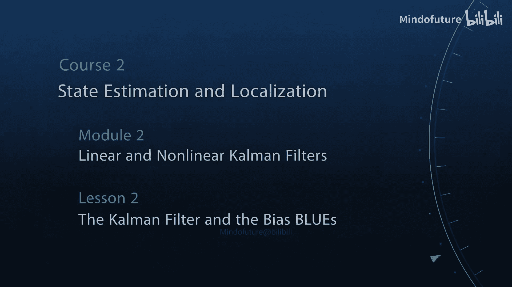
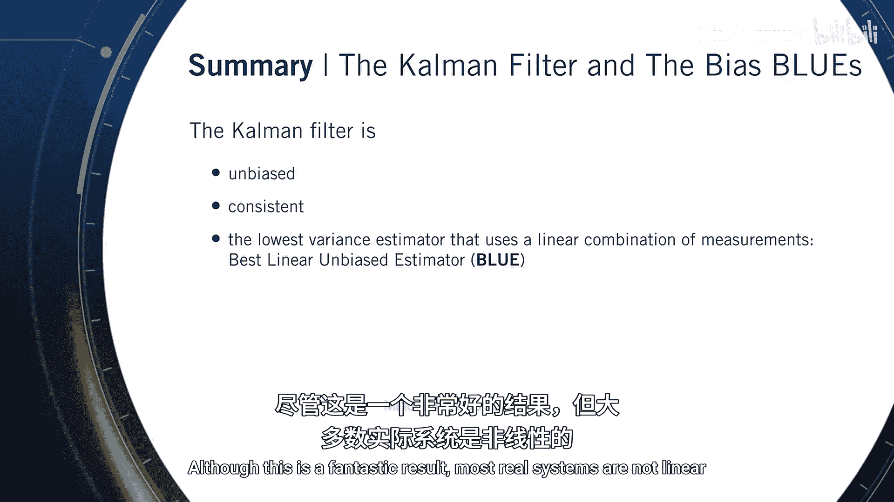

# 015：卡尔曼滤波与偏差问题

在本节课中，我们将探讨卡尔曼滤波器的核心特性，理解它为何是一种强大的状态估计方法。我们将学习两个关键概念：**偏差**和**一致性**，并最终解释为何卡尔曼滤波器被称为**最佳线性无偏估计器**。

上一节我们介绍了卡尔曼滤波器，本节中我们来看看是什么特性使其成为一种极具吸引力的估计方法。

## 偏差

首先，让我们讨论偏差的概念。考虑使用上一课的卡尔曼滤波器来估计自动驾驶汽车的位置。

如果我们有办法知道车辆的真实位置，例如通过一个“先知”告知，我们就可以记录滤波器在每个时间步K的位置误差。由于我们处理的是随机噪声，仅进行一次实验是不够的。我们需要多次重复这个过程，并记录每个时间步的位置误差。

收集这些误差后，如果它们在特定时间步K的平均值趋近于0，那么我们称卡尔曼滤波器在该时间步的估计是**无偏的**。

从图形上看，情况可能如下所示。在特定时间步，我们知道真实位置。我们构建一个直方图，显示滤波器在多次试验中报告的位置，然后计算这些估计值的平均值与真实位置之间的差值。如果这个差值不趋近于0，那么我们的估计就是有偏的。然而，如果我们重复实验很多次，这个差值确实趋近于0，并且这种情况发生在所有时间间隔，那么我们称滤波器是**无偏的**。

虽然我们可以通过实验验证这种无偏性，但我们更希望有一些理论上的保证。考虑卡尔曼滤波器的动力学方程，定义预测和校正的状态误差，我们可以使用卡尔曼滤波器方程写出以下关系。

对于卡尔曼滤波器，我们可以证明这些误差的期望值恰好等于0。要使此结论成立，我们需要确保初始状态估计是无偏的，并且噪声是**白噪声**、**不相关**且**零均值**的。

虽然这对于线性系统是一个很好的结果，但请记住，这并不能保证在单次试验中我们的估计没有误差，只能保证误差的期望值为0。

## 一致性

卡尔曼滤波器还具有所谓的**一致性**。一致性意味着，对于所有时间步K，滤波器协方差矩阵 `P_k` 与我们的误差平方的期望值相匹配。

对于标量参数，这意味着我们估计的经验方差应与滤波器报告的方差相匹配。实际上，这意味着滤波器对其产生的估计既不过度自信，也不缺乏自信。

一个过度自信（因而不一致）的滤波器会报告一个过于乐观的协方差。也就是说，滤波器本质上会过分强调自身的估计，而对可能提供关键信息的未来测量更新不那么敏感。很容易看出，一个过度自信的滤波器可能会对自动驾驶汽车的性能产生负面或危险的影响。

正式证明一致性特性超出了本课程的范围。但可以确信，对于卡尔曼滤波器，只要我们的初始估计是一致的，并且噪声是白噪声、零均值的，那么所有估计都将是一致的。

## 最佳线性无偏估计器

综合以上内容，我们已经证明，在给定白噪声、不相关、零均值噪声的条件下，卡尔曼滤波器是**无偏**且**一致**的。基于这两个事实，我们说卡尔曼滤波器是**BLUE**，即**最佳线性无偏估计器**。它产生无偏估计，并具有可能的最小方差。

## 总结与展望

本节课中我们一起学习了偏差和一致性的定义，并证明了卡尔曼滤波器是**无偏的**、**一致的**，并且是**最佳线性无偏估计器**。这里的“最佳”指的是卡尔曼滤波器最小化了状态方差。

尽管这是一个非常好的结果，但大多数真实系统，对于自动驾驶汽车，我们通常需要估计非线性量，例如车辆在2D和3D中的**位姿**。为此，我们需要将线性卡尔曼滤波器扩展到非线性领域。我们将在下一课中完成这个任务。

