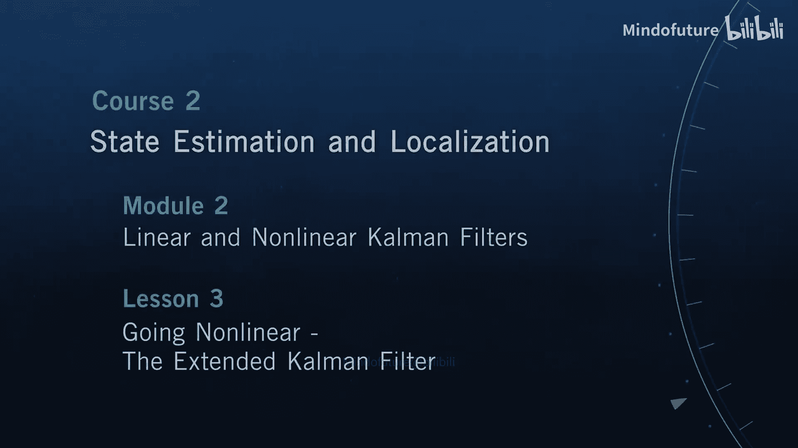
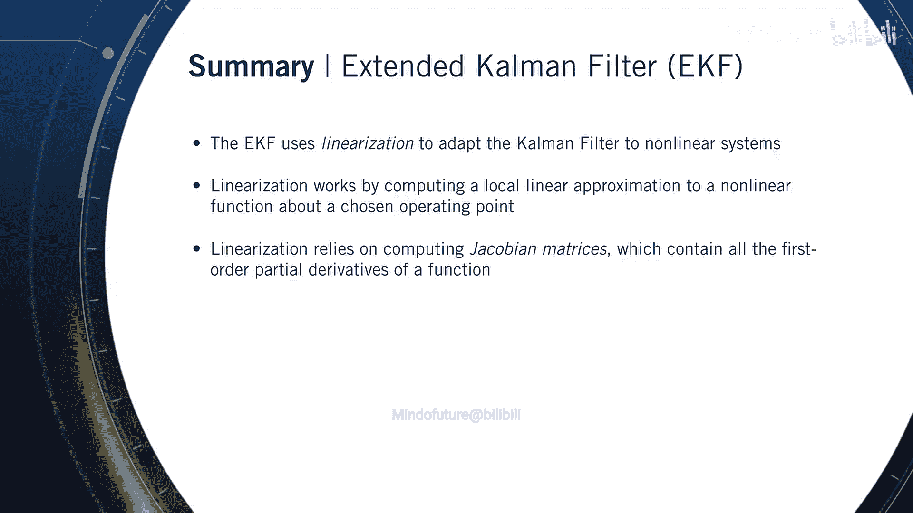

**自动驾驶汽车的状态估计和定位：第3课：迈向非线性世界：扩展卡尔曼滤波：03_02_01**

在本节课中，我们将学习如何将卡尔曼滤波应用于非线性系统。我们将介绍扩展卡尔曼滤波，这是一种通过线性化来处理非线性问题的强大工具。我们将了解其核心概念、数学原理，并通过一个具体示例来演示其应用。

到目前为止，在本模块中，你已经学习了如何使用线性卡尔曼滤波器进行状态估计。你也了解到卡尔曼滤波器是最佳线性无偏估计器。然而，线性卡尔曼滤波器不能直接用于估计那些是测量值或控制输入的非线性函数的状态。例如，汽车的姿态包含其方向，而方向不是一个线性量。实际上，三维空间中的方向存在于一个球面上。因此，我们需要寻找其他方法。在本视频中，我们将学习卡尔曼滤波器的一个重要且广泛应用的变体，称为扩展卡尔曼滤波器。

扩展卡尔曼滤波器专为处理非线性系统而设计，通常被认为是状态估计的“主力军”，因为它被用于包括自动驾驶汽车在内的各种应用。通过本视频的学习，你将能够：描述扩展卡尔曼滤波器如何使用一阶线性化将非线性问题转化为线性问题；理解雅可比矩阵在扩展卡尔曼滤波器中的作用以及如何计算它们；并将扩展卡尔曼滤波器应用于一个简单的非线性跟踪问题。

滤波器的工作原理是，首先基于先前的状态和我们给予系统的任何输入，预测在某个时间步K的更新状态估计的均值和协方差。然后，滤波器使用测量模型来预测基于状态估计应该接收到什么测量值，并将这些预测与实际从传感器接收到的测量值进行比较。卡尔曼增益告诉我们如何权衡所有这些信息，以便将它们最优地组合成一个修正后的估计，即一个新的状态和一个更新的协方差。这有时被称为预测-校正架构。

正如我们在上一个视频中看到的，对于线性系统，卡尔曼滤波器实际上是所有可能估计器中的最佳选择。不幸的是，这里有一个问题：现实中并不存在线性系统。即使是一个非常简单的系统，比如施加电压的电阻，也并非真正线性，至少并非总是如此。在一定的电压范围内，电流是电压的线性函数并遵循欧姆定律。但随着电压升高，电阻发热，会以非线性方式改变电阻值。由于我们在实践中遇到的系统都是非线性的，这就提出了一个重要问题：我们还能将卡尔曼滤波器用于非线性系统吗？如果能，该如何使用？

扩展卡尔曼滤波器的核心概念是线性化非线性系统的思想。因此，扩展卡尔曼滤波器有时也被称为线性化卡尔曼滤波器。线性化一个系统意味着选择一个工作点，并找到该非线性函数在该点邻域内的线性近似。在二维空间中，这意味着找到函数在x等于a处的切线。从数学上讲，我们通过对函数进行泰勒级数展开来实现这一点。回想一下你的微积分课程，你可能记得泰勒级数展开是一种将函数表示为无穷级数的方法，其项由函数在单点处的导数计算得出。对于线性化，我们只对泰勒级数展开中的一阶项感兴趣。

让我们回到一般的非线性运动和测量模型，并尝试对它们进行线性化。我们应该选择什么作为泰勒展开的工作点呢？理想情况下，我们希望围绕状态的真实值对模型进行线性化，但我们无法做到这一点，因为如果我们已经知道状态的真实值，就不需要估计它了。因此，让我们选择次优方案：对于我们的运动模型，我们将围绕先前状态的后验估计进行线性化；对于测量模型，我们将围绕基于运动模型预测的当前状态进行线性化。这样，我们就得到了一个状态空间中的线性系统，而矩阵被称为系统的雅可比矩阵。正确计算这些矩阵是扩展卡尔曼滤波器算法中最重要和最困难的一步，也是最容易出错的地方。

但这些雅可比矩阵到底是什么呢？在向量微积分中，雅可比矩阵是一个向量值函数的所有一阶偏导数组成的矩阵。雅可比矩阵的每一列包含函数输出相对于某个给定输入的导数。直观地说，雅可比矩阵告诉你函数的每个输出沿着每个输入维度变化的速度有多快，就像标量函数的导数告诉你随着输入变化，输出变化的速度一样。雅可比矩阵实际上就是一阶导数在多维情况下的推广。这里有一个二维函数的雅可比矩阵的简单例子。雅可比矩阵捕获了两个输出变量分别相对于两个输入变量的一阶导数。熟悉推导雅可比矩阵的最佳方法就是练习。尝试推导向量值函数的雅可比矩阵。

现在，我们知道了如何计算扩展卡尔曼滤波器所需的雅可比矩阵。剩下的就是将它们代入我们标准的卡尔曼滤波器方程中。与我们在模块2中看到的卡尔曼滤波器方程相比，扩展卡尔曼滤波器方程有几个需要注意的不同之处。首先，在预测和校正步骤中，我们仍然使用非线性模型来传播状态估计的均值，并计算测量残差。这是因为我们围绕先前的状态估计对运动模型进行了线性化，并围绕预测的状态对测量模型进行了线性化。根据定义，线性化模型在工作点处与非线性模型完全重合。第二个不同之处是出现了与过程和测量噪声相关的雅可比矩阵。在许多情况下，这两个矩阵都是单位矩阵，因为噪声通常被假定为加性的，但情况并非总是如此。

到目前为止，这一切都非常抽象。因此，让我们通过一个实际使用扩展卡尔曼滤波器的具体示例来逐步讲解。我们将使用模块2中的同一个例子，但稍作改动。我们将跟踪沿轨道移动的汽车的位置和速度。但现在，我们不再接收周期性的GPS测量值来告知我们的位置，而是使用像相机这样的车载传感器来测量远处地标相对于地平线的方位角。我们将保持与原始示例中相同的线性运动模型，并假设我们知道地标的高度及其在全局参考系中的位置。由于我们的传感器测量的是一个角度，我们的测量模型对汽车的位置具有非线性依赖关系。我们将需要对测量模型进行线性化，并在我们的扩展卡尔曼滤波器中使用它。这个问题的雅可比矩阵看起来像这样。注意，这个问题中的矩阵与原始问题中的矩阵完全相同，因为我们的运动模型在状态上已经是线性的。同时，注意噪声雅可比矩阵都是单位矩阵，因为运动和测量模型都具有加性噪声。

尝试使用这里给出的数据，通过扩展卡尔曼滤波器估计时间1时车辆的位置。这是状态均值和协方差的预测步骤结果。注意，结果与线性卡尔曼滤波器的情况相同，因为运动模型实际上是线性的。对于校正步骤，这是你应该得到的结果。请记住，你应该使用非线性测量模型来计算测量残差，而不是线性化模型。另外，请注意，在这种情况下，即使状态估计的校正后均值与预测均值不同，校正后的协方差与预测协方差相比变化不大。这是因为在这个距离上，方位角变化缓慢，与GPS测量相比，它没有提供太多关于车辆状态的信息。

总结一下，我们看到扩展卡尔曼滤波器使用线性化来使卡尔曼滤波器适应非线性系统。在接下来的课程项目中，我们将遇到几种不同的非线性系统，可以对其应用扩展卡尔曼滤波器或其近亲无迹卡尔曼滤波器。线性化是通过围绕一个工作点进行一阶泰勒级数展开，计算非线性函数的局部线性近似来实现的。这需要几个雅可比矩阵，它们包含了一组一阶偏导数。

在下一个视频中，我们将讨论扩展卡尔曼滤波器的另一种形式，称为误差状态扩展卡尔曼滤波器。这将是本课程后面讨论在三维空间中估计车辆方向时的一个有用工具。