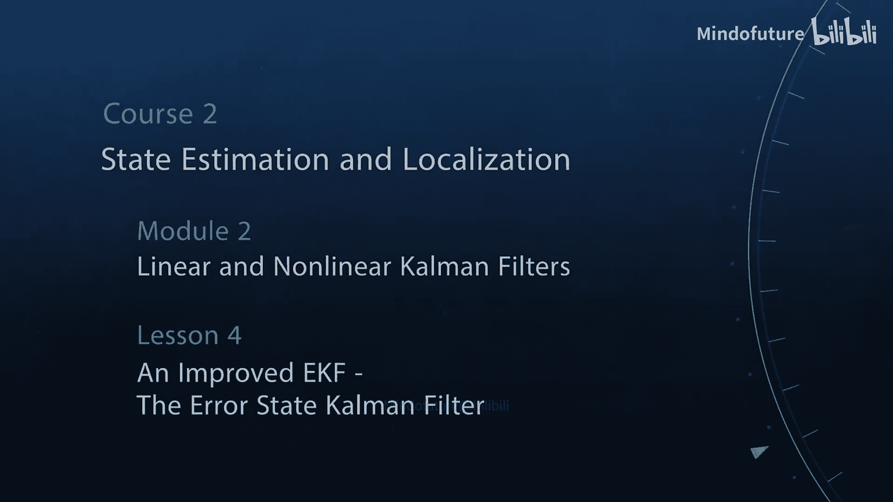
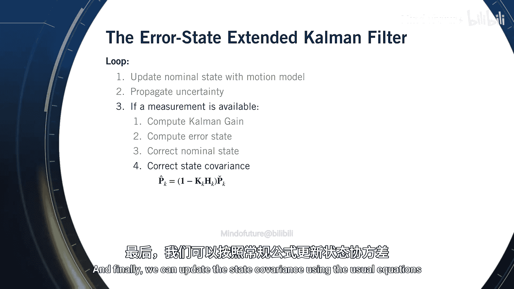
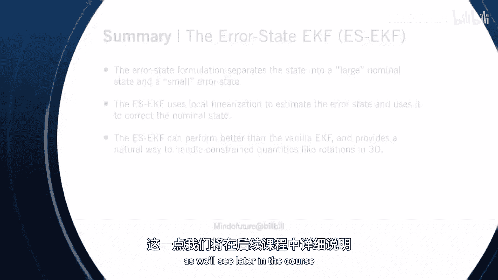

**自动驾驶汽车的状态估计和定位：第4课：改进型扩展卡尔曼滤波 - 误差状态扩展卡尔曼滤波**

在本节课中，我们将学习扩展卡尔曼滤波的一种变体——误差状态扩展卡尔曼滤波。学完本节，你将能够描述误差状态扩展卡尔曼滤波的公式，并阐述其相较于上一节介绍的经典扩展卡尔曼滤波的优势。

上一节我们介绍了扩展卡尔曼滤波，它通过局部线性化的方法，使得卡尔曼滤波方程能够应用于非线性系统。本节中，我们来看看一种名为误差状态扩展卡尔曼滤波的变体，它具备一些优良特性，将在后续课程中派上用场。

误差状态扩展卡尔曼滤波的核心思想非常简单。我们将车辆状态 **X** 视为由两部分组成：一个称为**名义状态** **X̂** 的主要部分，和一个称为**误差状态** **ΔX** 的较小部分。

我们可以用一个简单的汽车位置跟踪例子来理解。绿色线代表汽车的真实位置，这是我们试图估计的量。红色线代表名义状态，即基于我们对汽车运动模型以及加减速输入的最佳猜测。当然，运动模型从不完美，总存在一些随机过程噪声。这些误差会随着我们积分运动模型而随时间累积。我们可以将误差状态视为所有这些建模误差和过程噪声随时间累积的地方。因此，误差状态就是名义状态与真实状态在任何给定时刻的差值。

如果我们能计算出误差状态，实际上就可以用它来修正名义状态，使其更接近真实状态。

在误差状态扩展卡尔曼滤波中，我们不再对可能具有复杂非线性行为的完整状态进行卡尔曼滤波，而是使用扩展卡尔曼滤波来估计误差状态，然后利用误差状态的估计值来修正名义状态。

从数学上讲，这意味着我们要重新排列线性化的运动模型，使其成为一个方程，能够告诉我们时刻K的真实状态与预测状态之间的差值，如何与时刻K-1的同一差值相关联。这些差值正是我们刚才讨论的误差状态 **Δx_K** 和 **Δx_{K-1}**，描述它们关系的方程称为**误差状态运动学**。

我们也可以直接用误差状态来重新表达线性化的测量模型。

我们可以用一种与经典扩展卡尔曼滤波非常相似的方式来使用这种误差状态公式。

以下是误差状态扩展卡尔曼滤波的步骤：

首先，我们使用非线性运动模型和当前对状态的最佳估计来更新名义状态。在获得测量值进行修正之前，我们可以多次执行此步骤。因此，当前最佳估计可能是 **X̌** 或 **X̂**。

我们还需要跟踪状态协方差，它会随着我们从运动模型中积分越来越多的过程噪声而增长。同样，先前的协方差估计可能是 **P̌** 或 **P̂**，这取决于我们是否使用了测量值进行修正。我们可以重复此循环，根据需要不断更新名义状态和误差状态协方差，直到收到测量值并希望进行修正。

当需要进行修正时，我们可以像往常一样计算卡尔曼增益，然后利用卡尔曼增益、测量值以及我们的非线性测量模型来计算误差状态的最佳估计。

现在，这里的情况略有不同。一旦我们有了误差状态均值的估计，我们希望用它来更新名义状态并修正误差。我们可以通过简单地将误差状态的估计值加到名义状态上来实现，从而得到完整状态的修正后状态估计。

最后，我们可以使用常规方程更新状态协方差。

这个过程会一直持续下去，至少持续到车辆耗尽燃料为止。

那么，在实践中我们为何要使用误差状态扩展卡尔曼滤波呢？主要有两个很好的理由。

一个原因是它通常比经典扩展卡尔曼滤波表现更好，因为较小的误差状态比较大的名义状态更适合线性滤波，而名义状态我们可以进行非线性积分。

另一个原因是，误差状态公式使得处理像旋转这样的受约束量变得更加容易，这在课程后面会很有用。原因在于，我们不一定必须使用简单的向量加法来分解状态。事实上，只要它为我们提供了一种将小扰动纳入名义状态的一致方法，我们可以使用任何广义的组合操作。

如果现在听起来有点抽象，请不要担心。在课程后面，我们将使用误差状态扩展卡尔曼滤波来帮助处理三维空间中的旋转，这是一种非常常见的受约束量类型。

让我们来总结一下。

扩展卡尔曼滤波的误差状态公式将车辆状态分为一个大的名义状态和一个小的误差状态。名义状态跟踪运动模型预测的状态应该是什么，而误差状态则捕获随时间累积的建模误差和过程噪声。在误差状态扩展卡尔曼滤波中，我们估计这个小误差状态，并将其用作对名义状态的修正。这是误差状态扩展卡尔曼滤波与估计完整状态的经典扩展卡尔曼滤波之间的主要区别。请记住，两种公式仍然依赖于局部线性化。

误差状态扩展卡尔曼滤波相较于经典扩展卡尔曼滤波有几个优势。首先，它通常表现更好，因为误差状态的演变往往更接近线性。其次，误差状态公式使得处理像三维旋转这样的特殊量变得更加容易，正如我们将在课程后面看到的那样。

在下一个视频中，我们将讨论扩展卡尔曼滤波的一些缺点，以及局部线性化如何可能失效，从而为自动驾驶汽车带来潜在的危险情况。