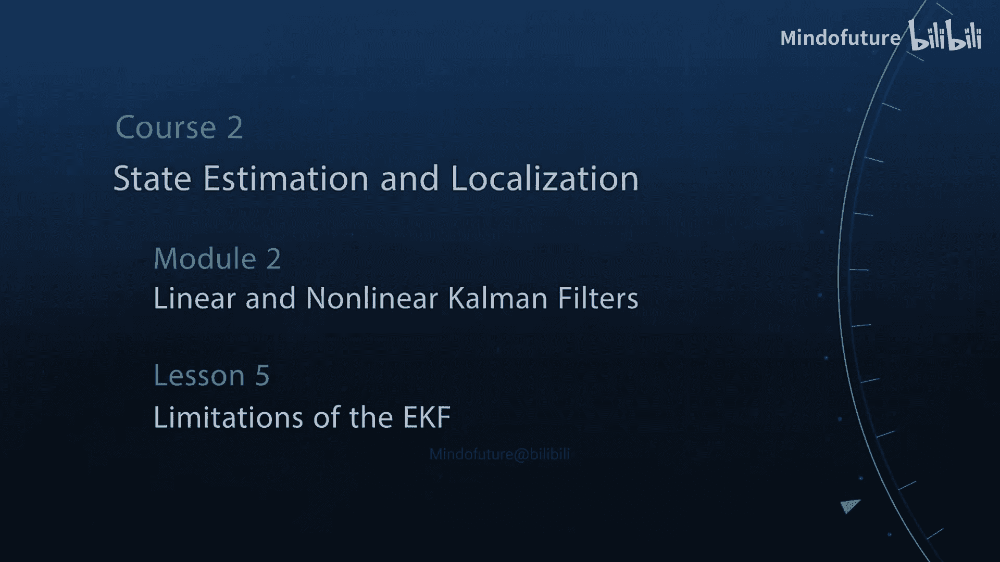
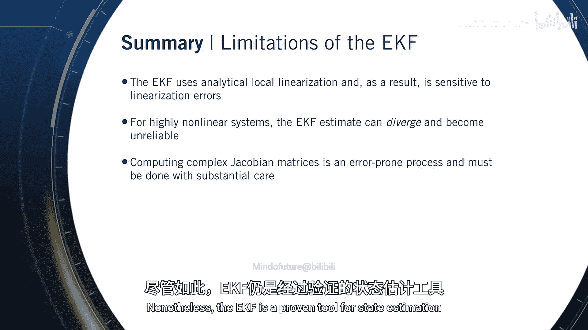
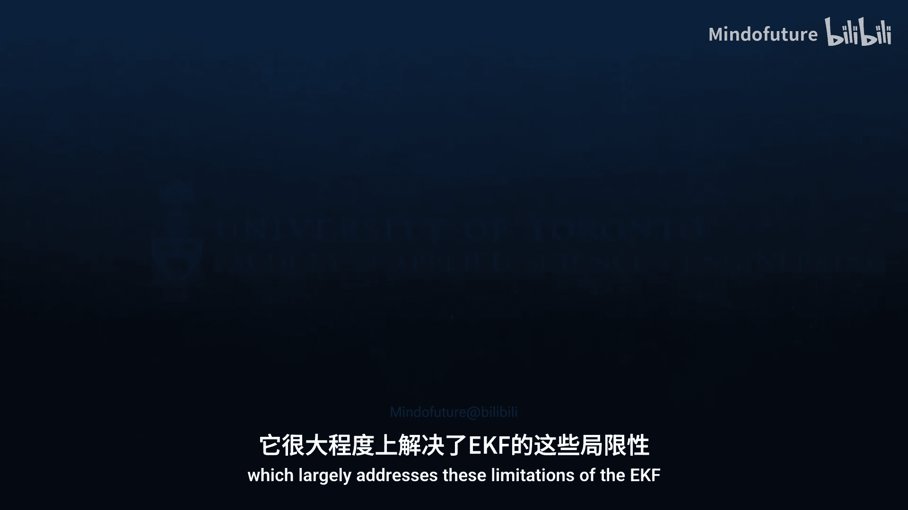

# 018：扩展卡尔曼滤波的局限性

在本节课中，我们将要学习扩展卡尔曼滤波（EKF）在实际应用中的主要局限性。我们将通过一个具体的非线性变换例子，来理解线性化误差如何影响状态估计的均值和协方差，并探讨这些局限性可能带来的后果。

在上一节中，我们介绍了扩展卡尔曼滤波（EKF）及其如何将线性卡尔曼滤波应用于非线性系统。本节中，我们来看看EKF方法存在的一些重要限制。

虽然EKF在许多实际问题中表现良好，但在决定是否采用EKF时，必须牢记其一些重要的局限性。

EKF的工作原理是通过线性化系统的非线性运动模型和观测模型，来更新状态估计的均值和协方差。线性化模型只是真实非线性模型的局部线性近似。我们将近似值与真实模型之间的差异称为**线性化误差**。

通常，任何函数的线性化误差取决于两个因素。

第一个因素是原始函数本身的非线性程度。如果我们的非线性函数变化非常缓慢或大部分时间相当平坦，线性近似将是一个相当好的拟合。反之，如果函数变化很快，线性近似在其大部分定义域内都无法很好地捕捉函数的真实形状。

第二个因素是距离线性化操作点的远近。距离操作点越远，线性近似与真实函数偏离的可能性就越大。

线性化误差的这些特性对EKF有重要影响。让我们通过一个例子，看看线性化误差如何影响经过一对常见非线性函数变换后的两个随机变量的均值和协方差。

具体来说，我们来看从极坐标（R, θ）到笛卡尔坐标（X, Y）的非线性变换。这种变换通常用于处理激光扫描仪或激光雷达（LiDAR）报告的距离和方位测量值，正如许多自动驾驶汽车上的扫描仪所做的那样。

我们从极坐标区间上的均匀分布中抽取若干样本，并考虑将这些样本变换到笛卡尔坐标时会发生什么。

为了说明这种情况，我们将均匀分布的随机样本绘制为左侧图中的蓝色点。当我们将这些样本点中的每一个变换为相应的笛卡尔坐标时，我们看到变换后的分布呈现出右侧图所示的香蕉形状。

显然，仅使用均值和协方差无法完全捕捉香蕉形状分布的特征。但让我们看看原始概率密度函数的均值和协方差会发生什么变化。

在左侧图中，均匀分布的真实均值显示为中间的绿点，真实协方差由绿色椭圆表示。

将均匀分布变换到笛卡尔坐标后，输出分布的均值落在这里，其协方差看起来像这样。

现在，考虑如果我们围绕原始分布的均值对极坐标到笛卡尔坐标的变换进行线性化，然后再次变换所有样本点会发生什么。线性化变换给出的输出分布看起来像是另一个均匀分布，与我们之前看到的香蕉形状分布几乎没有相似之处。

如果我们观察这个分布的均值（用红点表示），它落在上方某处。线性化的协方差看起来也大不相同。

让我们比较一下线性化和非线性化的输出分布。可以看到，线性化分布的均值与真实均值的位置非常不同。并且线性化协方差严重低估了真实输出分布在Y维度上的扩展范围。

因此，在这种情况下，我们可以看到线性化误差可能导致我们对输出分布的认知完全偏离目标。这会给我们的估计器带来大问题。

例如，从激光扫描仪估计出的车道标记位置可能与实际位置存在显著差异，导致我们的汽车越过中心线。那么，什么时候线性化会成为EKF的问题呢？

有两种情况需要注意。

第一种情况是当系统动力学高度非线性时。如果你的运动和测量模型接近线性，线性化误差不会是大问题。但如果它们不是线性的，你的线性化估计器将无法很好地捕捉系统的真实行为。

第二种情况与你试图使用线性化模型时距离操作点的远近有关。如果你的自动驾驶汽车相对于传感器采样时间移动得非常快，你将比它缓慢移动时获得更多的线性化误差。

从数学上讲，EKF中的线性化误差有两个重要后果，我们在前面的例子中都看到了。

1.  估计的均值可能与真实状态大不相同。
2.  估计的协方差可能无法准确捕捉状态中的真实不确定性。

换句话说，这意味着线性化误差可能导致我们的估计器对一个完全错误的答案过度自信。在最坏的情况下，估计器可能会**发散**，即完全迷失方向，无法提供有用的输出。

更糟糕的是，一旦像EKF这样的估计器发散，就无法将其拉回正轨。通常，如果可能，你不得不重新初始化。这对于处理自动驾驶汽车时的安全性来说是一个巨大的问题。如果你的汽车估计器在行驶过程中发散，它很容易驶离道路冲进沟里，或者导致与另一辆车相撞。

因此，线性化误差是EKF的主要理论局限性。但在我们的实现中还会遇到其他常见问题。

实践中最常见的问题可能是在计算雅可比矩阵时很容易出错，尤其是当我们处理复杂的非线性系统时。在推导雅可比矩阵时漏掉一个负号，可能导致无数小时的调试。有些人试图通过在运行时使用数值微分或在编译时使用自动微分来规避这个问题，但这些方法也有其自身的缺陷，有时可能表现不可预测。

除此之外，如果我们的一个或多个模型甚至不可微怎么办，比如步进电机的阶跃函数响应。所有这些缺点引出了一个问题：我们真的需要线性化来进行非线性卡尔曼滤波吗？

本节课中我们一起学习了扩展卡尔曼滤波（EKF）基于其解析局部线性化方法所带来的几个局限性。如果被建模系统的动力学高度非线性或线性化误差很大，滤波器可能会发散。EKF需要计算雅可比矩阵，这通常是一个繁琐且容易出错的过程。尽管如此，EKF是状态估计中一个经过验证的工具，作为自动驾驶汽车工程师，你无疑会经常遇到它。

在下一个视频中，我们将讨论另一种卡尔曼滤波变体，称为无迹卡尔曼滤波（UKF），它在很大程度上解决了EKF的这些局限性。