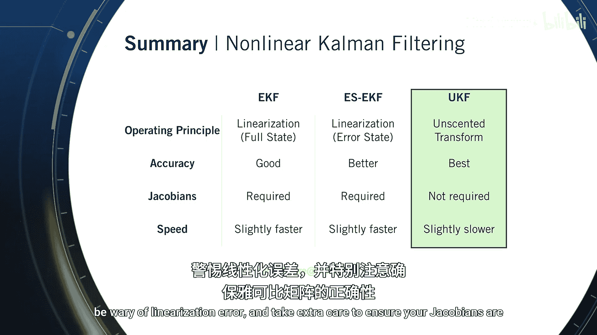

# 019：无迹卡尔曼滤波

在本节课中，我们将要学习一种处理非线性系统的卡尔曼滤波替代方案——无迹卡尔曼滤波。我们将了解其核心思想“无迹变换”的工作原理，并将其与扩展卡尔曼滤波进行比较，最后学习如何将其应用于一个简单的非线性跟踪问题。

## 无迹变换的动机

在上一节中，我们看到了线性化误差如何导致扩展卡尔曼滤波产生与真实状态值差异很大的状态估计，以及无法准确捕捉状态不确定性的协方差。在依赖扩展卡尔曼滤波的安全关键应用（如自动驾驶汽车）中，这可能是一个大问题。

无迹卡尔曼滤波是一种非线性卡尔曼滤波的替代方法，它依赖于一种称为“无迹变换”的技术，将概率分布通过非线性函数进行传递。我们将看到，对于相似的计算量，无迹变换比扩展卡尔曼滤波的分析线性化方法提供更高的精度，并且无需计算任何雅可比矩阵。

## 无迹变换的直观理解

无迹变换背后的直觉很简单：近似一个概率分布通常比近似一个任意的非线性函数要容易得多。

考虑一个简单的例子：一个一维高斯分布（如左侧所示）通过一个非线性函数变换成一个更复杂的一维分布（如右侧所示）。我们已经知道输入高斯分布的均值和标准差，我们希望利用这些信息和非线性函数来计算出输出分布的均值和标准差。无迹变换为我们提供了一种实现此目的的方法。

## 无迹变换的三个步骤

无迹变换的基本思想包含三个步骤。

以下是具体步骤：

1.  **选择Sigma点**：首先，我们从输入分布中选择一组样本点。这些不是随机样本，而是确定性样本，被选择为距离均值特定数量的标准差。因此，这些样本被称为Sigma点，无迹变换有时也被称为Sigma点变换。
2.  **非线性变换**：一旦我们拥有了一组精心选择的Sigma点，第二步也是最简单的一步，就是将每个Sigma点通过我们的非线性函数，产生一组属于输出分布的新Sigma点。
3.  **计算统计量**：最后，我们可以使用一些精心选择的权重计算输出Sigma点的样本均值和协方差，这些将为我们提供真实输出分布均值和协方差的良好近似。

## 深入Sigma点

现在您已经了解了无迹变换的基本思想，让我们详细看看这些步骤。您可能首先会问，我们需要多少个Sigma点，以及哪些点才是Sigma点。

一般来说，对于一个n维概率分布，我们需要 `2n + 1` 个Sigma点：一个用于均值，其余对称地分布在均值周围。左侧的图表展示了一维和二维示例的Sigma点。在一维中，我们需要3个Sigma点；在二维中，我们需要5个。

确定Sigma点位置的第一步是取与输入分布相关的协方差矩阵的**Cholesky分解**。Cholesky分解本质上是对称正定矩阵（如协方差矩阵）的一种平方根运算。实际上，如果输入概率分布是一维的，Cholesky分解实际上就是方差的平方根，也就是标准差。我们不会深入讨论如何计算Cholesky分解，但您可以使用MATLAB中的 `chol` 函数或NumPy中的 `cholesky` 函数。

一旦我们分解了协方差矩阵，我们可以选择第一个Sigma点为分布的均值，其余的为均值加上或减去某个因子乘以我们从Cholesky分解得到的矩阵L的每一列。这里的n值再次是概率分布的维度数。参数Kappa是一个您可以自由设置的调优参数。对于我们处理的高斯分布，设置 `n + Kappa = 3` 是一个不错的选择。

## 重组变换后的Sigma点

现在我们有了Sigma点集合。下一步很简单，只需将每个Sigma点通过我们的非线性函数，得到一组新的变换后的Sigma点。

现在剩下的就是重新组合变换后的Sigma点，以找到我们的输出均值和输出协方差。我们使用您在基础统计学课程中见过的样本均值和协方差的标准公式来实现。诀窍在于，每个点在均值和协方差计算中都有一个特定的权重，该权重取决于参数Kappa和输入分布的维度n。

## 无迹变换实例

为了看无迹变换的实际效果，让我们回到上一节的例子，在那里我们将极坐标下的均匀分布非线性地变换到笛卡尔坐标。让我们看看无迹变换与分析线性化方法相比如何。

这里再次用绿色显示了两个分布的真实均值和协方差。现在，让我们应用无迹变换。我们输入分布的维度是2，所以我们需要5个Sigma点，在图中显示为橙色星号。将这些Sigma点通过我们的非线性函数变换后，它们位于此处。我们从变换后的Sigma点计算出的均值和协方差如图所示，显示为橙色。

请注意，我们使用无迹变换估计的均值几乎与真实的非线性均值完全相同，我们估计的协方差也几乎与真实协方差完全匹配。将其与分析线性化变换后的均值和协方差（红色）进行比较，两者都与真实均值和真实协方差有很大不同。从这个例子很容易看出，无迹变换为我们提供了输出概率分布的更好近似，而所需的工作量并不比分析线性化方法多多少。

## 无迹卡尔曼滤波

既然我们已经了解了无迹变换的工作原理，我们就可以轻松地将其用于我们的卡尔曼滤波框架中，以处理非线性模型。这种卡尔曼滤波的变体被称为**无迹卡尔曼滤波**，您也可能听到它被称为Sigma点卡尔曼滤波。

UKF的主要思想是，不像扩展卡尔曼滤波那样通过线性化来近似系统方程，我们使用无迹变换来直接近似概率分布。

让我们看看UKF的预测步骤。为了通过运动模型将状态和协方差从时间 `K-1` 传播到时间 `K`，我们使用当前对状态均值和协方差的最佳猜测来应用无迹变换。

以下是预测步骤：

1.  首先，我们分解时间 `K-1` 的估计状态协方差。
2.  然后，我们计算以时间 `K-1` 的估计状态均值为中心的Sigma点。
3.  其次，我们通过非线性运动模型传播我们的Sigma点，得到一组新的用于时间 `K` 预测状态的Sigma点。
4.  最后，我们计算时间 `K` 状态的预测均值和协方差。

在这一点上，通过将过程噪声的协方差加到变换后Sigma点的协方差中来得到最终的预测协方差是很重要的。如果过程噪声不是加性的，这个方程看起来会有点不同，但大多数时候，除非有充分的理由，否则您处理的模型中的噪声都是加性的。

## 无迹卡尔曼滤波的校正步骤

对于校正步骤，我们将遵循类似的程序，这次使用非线性测量模型。

以下是校正步骤：

1.  首先，我们将从非线性运动模型得到的Sigma点集合代入我们的非线性测量模型，得到另一组用于预测测量的Sigma点。
2.  然后，我们可以使用样本均值和协方差公式来估计预测测量的均值和协方差。
3.  再次注意，我们加入了测量噪声协方差以获得预测测量的最终协方差，并且记住这个公式仅适用于加性噪声。
4.  为了计算卡尔曼增益，我们还需要预测状态和预测测量之间的**互协方差**，它告诉我们测量值与状态的相关程度。您可以使用互协方差的标准公式并采用与之前相同的权重来计算它。
5.  然后剩下的就是使用卡尔曼增益来最优地校正预测状态的均值和协方差，这样就完成了。

UKF遵循与EKF相同的预测-校正模式，但我们只是用无迹变换取代了分析线性化步骤。

## 应用示例

让我们尝试将UKF应用到我们之前用EKF处理过的相同驾驶场景示例中。我们再次尝试跟踪一辆通过踩油门或刹车控制的移动汽车的位置和速度。汽车上有一个传感器，可以测量远处地标与地平线之间的角度。运动模型是线性的，但测量模型是非线性的。

尝试使用此处给出的数据，利用UKF估计车辆在时间 `K=1` 时的位置。这是初始协方差矩阵的Cholesky分解，以及我们将用于表示状态及其协方差的五个Sigma点。这是状态均值的预测步骤结果。最后是预测协方差。请注意，预测的均值和协方差与我们使用线性卡尔曼滤波和扩展卡尔曼滤波得到的结果相同。这是因为运动模型实际上是线性的。

对于校正步骤，这些是预测测量的Sigma点以及该分布的均值和协方差。最后是互协方差、卡尔曼增益以及我们对车辆在时间 `K=1` 时位置的最终答案。

## 总结与回顾

总结本视频，我们研究了无迹卡尔曼滤波，它使用无迹变换使卡尔曼滤波适应非线性系统。正如我们所看到的，无迹变换通过将一小组精心选择的样本通过非线性系统并计算输出的均值和协方差来工作。对于相似的计算成本，它在近似输出分布方面通常比EKF使用的局部分析线性化技术做得更好。

让我们回顾一下在本模块中学到的内容。我们首先讨论了线性卡尔曼滤波，它是一种递归最小二乘估计形式，允许我们将运动模型的信息与传感器测量的信息结合起来估计车辆状态。卡尔曼滤波遵循预测-校正架构：运动模型用于预测状态，测量用于校正这些预测。我们还看到卡尔曼滤波是最佳线性无偏估计器，即卡尔曼滤波是仅使用测量值线性组合的最佳无偏估计器。

但是，当然，现实中并不真正存在线性系统，因此我们需要开发处理非线性系统的技术。在本模块中，我们研究了三种不同的非线性卡尔曼滤波方法：扩展卡尔曼滤波、EKF的误差状态公式以及无迹卡尔曼滤波。正如我们所讨论的，主要区别在于EKF依赖于局部分析线性化来通过非线性函数传播概率分布（无论是使用全状态还是误差状态公式）。相比之下，UKF依赖于无迹变换来处理非线性函数。

对于大多数仅轻度非线性的系统，EKF将给出准确的结果。但在线性化误差对EKF构成问题的情况下，UKF将更准确。误差状态卡尔曼滤波的性能介于两者之间。UKF相对于任何EKF公式的最大优势之一是，UKF不需要您计算非线性模型的任何导数，而这容易导致人为错误或数值不稳定。最后，在速度方面，对于典型的估计问题，EKF以微弱优势胜出。但总的来说，EKF和UKF需要非常相似的计算量。

由于其准确性和简单性，我们建议在您的项目中尽可能使用UKF而不是EKF。如果必须使用EKF，我们的建议是使用误差状态公式，警惕线性化误差，并格外小心以确保您的雅可比矩阵是正确的。

一个好的口诀是：**警惕线性化误差**。

现在您已经学习了状态估计所需的基本工具，我们可以开始思考在自动驾驶汽车上可能找到的传感器类型，以及如何使用它们来定位车辆。在下一个模块中，我们将讨论一对常见的传感器：惯性测量单元和全球导航卫星系统。