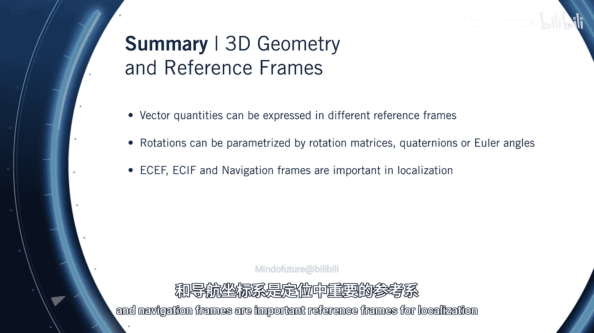

# 020：三维几何与参考坐标系

在本节课中，我们将学习三维几何与参考坐标系的基础知识。这是理解后续传感器工作原理和车辆定位算法的关键前提。

## 概述

本节课我们将回顾三维运动学中的核心概念。首先，我们会探讨参考坐标系如何影响向量的坐标表示。接着，我们将对比几种不同的旋转表示方法。最后，我们会介绍在自动驾驶定位中至关重要的几个参考坐标系。

## 向量与参考坐标系

一个向量是一个具有大小和方向的几何对象。我们常常将向量本身与它的坐标表示（即一组代表其方向和大小的数字）混为一谈。然而，这种理解并不完全正确。

想象一个在空间中固定的向量，当我们从不同角度观察它时，其坐标会发生变化。更准确地说，同一个向量量在不同的坐标系或参考系中，会拥有不同的坐标。

我们使用以下符号约定：在坐标系A中，向量R的坐标记为 **R_A**。同理，在坐标系B中，其坐标记为 **R_B**。

为了将一组坐标转换到另一组坐标，我们需要一个旋转矩阵，它精确地描述了一个坐标系相对于另一个坐标系的旋转关系。我们使用粗体大写字母 **C** 来表示旋转矩阵，其下标按从右到左的顺序表示初始和最终的参考坐标系。例如，**C_AB** 表示从坐标系B到坐标系A的旋转矩阵。

## 坐标变换与向量加法

在实际应用中，我们经常需要讨论点在不同参考系之间的坐标变化。例如，我们可能知道某个建筑物在一个固定坐标系中的位置，现在想求它在当前车辆坐标系中的位置。

计算这个位置需要使用向量加法，并确保所有坐标都在同一个参考系中表达。我们使用上标来表示三维向量的起点和终点（同样是从右到左），并使用下标来表示该向量所在的坐标系。例如，**r_AB^V** 表示在车辆坐标系V中表达的、从点B指向点A的向量。

我们可以通过操作这个表达式来求解车辆坐标系或某个惯性坐标系中的坐标。

## 旋转的表示方法

跟踪参考坐标系的一个关键部分是跟踪它们相对于某个基础参考系的方位或旋转。旋转是特别棘手的数学对象，如果处理不仔细，可能会成为重大错误的来源。

有多种方法可以表示旋转，以下是三种常见的方式。

### 1. 旋转矩阵

最常见的是使用一个3x3的旋转矩阵，正如我们之前所做的那样。这个矩阵通过点积定义了两个参考坐标系基向量之间的关系，因此它常被称为方向余弦矩阵。

旋转矩阵的一个重要性质是，它的逆矩阵就是它的转置矩阵：**C^{-1} = C^T**。

### 2. 单位四元数

四元数本身就是一个有趣的数学主题。对我们而言，只需知道一个单位四元数可以表示为一个单位长度的四维向量。它参数化了一个绕向量 **u** 定义的轴旋转角度 **φ** 的旋转。

我们可以通过一个略显繁琐但直接的代数表达式将四元数转换为旋转矩阵。

为什么我们要使用四元数？因为它们没有奇异性问题，并且只需要4个参数，而不是9个。在本课程的第5模块中，我们将需要将两个四元数相乘。重要的是，四元数乘法不同于普通的乘法，因为四元数是一种复数（实际上是超复数），因此适用不同的规则。四元数乘法运算符通常用一个带X的圆圈表示，并且可以用涉及每个四元数标量和向量部分的矩阵运算来表达。

与矩阵乘法类似，四元数乘法满足结合律，但通常不满足交换律，即乘法的顺序很重要。我们可以利用四元数乘法来表示连续的旋转。两个单位四元数 **p** 和 **q** 的乘积所对应的旋转矩阵，等同于分别由 **p** 和 **q** 定义的旋转矩阵的连续乘积。我们将在课程的最后模块中利用这一重要性质。

### 3. 欧拉角

另一种表示旋转的方法是使用三个称为欧拉角的数字。这些角度将一个任意旋转表示为绕不同主轴进行的三个独立旋转的组合。

欧拉角之所以有吸引力，部分原因在于它是一种简洁的表示法，只需要3个参数，而不是完整旋转矩阵所需的9个。然而，欧拉角表示法存在所谓的奇异性问题。奇异性使状态估计变得复杂，因为它代表了某些特定的旋转，从这些旋转出发，两个欧拉角是无法区分的。四元数和旋转矩阵没有这个问题，但代价是使用了更多的参数。

## 不同旋转表示法的比较

那么，自动驾驶工程师使用哪种旋转表示法呢？这取决于具体情况，每种方法都有其优缺点。

*   **旋转矩阵**：可以表示任何旋转，但需要9个参数并有6个约束条件。
*   **单位四元数**：也可以表示任何旋转，但它也有一个约束条件（单位长度）。要使用单位四元数实际旋转一个向量，除了简单的矩阵乘法外，还需要一些额外的代数运算。
*   **欧拉角**：无约束，直观易于可视化，且仅使用3个参数，但存在奇异性问题。

## 重要的参考坐标系

最后，让我们看看在定位车辆时将要用到的四个重要参考坐标系。

以下是这些坐标系的定义：

1.  **地心惯性坐标系**：原点在地球中心。Z轴指向真北，X轴和Y轴相对于遥远的恒星固定。这意味着尽管地球绕Z轴旋转，但X轴和Y轴不随之移动。
2.  **地心地固坐标系**：与ECIF类似，但其X轴与本初子午线对齐，并随地球一起旋转。Y轴由右手定则确定。
3.  **导航坐标系或当地切平面坐标系**：这是一个固定在地面上的坐标系。一种非常常见的导航坐标系是附在某个已知起点上，其X轴指向北，Y轴指向东，Z轴指向下。这被称为NED坐标系。一个密切相关的坐标系是ENU坐标系，其X轴指向东，Y轴指向北，Z轴指向上。
4.  **传感器坐标系**：这是一个刚性连接到传感器（如激光雷达、GPS接收器或惯性测量单元）上的坐标系。这个坐标系通常与通用的车辆坐标系不同，车辆坐标系可以放置在车辆上任何方便的位置，例如质心。对于定位任务，我们通常会忽略车辆坐标系和传感器坐标系之间的区别，并假设如果我们能跟踪传感器，那么在经过适当的校准后（这是我们后面会探讨的主题），我们就应该能够跟踪车辆上的任何点。

## 总结

本节课我们一起学习了三维几何与参考坐标系的基础知识。

我们了解到，向量量可以通过旋转和平移在不同的参考系中表达。旋转可以用旋转矩阵、四元数或欧拉角来参数化，每种方法都有其优缺点。此外，地心地固坐标系、地心惯性坐标系和导航坐标系是车辆定位中至关重要的参考坐标系。

在下一个视频中，我们将讨论如何利用本节课学到的工具，通过使用惯性测量单元来跟踪运动。