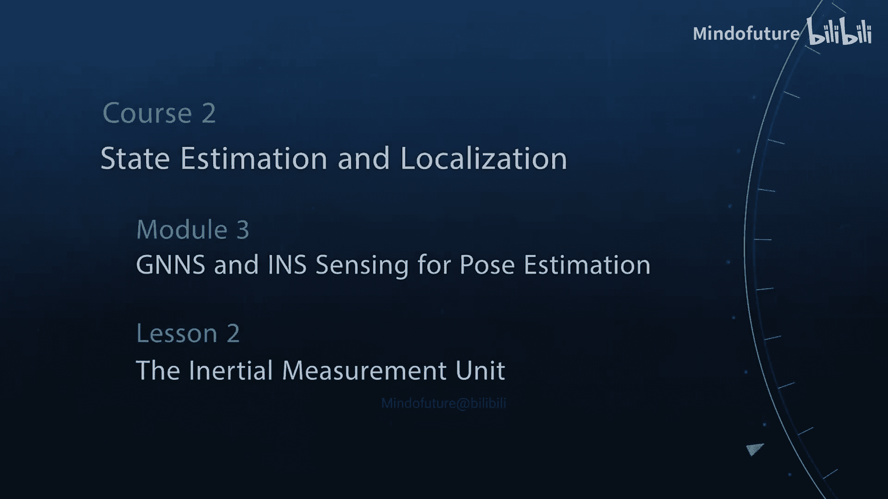
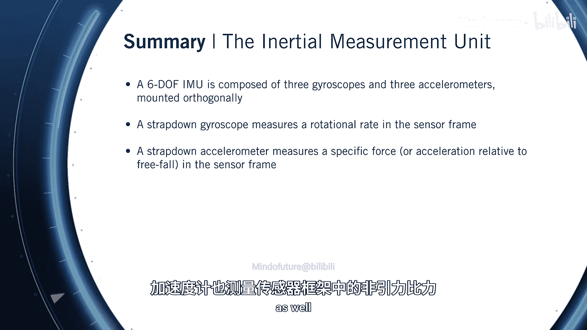

# 021：惯性测量单元（IMU）

在本节课中，我们将讨论惯性测量单元，即IMU。课程结束时，你将能够描述构成基本IMU的两种传感器的工作原理：加速度计和陀螺仪。你还将能够为每种传感器建立模型，并考虑传感器噪声和偏差等因素。当我们将IMU集成到完整的状态估计器中时，这将至关重要。

## 什么是IMU？🚀

惯性测量单元测量物体在惯性空间中的运动。如今，一种廉价的、大规模生产的IMU几乎出现在每一部智能手机中，例如图中所示的iPhone X。IMU通常用于步数统计、健康追踪等任务，最近也用于增强现实设备。

尽管IMU如今无处不在，但开发一种能够精确追踪运动物体运动的传感器是20世纪的一项重大成就。IMU在GPS出现之前就辅助了跨洋飞行，并且作为阿波罗任务中机载制导、导航和控制系统的一部分至关重要。阿波罗飞船依靠IMU在漫长的月球航行中精确追踪飞行器的位置和姿态。

在太空中，几乎没有地标可供制导参考。虽然可以追踪恒星，但这并不容易。机载IMU无需此类地标即可工作，实现了安全导航至月球表面。在现代自动驾驶汽车中，IMU扮演着非常相似的角色，在其他传感器的导航信息不可用或不可靠时进行补充。

## IMU的组成与类型 📦

那么，什么是IMU？通常，惯性测量单元是一个复合传感器套件，它结合了三个陀螺仪和三个加速度计，以追踪刚体的六自由度运动。一些IMU还包含磁力计或罗盘来辅助追踪方向。

IMU有多种形状和形式。现代智能手机中的传感器相对便宜，批量购买时通常成本不到几美元。它们重量轻，功耗相对较低，但产生的测量值噪声较大。更昂贵的IMU使用更复杂的组件，并具有更精确的校准模型，例如可以消除温度波动的影响。

## 陀螺仪详解 🌀

让我们更详细地讨论IMU的组成部分：陀螺仪和加速度计。

陀螺仪有着悠久的历史。“陀螺仪”这个术语可能相当令人困惑，因为它指代几个与测量方向或方向变化相关的概念。这个词本身来源于希腊语，意为“看圆圈”。历史上，陀螺仪是一个旋转的圆盘，由于其角动量，能够抵抗方向的变化。

在19世纪末和20世纪初，工程师们意识到这种旋转轮可以用作航海和航空导航的方向参考。这需要精密的加工和一套使用高质量宝石或气动轴承的万向节。虽然这种旋转盘式陀螺仪可以非常精确，但它相当重、体积大，并且制造成本通常非常高昂。尽管如此，它仍然用于航空和弹道应用，转速可达24，000 RPM。

在现代陀螺仪中，旋转金属盘通常被微机电系统取代，该系统由一个小的硅音叉组成，其共振特性会根据施加的旋转或方向变化而改变。这些传感器便宜得多，可以封装在很小的空间里。然而，它们产生的测量值噪声较大，并且对基于温度的波动敏感。更重要的是，它们测量的是旋转速率，而不是直接测量方向，因此输出信号必须通过数值积分来确定方向变化。这个过程可能会给最终的方向估计引入额外的误差。

自动驾驶汽车工程师应该意识到，需要考虑漂移和性能随温度变化等问题，这给传感器建模过程带来了相当大的额外复杂性。人们通常认为旋转的机械装置不如硅组件，但情况并非总是如此。

## 加速度计详解 📈

加速度计测量沿单轴的线性加速度。基于MEMS的廉价加速度计使用一个带有检测质量的微型悬臂梁。当传感器被加速时，梁会发生偏转。这种偏转可以通过电容电路等方式测量，并转换为加速度值。更昂贵的传感器也可能使用压电材料。

需要注意的是，加速度计测量的是所谓的“固有加速度”或“比力”。这是单位质量所受的总非引力。固有加速度是相对于自由落体参考系的加速度。当你坐在椅子上，相对于地面静止时，你感受到的固有加速度将是你所在位置的重力加速度值，但方向向上。另一种说法是，作用在你身上的唯一非引力，即法向力，必须等于重力。

然而，对于导航目的，我们通常不关心固有加速度，我们关心的是相对于某个固定参考系的加速度。为了计算这个加速度，我们需要使用重力场中加速度计的基本方程：在固定坐标系中计算的位置二阶导数等于比力与重力加速度之和。

这有时可能是一个不太直观的概念。让我们在这里探讨一下。一辆静止汽车中的加速度计测量到向上的G值，因为坐标加速度为零（忽略地球自转）。由于重力向下作用，其负值就是向上的标量常数G。

让我们以国际空间站为例。低地球轨道上的G值更小吗？是的，但与地球表面相比，只小了大约10%。我们经常听到“零重力”这个术语，是因为整个国际空间站连同其中的宇航员都在自由落体。牢固连接到空间站的加速度计将具有等于G的坐标加速度。这意味着加速度计测量的比力将为0。另一种说法是，相对于自由落体的固有加速度为零。国际空间站处于自由落体状态。实际上，残余的大气阻力和结构振动会产生一些可测量的加速度，但它们通常低至10^-6 G。

## 传感器测量模型 📐

现在我们已经了解了陀螺仪和加速度计的基本原理，让我们讨论一下为了将它们集成到状态估计器中需要知道的测量模型。

使用上一课讨论的符号，让我们定义陀螺仪测量的表达式。来自三个陀螺仪的角旋转速率是**体坐标系相对于惯性坐标系的角速度在体坐标系中的表示**。我们为其添加一个缓慢变化的偏差项和一个白高斯加性噪声项来模拟传感器误差。虽然陀螺仪确实测量地球自转，但对于我们只关心短时间运动的应用，通常可以忽略这一点。

我们的加速度计测量模型将具有类似的噪声和偏差项。但现在，与我们可以直接测量旋转速率不同，我们需要使用重力场中加速度计的基本方程来明确消除重力的影响。由于加速度计在IMU体坐标系中测量加速度，我们需要始终跟踪方向，以便能够执行必要的减法。

## 模型的重要限制 ⚠️

最后，让我们讨论一下我们模型的一些重要限制。

首先，精确的方向估计对于精确的位置估计至关重要。当我们将测量的比力转换为加速度时，必须确保重力的方向是正确的。否则，即使是方向上的一个小误差，也可能导致我们认为自己在加速，而实际上并没有。

其次，我们推导的两个模型都忽略了地球自转的影响。对于长距离导航，这实际上很重要。

最后，我们推导的模型是针对捷联式IMU的。这些是物理上固定在车辆上的IMU，不包含安装在万向节上的旋转轮。虽然后者可能精确得多，但由于其体积和成本，它们很少用于汽车应用。

## 总结 📝

在本节课中，我们学习了六自由度IMU由三个陀螺仪和三个加速度计组成。陀螺仪测量传感器坐标系中的旋转速率。加速度计测量传感器坐标系中的非引力比力。

由于捷联式IMU校准困难且会随时间漂移，我们需要另一个传感器来定期校正我们的位姿估计。为此，我们可以使用现代全球导航卫星系统。我们将在下一讲中详细讨论。

