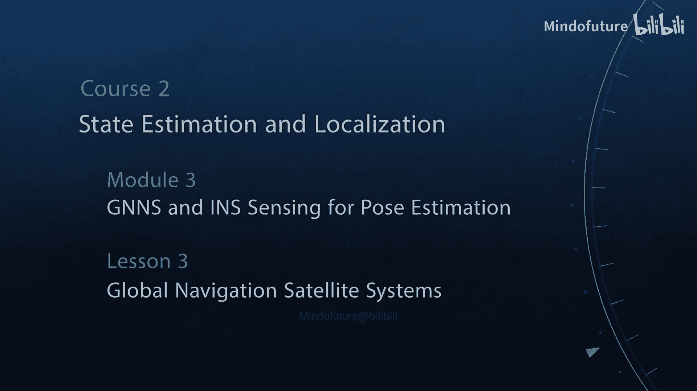
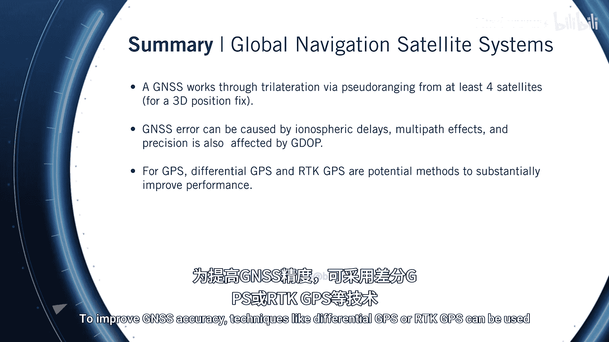

# 022：全球导航卫星系统（GNSS）📡




在本节课中，我们将要学习一种大家非常熟悉的传感器：全球导航卫星系统（GNSS）接收器。我们将了解为什么这种导航传感器对自动驾驶汽车至关重要，因为它能够在全球范围内提供误差有界的定位信息。

上一节我们讨论了惯性测量单元（IMU），本节中我们来看看另一种关键的定位传感器——GNSS。与IMU不同，GNSS能提供绝对位置信息，但其工作原理和误差来源也更为复杂。

## GNSS概述与历史背景

全球导航卫星系统（GNSS）接收器是一种能够提供全球定位的传感器。它通过测量与多颗卫星的距离来计算自身位置，其定位误差是有界的。

大多数现代智能手机都至少配备了一种GNSS接收器。虽然我们现在认为它理所当然，但第一个现代全球定位卫星系统——GPS，是在20世纪80年代为军事用途而建造的。到1995年第二代系统全面投入运行时，GPS已免费向公众开放。

这一部分原因与1983年韩国航空007号班机空难的高度公开有关。007航班是一架从纽约飞往首尔的波音747客机，在安克雷奇加油。在从安克雷奇飞往首尔途中，它偏离了计划航线，在苏联领空飞行数小时后被战斗机击落。飞越北太平洋时，007航班依靠惯性导航系统进行引导。飞行员未能正确初始化系统，错误地使飞机保持特定的磁航向，导致飞机偏离计划航线超过300公里。007航班被击落后不久，时任美国总统罗纳德·里根发布指令，允许美国的全球定位系统在完全开发后免费向公众开放。

虽然GPS是最初用于全球定位的导航卫星系统，但如今“全球导航卫星系统”（GNSS）一词已成为多个此类卫星星座的总称。截至2018年，两个完全投入运行的系统是GPS和俄罗斯的格洛纳斯（GLONASS）。其他几个系统，包括欧洲的伽利略星座，也接近完成。本视频将更仔细地研究GPS，尽管其他GNSS系统也遵循类似的工作原理。

## GPS系统工作原理

GPS星座由24至32颗卫星组成，分布在六个轨道平面上。卫星会定期退役和更换。每颗卫星都位于中地球轨道，高度约为20000公里，轨道周期略低于12小时。该星座的设计确保在地球表面任何地点、任何时间都至少能看到四颗卫星。

每颗卫星以两个频率广播信号，一个用于民用，一个用于军用。每个广播信号都包含一个伪随机码，用于标识卫星位置和信号发射时间。

GPS的基本原理是到达时间测距。接收器通过比较其内部时钟与信号发射时间，计算到每颗可见卫星的距离。时间差利用电磁信号以光速传播的知识转换为距离。

要计算三维位置，测距方程至少需要四颗可见卫星。如果已知高度且仅需要二维位置，则只需要三颗卫星。从到多个已知地标的距离中恢复位置的过程称为**三边测量**。

请注意，这与**三角测量**不同，三角测量是基于角度测量来计算位置的。

以下是GPS接收器使用的伪距测量模型：

```
ρ = r + c * (δt_r - δt_s) + I + T + ε
```
其中：
*   `ρ` 是测量的伪距。
*   `r` 是卫星与接收器之间的真实几何距离。
*   `c` 是光速。
*   `δt_r` 是接收器时钟误差。
*   `δt_s` 是卫星时钟误差。
*   `I` 是电离层延迟。
*   `T` 是对流层延迟。
*   `ε` 是测量噪声。

该模型考虑了接收器时钟误差、大气传播延迟和测量噪声。“伪距”一词指的是距离信息被上述误差源所破坏。

每个伪距测量在2D中定义一个圆，在3D中定义一个球体。如果我们恰好有四颗卫星，我们可以显式求解接收器位置和接收器时钟误差。如果我们有超过四颗卫星，我们可以使用**最小二乘法**在高斯噪声假设下找到最大似然位置。

## GNSS误差来源

GPS存在多种误差源。

首先，电离层中的带电离子会以未知量延迟信号。其次，周围的地形和建筑物可能导致信号反射，从而增加信号到达接收器前传播的距离，这称为**多径误差**。

时钟同步或卫星位置信息中的任何微小误差都可能带来灾难性后果。即使一微秒的定时误差也可能导致300米的显著位置误差。星历数据和卫星时钟经常更新和重新校准，但校准可能已过时。

最后，可见卫星的几何配置也会导致定位精度的变化，这被称为**几何精度衰减因子**。为了获得更高的精度，卫星在天空中分散分布的配置更可取。

## 提高GNSS精度的方法

幸运的是，对于某些应用，我们可以通过各种方式增强系统来提高GNSS精度。

**差分GPS**可以通过利用一个或多个固定基站更精确已知的位置来校正接收器的定位估计。校正信息通过单独的频率广播给移动车辆中的GNSS接收器。

**实时动态**（RTK）GPS利用载波相位信息，在某些情况下可将定位精度提高到两厘米。

虽然这两种技术都可以显著提高GPS的精度，但实施起来通常成本相当高。

正如我们在上一个视频中提到的，惯性传感器对导航非常有用，但它们会随时间漂移或累积无界误差。相比之下，GPS系统提供有界误差的定位更新。配备GPS的自动驾驶汽车将始终保持有保证的定位精度水平，除非GPS接收器发生故障或失去对至少四颗卫星的跟踪。

## 总结与下节预告

本节课中我们一起学习了全球导航卫星系统（GNSS）的核心知识。



全球导航卫星系统通过结合至少四颗卫星的伪距来确定三维位置。GPS或GNSS误差可能来自几个不同的来源，包括电离层延迟、多径效应，也可能来自几何精度衰减因子。为了提高GNSS精度，可以使用差分GPS或RTK GPS等技术。


本模块到此结束。在模块4中，我们将描述如何融合来自IMU的惯性测量和来自GPS的位置测量，为自动驾驶汽车生成精确的定位估计。这些传感器是互补的，并且几乎在所有自动驾驶汽车中一起使用。下个模块再见。😊