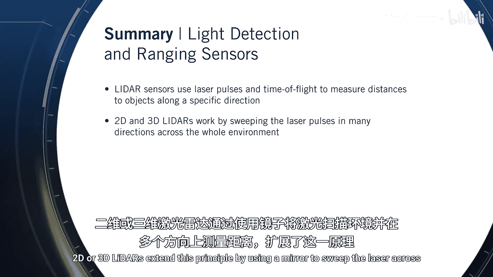

# 024：激光雷达传感器工作原理

在本节课中，我们将要学习激光雷达传感器。激光雷达是自动驾驶汽车的一项关键技术，因为它能提供全方位的精确距离信息。事实上，目前道路上大多数自动驾驶汽车都配备了某种类型的激光雷达传感器。

## 概述

欢迎来到课程的第四模块。在本模块中，我们将讨论激光雷达传感器。激光雷达因其能够全方位感知并提供非常精确的距离信息，已成为自动驾驶汽车的一项赋能技术。本模块中，您将学习激光雷达传感器的工作原理、处理激光雷达数据的基本传感器模型、激光雷达点云、应用于点云的各种变换操作，以及如何使用一种称为点云配准的技术，利用激光雷达为自动驾驶汽车定位。

具体在本视频中，我们将探讨激光雷达的工作原理，并了解2D和3D激光雷达的传感器模型。我们还将描述这些传感器的测量噪声和误差来源。在后续课程中，我们将更详细地讨论如何利用激光雷达数据进行自动驾驶汽车的状态估计。

## 激光雷达简介与应用

如果您见过像Waymo或Uber那样的自动驾驶汽车，您可能注意到车顶上有东西在旋转。那个东西就是激光雷达传感器，它的职责是提供车辆周围环境的详细3D扫描。实际上，激光雷达是自动驾驶汽车和许多其他移动机器人最常用的传感器之一。

激光雷达有多种形状和尺寸，可以测量到单个点的距离、对世界进行2D切片扫描，或执行完整的3D扫描。当今一些最流行的型号由加利福尼亚的Velodyne、日本的Hokuyo和德国的SICK等公司制造。本视频中，我们主要将以Velodyne传感器为例，但基本技术同样适用于其他类型的激光雷达。

在深入了解激光雷达传感技术之前，让我们快速回顾一下这一重要传感器的历史。激光雷达最早于20世纪60年代推出，就在激光本身发明后不久。第一个使用激光雷达的团体是美国国家大气研究中心的气象学家，他们部署激光雷达来测量云层高度。这些地基云高仪至今仍在使用，不仅用于测量水云，还用于探测火山灰和空气污染。

如今，机载激光雷达传感器常用于农业、地质学、军事等领域的地表勘测和测绘。但首次让激光雷达进入公众视野的应用是阿波罗15号任务，这是第四次载人登月任务，也是首次使用激光高度计绘制月球表面地图。

## 激光雷达工作原理：飞行时间测距

我们已经看到激光雷达可用于测量距离并创建某种类型的地图。但它们实际上是如何工作的？我们如何在自动驾驶汽车上使用它们？

要构建一个一维的基本激光雷达，您需要三个组件：一个激光器、一个光电探测器和一个非常精确的秒表。激光器首先沿某个已知射线方向发射一个短脉冲光，通常在近红外频段。同时，秒表开始计时。激光脉冲以光速从传感器向外传播，并击中一个远处的目标，可能是我们前方道路上的另一辆车，或像停车标志或建筑物这样的静止物体。

只要目标表面不是太光滑或闪亮，激光脉冲就会从表面向各个方向散射，其中一些反射光会沿着原始射线方向返回。光电探测器捕捉到返回的脉冲，秒表告诉您脉冲首次发出和返回之间经过了多少时间。这个时间称为往返时间。

我们知道光速略低于每秒3亿米。因此，我们可以将光速乘以往返时间，以确定激光脉冲行进的总往返距离。由于光速比汽车快得多，在发生这一切的几纳秒内，将激光雷达和目标视为基本静止是一个很好的近似。这意味着从激光雷达到目标的距离，就是我们刚刚计算的往返距离的一半。

这种技术称为**飞行时间测距**。虽然这不是构建激光雷达的唯一方法，但它是一种非常常见的方法，也用于雷达和声纳等其他类型的测距传感器。

值得一提的是，光电探测器还会告诉您返回脉冲的强度相对于发射脉冲的强度。这种强度信息在自动驾驶中较少使用，但它提供了关于环境几何形状和光束反射材料的一些额外信息。强度数据之所以有用，部分原因在于可以从激光雷达强度数据创建2D图像，然后您可以在下一门课程中学到的计算机视觉算法中使用这些图像。由于激光雷达是自身的光源，它实际上为自动驾驶汽车提供了一种在黑暗中“看见”的方式。

## 从点到云：2D与3D扫描

现在我们知道如何使用激光器、光电探测器、秒表和飞行时间方程来测量到单个点的单个距离。但显然，只关注前方一个点是不够的。那么我们如何使用这种技术来测量2D或3D中的一大堆距离呢？

诀窍是在激光雷达中内置一个旋转镜，将发射的脉冲导向不同的方向。随着镜子的旋转，您可以测量传感器周围2D切片中各点的距离。如果您随后给镜子添加一个上下点头运动，配合旋转，您可以使用相同的原理在3D中创建扫描。

对于Velodyne类型的激光雷达，其镜子和整个传感器主体一起旋转，很难使用点头运动来进行3D扫描。相反，这些传感器实际上会从一系列以固定角度间隔排列的独立激光器中创建多个2D扫描线，这有效地让您用水平条纹的激光“描绘”世界。

下图展示了一个典型的原始激光雷达数据流，来自安装在车顶的Velodyne传感器。中间的黑色空洞是传感器本身所在的盲点。从那里向外扩散的同心圆是由旋转的Velodyne传感器产生的各个扫描线。扫描中的每个点都根据返回信号的强度着色。3D扫描中所有点的集合称为**点云**，我们将在接下来的视频中讨论如何使用点云进行状态估计。

## 坐标转换：传感器模型

但在讨论点云之前，我们需要考虑3D中的单个点。通常，激光雷达使用球坐标测量3D点的位置：**距离**（从传感器原点到3D点的径向距离）、**仰角**（从传感器的XY平面向上测量）和**方位角**（从传感器的X轴逆时针测量）。这是合理的，因为方位角和仰角告诉您激光脉冲的方向，而距离告诉您目标点在该方向上有多远。方位角和仰角使用编码器测量，编码器告诉您镜子的方向；距离则使用我们之前见过的飞行时间法测量。对于Velodyne类型的激光雷达，给定扫描线的仰角是固定的。

现在，假设我们想确定扫描点在传感器坐标系中的笛卡尔X、Y、Z坐标。当我们将多个激光雷达扫描合并到地图中时，这通常是我们想要做的事情。为了从球坐标转换到笛卡尔坐标，我们使用您在力学课程中遇到过的相同公式。

这为我们提供了一个**逆传感器模型**。我们称之为逆模型，因为我们的实际测量值是以球坐标给出的，而我们正试图重建产生这些测量值的点的笛卡尔坐标。请注意，我们还没有讨论测量噪声，我们稍后会回到这个问题。

要朝另一个方向转换，即从笛卡尔坐标到球坐标，我们可以推导出此处给出的逆变换。这是我们3D激光雷达的**前向传感器模型**，给定一组笛卡尔坐标，它定义了传感器实际会报告什么。

大多数时候，我们正在研究的自动驾驶汽车使用像Velodyne这样的3D激光雷达传感器。但有时您可能想单独使用2D激光雷达，无论是用于检测障碍物，还是在停车场等更结构化的环境中进行状态估计。有些汽车战略性地放置了多个2D激光雷达，以充当单个3D激光雷达，以不同密度覆盖不同区域。

对于2D激光雷达，我们使用完全相同的正向和逆向传感器模型，但仰角和传感器坐标系中3D点的Z分量均为0。换句话说，我们所有的测量都局限于传感器的XY平面，我们的球坐标简化为熟悉的2D极坐标。

## 测量噪声与误差源

我们现在已经了解了如何在传感器测量的球坐标和我们通常对状态估计感兴趣的笛卡尔坐标之间进行转换。但是测量噪声呢？对于激光雷达传感器，有几个重要的噪声源需要考虑。

首先，反射信号到达的确切时间存在不确定性，这源于我们用于计算飞行时间的秒表必然具有有限的分辨率。同样，在2D和3D激光雷达中，镜子的确切方向也存在不确定性，因为用于测量方向的编码器也具有有限的分辨率。

另一个重要因素是与目标表面的相互作用，这会降低返回信号的质量。例如，如果表面完全是黑色的，它可能会吸收大部分激光脉冲。或者，如果它像镜子一样非常闪亮，激光脉冲可能会完全散射到原始脉冲方向之外。在这两种情况下，激光雷达通常会报告一个最大距离误差，这可能意味着沿光束方向是空的空间，或者脉冲遇到了高吸收性或高反射性的表面。换句话说，您根本无法判断那里是否有东西。如果您的自动驾驶汽车仅依赖激光雷达来检测和避开障碍物，这可能是一个安全问题。

最后，光速实际上会根据其穿过的材料而变化。例如，空气的温度和湿度也会微妙地影响我们飞行时间计算中的光速。通常通过假设球坐标上存在加性零均值高斯噪声，并配合经验确定或手动调整的协方差，来考虑这些因素。正如我们之前所见，高斯噪声模型对于状态估计特别方便，即使在大多数情况下它并不完全准确。

另一个无法轻易解释的非常重要的误差来源是**运动畸变**。这是因为激光雷达所依附的车辆通常相对于其扫描的环境在运动。虽然汽车不太可能以光速的显著比例运动，但它通常以传感器自身旋转速度的显著比例运动，而传感器在扫描10到100米距离的物体时，旋转速度通常在5到20赫兹左右。这意味着激光雷达扫描中的每一个点都是从略微不同的位置和方向获取的，这可能导致伪影，例如在激光雷达扫描中出现重复的物体。这使得自动驾驶汽车更难理解其环境，纠正这种运动畸变通常需要由GPS和INS等提供的车辆精确运动模型。

## 总结

本节课中，我们一起学习了激光雷达传感器。我们了解到，激光雷达传感器通过发射脉冲激光并测量脉冲的飞行时间来测量距离。2D或3D激光雷达通过使用镜子将激光扫过环境并在多个方向上测量距离，扩展了这一原理。

在下一个视频中，我们将更仔细地研究由2D和3D激光雷达创建的点云，以及如何利用它们为我们的自动驾驶汽车进行状态估计。