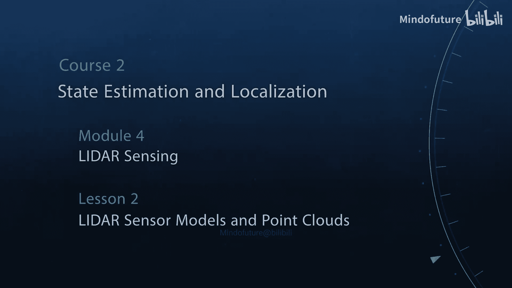
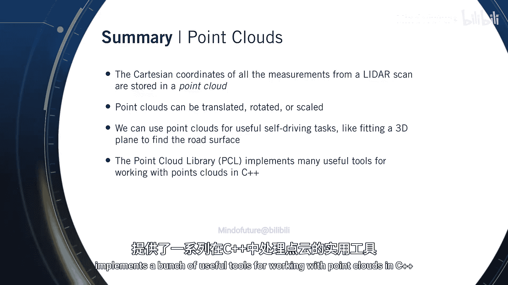
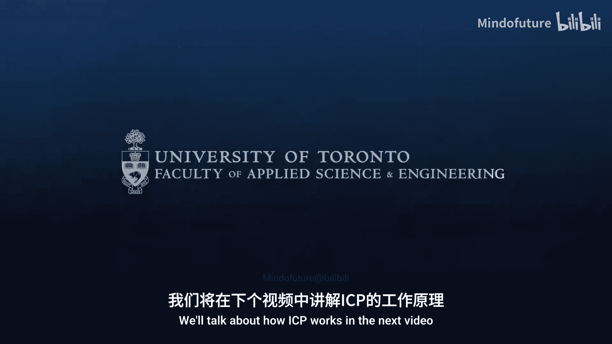

# 025：激光雷达传感器模型与点云

## 概述

在本节课中，我们将学习如何利用激光雷达传感器生成的点云数据进行自动驾驶汽车的状态估计。我们将首先了解点云的基本数据结构，然后探讨如何对点云进行平移、旋转和缩放等空间操作。最后，我们将学习如何使用最小二乘法将平面拟合到点云中，以检测道路或其他表面。

---

## 点云数据结构

上一节我们介绍了激光雷达的基本工作原理。本节中，我们来看看如何存储和处理激光雷达扫描产生的海量数据点。

三维激光雷达传感器为每个扫描点返回**距离**、**仰角**和**方位角**的测量值。我们可以使用逆传感器模型将这些球坐标转换为笛卡尔坐标 `(X, Y, Z)`，从而利用一次激光雷达扫描的所有测量值构建一个大型点云。

对于某些激光雷达设置，这些点云包含超过一百万个点的情况并不少见。那么，我们如何处理这些庞大的点云呢？

以下是存储点云的一种常见数据结构：

*   为每个点分配一个索引（例如点1到点n）。
*   将每个点的 `(X, Y, Z)` 坐标存储为一个 `3x1` 的列向量。
*   将这些向量并排堆叠成一个矩阵，我们称之为 `P`。

用矩阵形式存储点云，便于利用像 Python 的 NumPy 库这样的标准线性代数库。我们可以利用快速的矩阵运算，而不是遍历列表并独立处理每个向量。

---

## 点云的空间操作

在了解了点云的数据结构之后，接下来我们探讨对点云进行状态估计至关重要的三种基本空间操作：**平移**、**旋转**和**缩放**。

对于状态估计，更有用的思考方式是：世界中的物体基本保持不动，而附着在车辆上的参考系在移动，并从不同角度观察世界。

### 平移

考虑我们的参考系平移（例如车辆向前行驶10米）将如何影响我们对点云中单个点的感知。

点 `P` 在新坐标系 `S'` 中的坐标，可以通过从其在原坐标系 `S` 中的坐标减去坐标系间的平移向量来获得。

对于整个点云，可以通过从点云矩阵 `P` 中减去一个平铺了平移向量的大矩阵 `T` 来实现批量操作。在 Python 的 NumPy 库中，通常可以利用广播语义隐式完成此操作，无需显式构建 `T` 矩阵。

### 旋转

如果我们旋转参考系，物理点 `P` 本身没有改变，改变的是我们用来表示向量坐标的基向量组。

旋转矩阵 `C` 告诉我们如何从向量在原坐标系中的坐标，找到该向量在旋转后坐标系中的坐标。因此，如果我们知道从坐标系 `S` 到 `S'` 的旋转矩阵 `C`，只需将其与 `P` 在 `S` 系中的坐标相乘，即可得到 `P` 在 `S'` 系中的坐标。

对于整个旋转点云，操作完全相同，这得益于矩阵乘法的性质。

### 缩放

缩放操作与旋转非常相似，但我们改变的是坐标系中基向量的长度，而不是方向。

从数学上讲，这意味着将每个点的坐标预乘一个对角矩阵 `S`，其非零元素就是沿每个维度所需的缩放因子。通常（但不总是），这些缩放因子是相同的，此时矩阵乘法等价于乘以一个标量。在这种情况下，我们称缩放是**各向同性**的，即每个方向都相等。

与旋转一样，我们可以对单个点或整个点云使用相同的矩阵乘法。

---

## 组合空间变换

通常，我们感兴趣的是平移和旋转（有时包括缩放）的组合变换。例如，我们经常需要估计能最佳对齐两个点云的平移和旋转，以便估计自动驾驶汽车的运动。我们将在下一个视频中讨论如何做到这一点。

幸运的是，我们可以轻松地将所有三个操作组合成一个方程。首先平移每个向量，然后旋转到新坐标系，最后应用任何缩放。当然，这个操作也适用于批量处理的情况。

---

## 平面拟合

在进入下一节之前，还有一个重要的操作需要讨论：**平面拟合**。对于自动驾驶汽车，平面拟合最常见和最重要的应用之一是找出道路表面在哪里，并预测汽车继续行驶时道路将位于何处。

回想一下高中几何，三维空间中平面的方程是：
`Z = A + B*X + C*Y`

这个方程告诉你，当你在 `X` 和 `Y` 方向上移动时，平面的高度 `Z` 如何变化。它依赖于三个参数 `A`、`B` 和 `C`，它们分别告诉你平面在每个方向上的斜率以及平面与 `Z` 轴的交点。

在我们的例子中，我们从激光雷达点云中获得了一堆 `(X, Y, Z)` 的测量值，我们希望找到参数 `A`、`B`、`C` 的值，从而给出通过这些点的最佳拟合平面。

为此，我们将回顾第一模块中的工具：**最小二乘估计**。

以下是使用最小二乘法拟合平面的步骤：

1.  为点云中的每个点定义一个测量误差 `e`，它是因变量 `Z` 的预测值 `Ž` 与实际观测值 `Z` 之间的差值。`Ž` 通过将当前对参数 `Â`、`B̂`、`Ĉ` 的猜测以及 `X`、`Y` 的实际值代入平面方程得到。
2.  将所有误差项堆叠成矩阵形式，得到一个系数矩阵 `A` 乘以参数向量 `x`，再减去堆叠的测量值向量 `b`。
3.  最小化该误差的平方和，以获得我们的解。这与我们在模块1中解决的电阻器问题原理相同。
4.  将平方误差展开为参数向量 `x` 的矩阵多项式。
5.  对平方误差函数关于参数向量 `x` 求偏导数，并令其为零以找到最小值。这给出了我们需要求解以获得最终最小二乘估计的线性方程组。
6.  使用高效的数值求解器（如 Python NumPy 的 `solve` 函数）求解此线性系统，或直接使用伪逆来获得平面参数的最终答案。

这里需要注意的一点是，我们没有考虑 `X`、`Y`、`Z` 测量中的传感器噪声。我们所做的只是找到通过一组点的最佳拟合平面。当然，可以用更复杂的方式来设置这个问题，以考虑传感器噪声。你可以使用类似于我们刚才讨论的批处理方法，甚至可以考虑将道路参数纳入卡尔曼滤波器，在传感器数据传入时实时估计它们。对于你的自动驾驶应用，最佳解决方案将取决于你对激光雷达数据的信任程度以及对道路表面不确定性的考量程度。

---

## 点云库

尽管我们这里描述的所有操作都可以用 NumPy 或任何其他线性代数库轻松实现，但有一个出色的开源工具叫做**点云库**，它为处理点云提供了各种有用的函数。

事实上，它非常有用，在工业界几乎随处可见。其核心库是用 C++ 构建的，但也有非官方的 Python 绑定可用。如果你想了解更多关于 PCL 的功能，强烈建议访问 `pointclouds.org` 查看。

PCL 中最有用的算法之一称为**迭代最近点算法**，它是使用两个激光雷达点云估计自动驾驶汽车运动的常用方法。我们将在下一个视频中讨论 ICP 的工作原理。

---

## 总结

本节课中，我们一起学习了：
1.  点云是捕获激光雷达扫描所有测量值的一种方式，通常存储为一个大矩阵。
2.  如何使用线性代数对点云进行有用的操作，如**平移**、**旋转**和**缩放**。
3.  如何使用**最小二乘算法**将三维平面拟合到点云中以找到道路表面。
4.  点云库在 C++ 中实现了一系列用于处理点云的有用工具，其中迭代最近点算法是用于运动估计的关键算法。