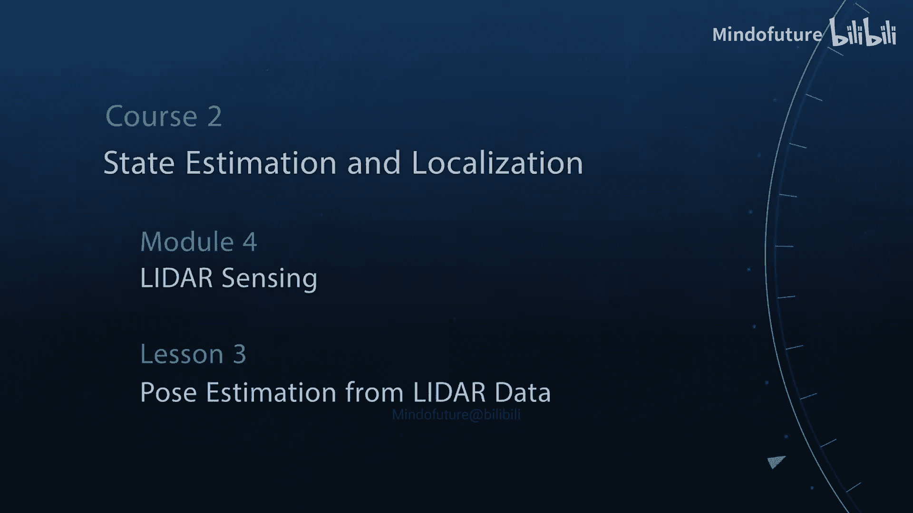
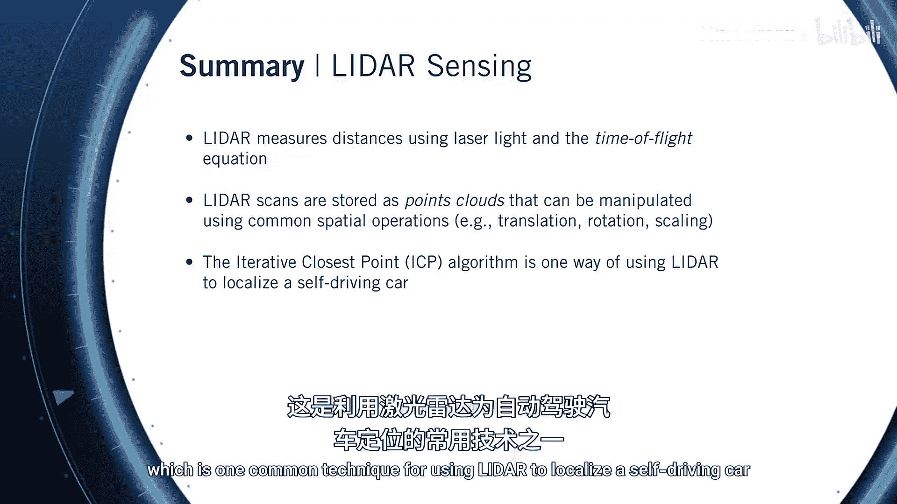

# 026：基于激光雷达数据的姿态估计

## 概述
在本节课中，我们将学习如何利用激光雷达（LiDAR）数据来估计自动驾驶汽车的运动。核心内容围绕**点集配准问题**展开，并详细介绍解决该问题的**迭代最近点（ICP）算法**。我们将了解ICP的基本原理、实现步骤、潜在挑战以及如何应对现实世界中的动态物体干扰。

---

## 点集配准问题简介
上一节我们学习了点云的平移、旋转和缩放操作。本节中，我们来看看如何将这些操作应用于真实的点云数据，以估计自动驾驶汽车的运动。

我们通常通过解决**点集配准问题**来实现这一目标，这是计算机视觉和模式识别中最重要的问题之一。

让我们回到自动驾驶汽车通过车顶激光雷达观测一棵树的例子。
*   在时间 **T=1**，激光雷达返回一个点云，其所有点的坐标都相对于扫描时激光雷达的姿态给出。我们称此坐标系为 **S**。
*   在时间 **T=2**，汽车向前行驶了一段距离，激光雷达再次扫描到树并返回第二个点云，其坐标相对于 **T=2** 时刻激光雷达的姿态给出。我们称此坐标系为 **S‘**。

**点集配准问题**可以描述为：给定两个在不同坐标系下的点云，并且已知它们对应或包含世界中的同一物体，我们应如何对齐它们，以确定传感器在两次扫描之间必须发生的运动。

更具体地说，我们希望找到两个传感器参考系之间的**最优平移**和**最优旋转**，以最小化两个点云之间的距离（我们稍后将定义“距离”的含义）。为简化问题，我们假设拥有理想的激光雷达传感器，可以一次性测量整个点云，从而忽略运动畸变的影响。

---

## 迭代最近点（ICP）算法
如果我们事先知道第二个点云中的每个点具体对应第一个点云中的哪个点，那么这个问题很容易解决。我们只需找到将每个点与其对应点对齐的平移和旋转即可。

然而，通常我们并不知道点之间的对应关系。**迭代最近点（ICP）算法**是解决这类问题最流行的算法。

ICP的基本直觉是：当我们找到（或预先知道）最优的平移和旋转，并用它们将一个点云变换到另一个点云的坐标系时，真正相互对应的点对将是欧几里得意义上彼此最接近的点。

如果我们没有最优的变换参数，如何决定哪些点应该配对呢？ICP使用一个简单的启发式方法：**对于第一个点云中的每个点，在第二个点云中最佳的对应点候选就是当前距离它最近的点**。

这个想法是，这个启发式方法应该能为我们提供对应关系，从而让我们能做出一个比当前猜测稍好一点的下一个平移和旋转猜测。随着我们的猜测越来越好，对应关系也应该越来越好，直到最终收敛到最优的运动和最优的对应关系。这种使用最近点启发式方法的迭代优化方案正是ICP名称的由来。

---

## ICP算法步骤
以下是ICP算法的核心步骤：

首先，我们需要一个**初始变换猜测**。这是因为无法保证最近点启发式方法一定能收敛到最佳解。在这类迭代优化方案中，很容易陷入局部最小值，因此需要一个良好的起始猜测。初始猜测可以来自多种来源，对于自动驾驶等机器人应用，最常见的来源之一是**运动模型**（例如来自IMU、轮速计，或简单的恒定速度/零速度模型）。初始猜测的好坏取决于汽车行驶的平滑度相对于激光雷达扫描速率的关系。

**步骤一：初始猜测**
假设我们使用一个有噪声的IMU和运动模型来提供初始猜测，该模型告诉我们传感器向前平移了一点，并且向上倾斜了。

**步骤二：关联点**
使用初始猜测，将一个点云中的点坐标变换到另一个点云的参考系中。然后，将第二个点云中的每个点与第一个点云中**最近的点**进行匹配。请注意，一个点云中的两个点有可能与另一个点云中的同一个点相关联。

**步骤三：求解最优变换**
获取所有匹配点对，并找到能够最小化所有对应点之间**距离平方和**的变换。你可以将其想象为在每个匹配点对之间缠绕一根橡皮筋，然后松开手，等待系统找到其能量最低的配置。与这个最低能量配置相关的平移和旋转就是最优解。

**步骤四：迭代**
使用刚刚求解出的平移和旋转作为新的初始猜测，重复上述过程。我们持续迭代，直到优化收敛（即变换参数的变化非常小）。

---

## 求解最优变换：最小二乘与奇异值分解（SVD）
我们如何在步骤三中实际求解最优变换呢？你可能已经猜到，我们将使用我们最喜爱的工具：**最小二乘法**。

我们的目标是找到最能对齐两个点云的旋转矩阵 **R** 和平移向量 **t**。具体来说，我们希望最小化每对匹配点之间的欧几里得距离平方和，即以下损失函数：

**L(R, t) = Σ || (R * p_i + t) - q_i ||²**

其中 **p_i** 是第一个点云中的点，**q_i** 是第二个点云中与之匹配的点。

这个最小二乘问题比我们之前遇到的更复杂，因为旋转矩阵 **R** 在损失函数内部，并且旋转矩阵不能像向量一样简单相加。3D旋转属于**特殊正交群（SO(3))**，需要特殊处理。

幸运的是，这个问题有一个优美的闭式解。以下是求解该问题的四步算法：

1.  **计算质心**：分别计算两个点云的质心（所有点坐标的平均值）。
    *   **μ_p = (1/N) * Σ p_i**
    *   **μ_q = (1/N) * Σ q_i**
2.  **构造协方差矩阵 W**：这是一个3x3矩阵，捕获两个点云的分布关系。
    *   **W = Σ (q_i - μ_q) * (p_i - μ_p)^T**
3.  **通过SVD求解最优旋转矩阵 R**：对矩阵 **W** 进行**奇异值分解（SVD）**。
    *   **W = U * S * V^T**
    *   最优旋转矩阵 **R** 可通过以下公式计算：**R = U * C * V^T**，其中 **C** 是一个对角矩阵，用于确保 **R** 是一个正确的旋转（没有反射），其对角线元素为 **[1, 1, det(U)*det(V)]**。
4.  **求解最优平移向量 t**：有了旋转矩阵后，平移向量很容易计算。
    *   **t = μ_q - R * μ_p**

**关于奇异值分解（SVD）的简要说明**：SVD是将一个矩阵分解为两个酉矩阵（**U** 和 **V**）和一个对角矩阵（**S**）的乘积。对于本问题，我们可以将 **U** 和 **V** 视为旋转，**S** 视为缩放矩阵。由于我们处理的是刚体运动（无缩放），我们需要调整 **S** 矩阵以消除缩放并确保得到的是纯旋转。

---

## ICP的挑战与改进
**不确定性估计**：从安全角度以及后续讨论传感器融合时，我们需要考虑对ICP算法输出的置信度。可以通过公式估计运动参数的不确定性（协方差），但通常为了实用，我们会手动调整ICP的协方差矩阵以获得可接受的结果。

**ICP变体**：上面介绍的是最基本的**点到点ICP**。另一种在结构化环境（如城市或室内）中表现良好的流行变体是**点到平面ICP**。它不是最小化点对之间的距离，而是将第一个点云拟合出若干平面（如墙面、路面），然后最小化第二个点云中每个点到第一个点云中最近平面的距离。

**动态物体的挑战**：到目前为止，我们都假设激光雷达观测到的物体是静止的。如果物体在移动呢？例如，我们的汽车在繁忙的高速公路上行驶，扫描前方的车辆。如果两车同速行驶，ICP可能会错误地得出汽车没有移动的结论。虽然现实中点云会包含许多静止物体（道路、建筑、树木），但天真地使用ICP在存在移动物体的情况下，会倾向于将运动估计拉离真实运动。

**应对异常值（Outliers）**：
1.  **传感器融合**：将ICP运动估计与GPS、INS（惯性导航系统）的估计融合。我们将在课程后面讨论如何操作。
2.  **识别并忽略移动物体**：可以使用计算机视觉技术。
3.  **使用鲁棒损失函数**：这是一种更简单的方法。标准的最小二乘损失函数对由异常值引起的大误差非常敏感。**鲁棒损失函数**（如L1范数、Cauchy损失、Huber损失）的斜率不会随着误差增大而持续增加，而是保持恒定或逐渐减小，从而降低异常值的影响。
    *   数学上，我们将损失函数推广为：**L(R, t) = Σ ρ( || (R * p_i + t) - q_i || )**，其中 **ρ** 是鲁棒函数。
    *   使用鲁棒损失函数会使ICP问题稍微复杂，因为不再有闭式解，需要在主循环内增加一个迭代优化步骤，但其好处通常大于增加的复杂度。

---

## 总结
本节课中，我们一起学习了如何利用激光雷达数据进行车辆运动估计。

*   **迭代最近点（ICP）算法**是一种通过对齐来自激光雷达等传感器的点云来确定自动驾驶汽车运动的方法。
*   ICP通过迭代最小化每个点云中相邻点之间的欧几里得距离来工作，这也是算法名称的由来。
*   移动物体对ICP来说是一个问题，因为它们违反了ICP所基于的静态世界假设。
*   可以通过多种技术来缓解此类异常值测量，包括**鲁棒损失函数**，它比通常的平方误差损失函数更少地赋予大误差权重。

**本模块内容回顾**：
*   激光雷达（LiDAR）通过测量激光脉冲的飞行时间来测距。
*   2D和3D激光雷达传感器可以扫描汽车周围的大片环境。
*   每次扫描返回的点集合存储为**点云**，可以使用平移、旋转和缩放等标准空间操作进行处理。
*   这些操作是**迭代最近点（ICP）算法**的重要组成部分，而ICP是使用激光雷达定位自动驾驶汽车的常用技术。

---

在下一个模块中，我们将讨论状态估计的一些实际方面，并探讨如何将激光雷达和ICP与IMU、GPS等其他传感器结合使用，以获得准确可靠的车辆状态估计。