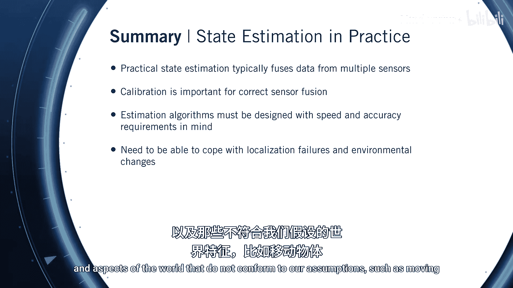

# 028：实践中的状态估计

在本节课中，我们将学习如何将状态估计理论应用于真实的自动驾驶汽车。我们将探讨如何整合来自多种传感器的数据，并考虑实际工程中的关键因素，如传感器标定、系统性能要求以及应对环境变化和故障的策略。

现在你已经学习了估计理论、三维几何和一些常见传感模式的基础知识，是时候进行实践，并思考如何将这些工具结合起来，构建一个可用于真实自动驾驶汽车的估计器。

一辆真实的自动驾驶汽车，例如Autonomoose，会配备多种不同的传感器。例如，Autonomoose配备了五个摄像头、一个3D激光雷达、一个惯性测量单元、四个雷达单元、一个GPS或GNSS接收器以及一个车轮编码器。所有这些传感器以不同的速率提供不同类型的数据。例如，IMU可能每秒报告200次加速度和角速度，而激光雷达每秒仅完成20次完整扫描。

因此，在本模块中，我们将讨论如何组合所有不同的信息，以获得最佳的车辆状态估计。这个过程称为传感器融合，它是自动驾驶汽车最重要的技术之一。

但为了进行传感器融合，我们还需要标定传感器，以确保传感器模型准确，并了解所有传感器的参考坐标系如何相互关联。我们还将讨论当一个或多个传感器发生故障时会发生什么，并概述最终项目，你将有机会在Carla模拟器中使用传感器实现一个完整的车辆状态估计器。

在这个第一个视频中，我们将从宏观角度概述设计自动驾驶汽车系统时应考虑的一些实际问题。

需要考虑哪些问题？我们已经提到了传感器融合和标定，但还需要考虑速度和精度要求，以及定位失败和如何处理环境中移动和变化的部分。

让我们从传感器融合开始。如果我们有一辆像Autonomoose这样配备了多种不同传感器的汽车，我们希望做的是找出如何组合所有这些不同的信息，以获得最佳的车辆状态估计。

使用所有这些数据可能看起来是一项艰巨的任务，但实际上，我们已经掌握了所需的工具。在本模块的第二课中，我们将详细讨论如何使用扩展卡尔曼滤波器等熟悉的工具，将所有传感器数据组合成一个一致的车辆状态估计。

但为了进行传感器融合，我们首先需要了解传感器的一些信息以及它们在车辆上的配置方式。

一方面，我们的传感器模型可能依赖于特定于汽车或传感器本身的参数。一个很好的例子是使用车轮编码器来测量汽车的前进速度。车轮编码器测量车轴的角速度，但如果我们想用它来获取车辆的前进速度，我们还需要知道轮胎的半径。

我们需要了解的关于车辆的另一个方面是每个传感器相对于车辆参考坐标系的位姿（位置和方向）。因为我们要组合来自不同位置传感器的信息，所以需要知道如何转换所有测量值，使它们在一个共同的参考坐标系中表达。

最后，我们需要考虑传感器测量的同步程度，以便正确地进行融合。直观地说，你可能认为直接将刚刚收到的激光雷达扫描与5秒前收到的GPS测量值结合起来，效果不如激光雷达扫描和GPS测量值在同一时间进行。

因此，传感器同步越精确，你的状态估计就越好。这其中的一部分涉及确定传感器记录测量值与估计器接收并处理该测量值之间的时间偏移。

所有这些因素都是标定的关键形式，我们将在第3课中更详细地讨论。

对于一辆在道路上安全行驶的自动驾驶汽车，我们的估计器需要多精确？这取决于汽车的大小、车道的宽度和交通密度。但为了得到一个大概的估计，你可以考虑像车道保持这样的任务可用的误差范围。

一辆典型的汽车大约宽1.8米，一条普通高速公路车道大约宽3米，上下浮动。因此，我们的估计器需要足够好，能将汽车定位在车道两侧大约60厘米的范围内。这假设我们确切知道车道的位置，并且没有其他交通。

作为比较，GPS精度的乐观范围在1到5米之间，具体取决于硬件、可见卫星数量等因素。因此，仅靠GPS显然不足以进行车道保持。这就是为什么我们需要组合来自许多不同传感器的信息的一个重要原因。

那么速度呢？我们需要多快更新车辆状态，以便汽车能够对快速变化的环境或意外事件做出反应？这完全取决于汽车在什么样的环境中运行。

想象一下，你闭着眼睛开车，每秒钟只睁开眼睛一次，看看周围的情况并进行一些调整。这对应于1赫兹的更新率。如果你在一条没有交通的笔直乡村道路上行驶，你可能会觉得这样做相对安全。如果你正穿过一个繁忙的城市十字路口，周围有数十辆其他汽车、公共汽车、自行车和行人，你可能会觉得每秒只睁一次眼非常不安全。

根据经验，15赫兹到30赫兹的更新率对于自动驾驶来说是一个合理的目标。当然，这里有一个权衡需要考虑。一辆自动驾驶汽车只有有限的机载计算能力可用，计算机除了状态估计外，还需要处理许多不同的进程，如控制、路径规划和感知。此外，机载可用总计算能力可能受到计算机实际允许功耗的限制。

对于使用固定计算资源进行状态估计，我们的算法可以有多复杂与我们被允许花费多少时间来计算解决方案之间存在权衡。作为自动驾驶汽车工程师，需要决定你的汽车在这个权衡曲线上处于什么位置。

即使我们有一个快速准确的估计算法，也会出现定位失败的情况。这怎么会发生呢？一方面，我们的一个或多个传感器可能会报告错误数据，甚至完全失效。GPS就是一个很好的例子，它在隧道中完全不起作用，并且在有许多高楼的城市中处理反射信号时也可能遇到困难。

我们的状态估计算法本身也可能遇到错误。例如，如果我们使用带有高度非线性传感器模型的扩展卡尔曼滤波器，我们可能会发现估计器中固有的线性化误差意味着我们可能会失去状态估计的准确性，即使估计器对其输出相当有信心。

或者，我们的估计器可能根本没有信心。回想一下卡尔曼滤波器方程，你可能记得，当我们通过运动模型向前传播时，状态的不确定性会增加，只有在合并来自激光雷达或GPS等外部观测后，不确定性才会缩小。

如果我们的激光雷达坏了，并且我们在没有GPS的隧道中行驶，我们能依赖IMU和运动模型多长时间，直到我们的状态不确定性变得太大，不再安全驾驶？我们将在第4课中讨论检测和应对此类定位故障的策略。

最后，我们需要考虑汽车所处的世界。在很大程度上，我们是在假设世界是静态和不变的条件下，开发了像激光雷达这样的传感器模型。

但当然，在现实中，世界总是在运动和变化。例如，其他汽车、行人和骑自行车的人可能在移动。一天中的光照会发生变化，甚至世界的几何形状也会随着季节而变化。

自动驾驶汽车面临的一大挑战是找到方法来解释这些变化，无论是通过建模它们，还是通过找到方法来识别和忽略违反我们假设的物体。事实上，这仍然是一个非常活跃的研究领域。

因此，总结这个视频，实践中的状态估计通常依赖于传感器融合来组合来自IMU、激光雷达、摄像头和GPS或GNSS接收器等多种不同传感器的信息。为了使传感器融合按预期工作，我们需要通过确定传感器模型的参数、所有传感器的相对位置和方向以及轮询时间的任何差异来标定传感器。

我们还需要考虑算法中速度和精度之间的权衡，这可能因你正在开发的自动驾驶汽车类型而异。问问自己，对于我的特定用例，我需要多准确地知道车辆状态，以及我需要多频繁地更新它？

最后，我们需要思考如何安全地应对定位失败以及不符合我们假设的世界方面，例如移动的物体。

在接下来的三个视频中，我们将更详细地探讨其中一些主题，从下一个视频的多传感器融合开始。

