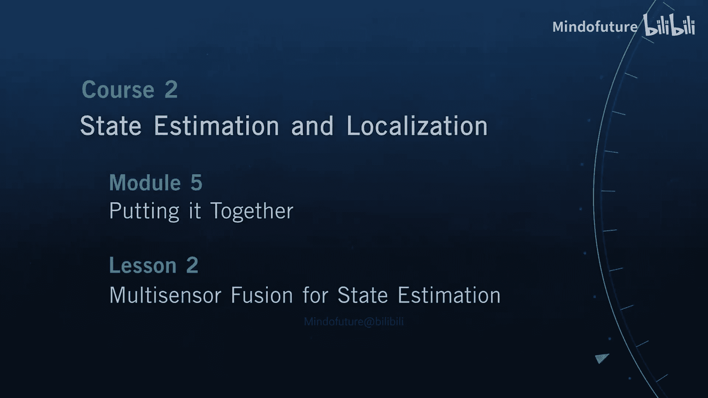
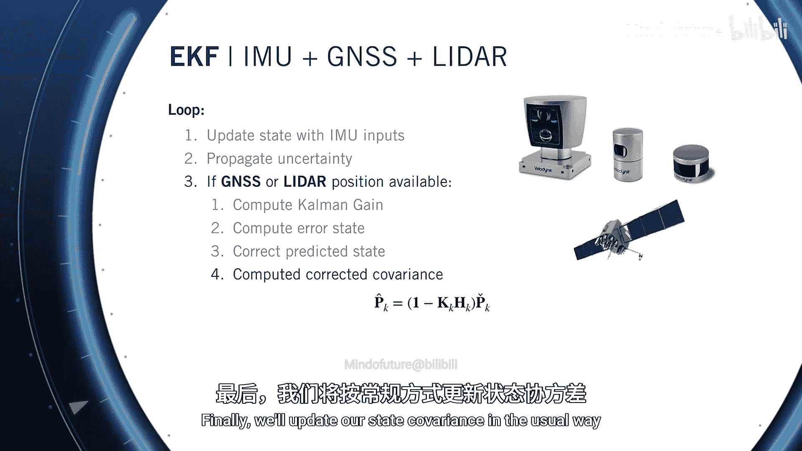
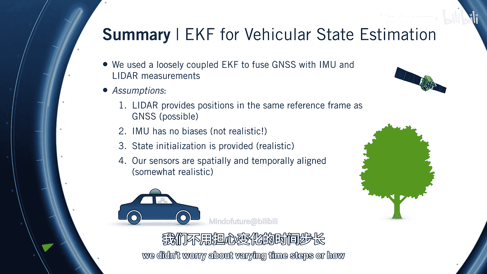

# 029：多传感器融合在状态估计中的应用

在本节课中，我们将学习如何将惯性测量单元、全球导航卫星系统接收器和激光雷达的数据融合在一起，构建一个用于自动驾驶汽车定位的扩展卡尔曼滤波器。我们将推导一个估计车辆位置、速度和姿态的滤波器，并了解其基本流程和关键假设。

## 传感器选择与融合策略

上一节我们介绍了定位所需的基本硬件和软件。本节中，我们来看看如何将所有组件整合在一起。

我们将推导一个扩展卡尔曼滤波器，用于使用IMU、GNSS接收器和激光雷达来估计自动驾驶汽车的位置、速度和姿态。

尽管我们会做一些简化，但流程的基本结构将类似于现代自动驾驶汽车中使用的方案。

在深入算法细节之前，有必要退一步思考：为什么使用这些传感器？能否采用更简单的方案？

我们选择使用IMU、GNSS接收器和激光雷达，原因如下。

首先，在为状态估计融合信息时，一个重要的考虑因素是不同传感器的误差是否相关。换句话说，如果一个传感器失效，另一个是否也可能因同样原因失效。在我们的案例中，这三种传感器使用不同的测量方法，不太可能因相同原因失效。

其次，我们应尽力选择本质上互补的传感器。在我们的案例中，IMU充当GNSS位置估计的高频平滑器，而GNSS数据可以减轻IMU漂移带来的误差。也可以使用轮速里程计达到此目的。本课程中，我们将坚持使用IMU，因为它能提供完整的三维位置和姿态信息，而轮速里程计仅限于二维。

最后，激光雷达可以通过在已知地图和天空无遮挡的位置提供非常精确的位置估计，来补充GNSS信息。反过来，GNSS可以告诉激光雷达在进行定位时使用哪张地图。

对于扩展卡尔曼滤波器状态估计，我们可以实现所谓的松耦合估计器或紧耦合估计器。

在紧耦合扩展卡尔曼滤波器中，我们使用来自GNSS和激光雷达的原始伪距和点云测量值作为观测值。

在松耦合系统中，我们假设这些数据已经过预处理，生成了一个带有噪声的位置估计。

尽管紧耦合方法可以实现更精确的定位，但实现起来通常很繁琐，并且需要大量调参。因此，我们将在此实现一个松耦合的扩展卡尔曼滤波器。

下图展示了我们系统的图形化表示。

我们将使用IMU测量值作为运动模型的噪声输入。这将给出我们的预测状态，每次有IMU测量值时都会更新，频率可达每秒数百次。

以慢得多的速率，每当GNSS和激光雷达测量值可用时（例如每秒一次或更慢），我们将整合它们，并用它们来修正我们的预测状态。

## 状态定义与运动模型

那么，我们的状态是什么？

我们将使用一个10维的状态向量，包括一个3D位置、一个3D速度，以及一个4D单位四元数，用于表示车辆相对于导航坐标系的姿态。

我们假设IMU在传感器坐标系中输出比力和旋转速率，并将它们组合成一个单一的输入向量 **u**。

需要指出的是，我们不会跟踪加速度计或陀螺仪的偏差。这些偏差通常被放入状态向量中进行估计，然后从IMU测量值中减去。为了清晰起见，我们在此忽略它们，并假设我们的IMU测量值是无偏的。

我们用于位置、速度和姿态的运动模型将积分来自IMU的比力和旋转速率。

位置更新如下所示：
`p_k+1 = p_k + v_k * Δt + 0.5 * (R_ns_k * (a_s_k - g_n) ) * Δt^2`

接下来是速度更新：
`v_k+1 = v_k + (R_ns_k * (a_s_k - g_n) ) * Δt`

最后是姿态或四元数更新：
`q_ns_k+1 = q_ns_k ⊗ q{(ω_s_k * Δt)}`

我们需要使用以下几个定义：
*   `p` 是位置。
*   `v` 是速度。
*   `q_ns` 是表示传感器坐标系 `s` 相对于导航坐标系 `n` 的姿态的四元数。
*   `R_ns` 是与四元数 `q_ns` 对应的旋转矩阵。
*   `a_s` 是传感器坐标系中的比力测量值。
*   `ω_s` 是传感器坐标系中的角速度测量值。
*   `g_n` 是导航坐标系中的重力矢量。
*   `Δt` 是时间步长。
*   `⊗` 表示四元数乘法。
*   `q{...}` 表示从角增量向量到四元数的转换。

请注意，增量姿态更新是通过四元数乘法应用的，其中姿态变化（即小角度 `ω` 乘以 `Δt` 的四元数形式）出现在右侧，因为姿态变化是在局部传感器坐标系中测量的。

由于我们表示为旋转矩阵的姿态参数，我们的运动模型是非线性的。为了在扩展卡尔曼滤波器中使用它，我们需要围绕预测状态对某个小误差或扰动进行线性化。

为此，我们将定义一个误差状态，由 `Δp`、`Δv` 和 `Δφ` 组成，其中 `Δφ` 是一个3x1的姿态误差向量。将姿态误差表示在全局或导航坐标系中，而不是局部坐标系中，有一些优势，因此我们将据此进行。这个选择将影响我们雅可比矩阵的推导以及误差状态更新的确切形式。

使用这个误差状态，我们可以推导出具有适当雅可比矩阵的误差动力学方程。

## 测量模型与滤波器流程

对于我们的测量模型，我们将使用一个非常简单的观测值：位置加上一些加性高斯噪声。

我们将为GNSS位置噪声定义一个协方差矩阵 `R_GNSS`，为激光雷达位置测量噪声定义一个协方差矩阵 `R_Lidar`。

这里需要指出，我们假设激光雷达和GNSS将在同一坐标系中提供位置测量值。在实际实现中，GNSS位置估计可能作为一种选择已知地图的方式，然后可以对照该地图比较激光雷达数据。

有了这些定义，我们现在可以描述我们的扩展卡尔曼滤波器。

我们的滤波器将在每次发生IMU测量时循环。

以下是滤波器的主要步骤：

1.  **状态预测**：首先，我们使用运动模型基于上一个状态预测一个新状态。上一个状态可能是完全修正后的状态，也可能是仅使用运动模型传播的状态，这取决于我们在上一个时间步是否收到了GNSS或激光雷达测量值。

2.  **协方差预测**：接下来，我们通过线性化的运动模型传播状态不确定性，同样需要考虑我们之前的状态是修正过的还是未修正的。

3.  **测量更新判断**：此时，如果我们没有任何GNSS或激光雷达测量值可用，我们可以重复步骤1和2。如果我们有，则继续。

4.  **计算卡尔曼增益**：我们将首先计算适用于给定观测值的卡尔曼增益。

5.  **计算误差状态**：然后，我们计算一个误差状态，用于修正我们的预测状态。这个误差状态基于卡尔曼增益与预测位置和观测位置之差的乘积。

6.  **状态修正**：然后，我们使用误差状态来修正预测状态。对于位置和速度，这种修正是直接的，但修正四元数需要一些更复杂的代数运算。我们需要这种特殊的更新，因为四元数是一个受约束的量，不是一个简单的向量。我们选择使用全局姿态误差，这意味着姿态更新涉及在左侧乘以误差状态四元数。这与传播步骤不同，在传播步骤中，我们在右侧乘以定义姿态变化的增量四元数。在完成本课程的最终项目时，应特别注意这一点。

7.  **协方差更新**：最后，我们以通常的方式更新状态协方差。

至此，您就拥有了自己的定位流程。

## 总结与假设回顾

如果您跟上了到目前为止的所有内容，那么恭喜您。您正走在成为定位专家的道路上。

在本节课结束前，让我们回顾一下在构建流程时所做的几个假设。

我们使用了一个松耦合的扩展卡尔曼滤波器框架，将来自IMU的惯性测量与来自GNSS接收器和激光雷达的位置测量融合在一起。

我们假设GNSS和激光雷达在同一坐标系中为我们提供位置估计，这需要一些预处理，但在实际实现中是可行的。

其次，我们没有考虑IMU测量中的加速度计或陀螺仪偏差。这简化了我们的代数运算，但不是一个现实的假设。幸运的是，如果您遵循我们在此所做的，添加偏差并不是一个巨大的跨越。

接下来，我们没有讨论滤波器状态初始化。这通常被认为是定位过程开始时某个已知的状态。

最后，我们还假设我们的传感器在空间和时间上都是对齐的。我们假设传感器已经过校准，即我们不担心变化的时间步长，或者如何将多个传感器测量值全部对齐到一个坐标系中。

执行后一步是构建精确定位流程非常重要的一部分。我们将在下一节讨论它。

本节课中，我们一起学习了如何构建一个用于自动驾驶汽车定位的松耦合多传感器融合扩展卡尔曼滤波器。我们定义了系统的状态和运动模型，介绍了测量模型，并概述了滤波器的完整预测与更新流程。同时，我们也明确了当前方案所做的关键简化假设，为后续深入实际实现细节奠定了基础。