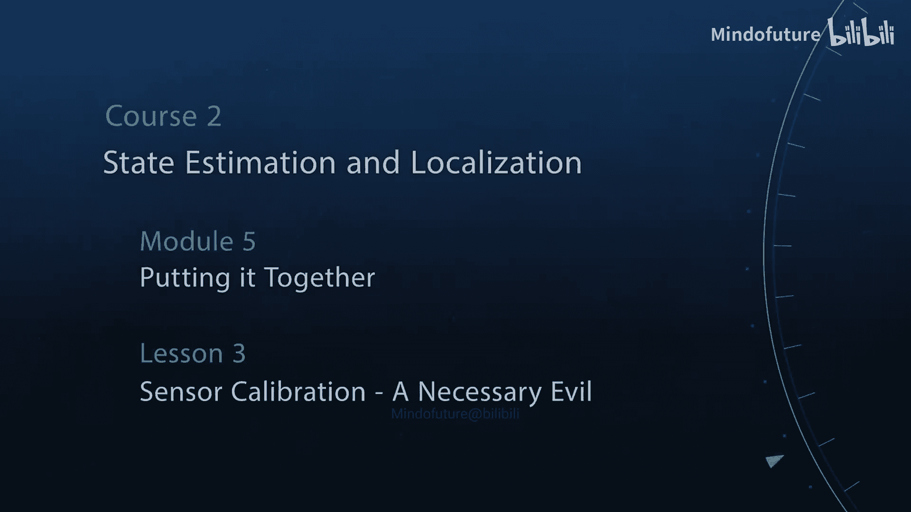
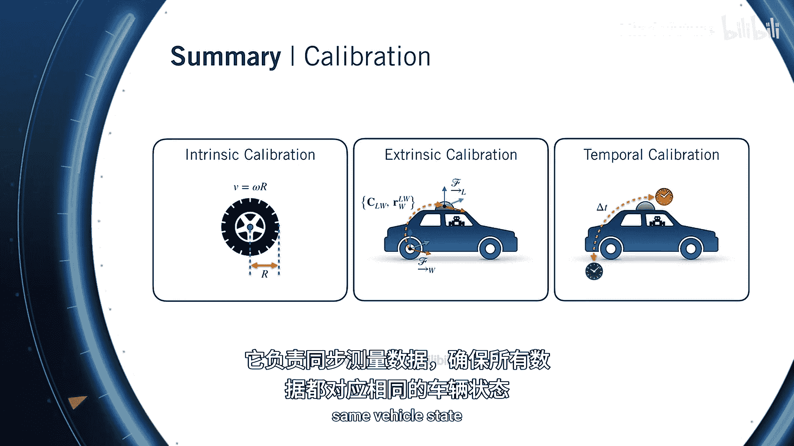

# 030：必要之恶

在本节课中，我们将要学习传感器标定。这是设计自动驾驶汽车状态估计器时必须考虑的关键环节。我们将探讨三种主要的标定类型：内参标定、外参标定和时间标定，并解释它们为何如此重要。

上一节我们介绍了如何融合多个传感器数据来估计车辆状态。本节中，我们来看看一个之前被暂时搁置的话题：传感器标定。这是工程师们不太喜欢谈论但绝对至关重要的工作。标定对于正确进行状态估计是必不可少的。

我们将讨论三种主要的传感器标定类型，以及为什么在设计自动驾驶汽车的状态估计器时必须考虑它们。

这三种主要标定类型是：
*   **内参标定**：处理传感器特定的参数。
*   **外参标定**：处理传感器在车辆上的位置和朝向。
*   **时间标定**：处理不同传感器测量之间的时间偏移。

## 内参标定

首先，让我们看看内参标定。在内参标定中，我们需要确定传感器模型的固定参数，以便在扩展卡尔曼滤波器等估计器中使用它们。

每个传感器都有与其相关的参数，这些参数对于该特定传感器是唯一的，并且通常被认为是恒定的。

以下是内参标定的两个例子：
1.  **车轮编码器**：假设我们有一个安装在汽车车轴上的编码器，用于测量车轮转速 `omega`。如果我们想用 `omega` 来估计车轮的前进速度 `V`，就需要知道车轮的半径 `R`，以便使用公式 **`V = omega * R`**。这里的 `R` 就是传感器模型的一个参数，它特定于编码器所连接的那个车轮。
2.  **激光雷达**：另一个例子是像 Velodyne 这样的激光雷达传感器中扫描线的仰角。仰角是一个固定值，但我们需要提前知道它，以便正确解释每次扫描。

那么，如何确定这些内参呢？以下是几种实用的策略。

以下是几种确定内参的实用策略：
*   **制造商标定**：最简单的方法是让制造商为你完成。传感器通常在工厂进行标定，并附带规格表，上面列出了所有需要填入模型以理解测量值的数字。这通常是一个好的起点，但可能不足以进行非常精确的状态估计，因为没有两个传感器是完全相同的，参数的真实值总会存在一些差异。
*   **手动测量**：另一种需要稍多工作量的简单策略是尝试手动测量这些参数。这对于轮胎之类的东西来说很简单，但对于激光雷达来说就不那么直接了，因为用角度尺在传感器内部测量并不实际。
*   **状态估计**：一种更复杂的方法是将内参作为车辆状态的一部分进行估计，可以在线进行，或者更常见的是在传感器投入运行前作为一个特殊的标定步骤。这种方法的优点是能产生针对特定传感器的精确标定，并且可以处理参数随时间缓慢变化的情况。例如，如果你持续估计轮胎半径，这可能是检测轮胎漏气的好方法。

现在，因为本课程中讨论的估计器是通用的，我们已经具备了进行这种自动标定的工具。为了了解其工作原理，让我们回到汽车在一维空间中运动的例子。

假设我们在后轮上安装了一个编码器来测量车轮转速。如果我们想同时估计车轮半径、位置和速度，我们只需要将其添加到状态向量中，并推导出新的运动和观测模型应该是什么。

*   对于运动模型，除了在矩阵中增加一行一列以表明车轮半径在时间步之间应保持不变外，其他都与之前相同。
*   对于观测模型，我们仍然通过 GPS 直接观测位置，但现在我们也通过编码器观测车轮转速。因此，我们在模型中包含了这个额外的非线性观测。

从这里，我们可以使用扩展或无迹卡尔曼滤波器来估计车轮半径，以及车辆的位置和速度。

## 外参标定

因此，内参标定对于即使使用单个传感器进行状态估计也是必不可少的。但是，外参标定对于融合来自多个传感器的信息同样重要。

在外参标定中，我们感兴趣的是确定所有传感器的相对位姿，通常是相对于车辆坐标系。例如，我们需要知道 IMU 和激光雷达的相对位姿，以便 IMU 报告的角速度与激光雷达点云在同一坐标系中表达。

就像内参标定一样，有不同的技术来进行外参标定。

以下是几种外参标定的方法：
*   **CAD 模型**：如果你幸运的话，可能会有一个精确的车辆 CAD 模型，其中所有传感器坐标系都已为你妥善布置好。
*   **手动测量**：如果你不那么幸运，可能会尝试手动测量。不幸的是，这通常很难或不可能精确完成，因为许多传感器的坐标系原点位于传感器内部，而你很可能不想拆解你的汽车和所有传感器。
*   **状态估计**：幸运的是，我们可以使用类似的技巧，通过将外参包含在我们的状态中来估计它们。这对于任意的传感器配置可能会变得有点复杂，目前仍有大量研究致力于寻找可靠完成此任务的不同技术。

## 时间标定

最后，一种经常被忽视但仍然重要的标定类型是时间标定。在我们所有关于多传感器融合的讨论中，我们一直隐含地假设我们组合的所有测量都是在完全相同的时刻捕获的，或者至少对于给定的精度水平足够接近。

但是，我们如何决定两个测量是否足够接近以被认为是同步的呢？显然的做法是在车载计算机接收到每个测量时为其打上时间戳，然后将时间最接近的测量匹配起来。例如，如果我们以 15 Hz 的频率获取激光雷达扫描，以 200 Hz 的频率获取 IMU 读数，我们可能希望将每个激光雷达扫描与时间戳最匹配的 IMU 读数配对。

但实际上，在激光雷达或 IMU 实际记录观测值到它到达计算机之间，存在一个未知的延迟。这些延迟可能是由传感器数据传输到主机计算机所需的时间，或由传感器电路执行的预处理步骤引起的，并且不同传感器的延迟可能不同。

因此，如果我们想获得非常精确的状态估计，就需要考虑我们的传感器实际上同步得有多好。有不同的方法来解决这个问题。

以下是处理时间同步的几种方法：
*   **假设零延迟**：最简单和最常见的做法是假设延迟为 0。通过这种方式，你仍然可以获得一个可用的估计器，但结果可能不如通过更好的时间标定得到的结果准确。
*   **硬件同步**：另一种常见策略是使用硬件定时信号来同步传感器。但这通常只适用于更昂贵的传感器设置。
*   **状态估计**：正如你可能猜到的，也可以尝试将这些时间延迟作为车辆状态的一部分进行估计，但这可能会变得复杂。事实上，我博士论文的整个一章都致力于解决相机-IMU 对的时间标定问题。

## 标定的重要性

我们已经看到了在设计自动驾驶汽车估计器时应考虑的不同类型的标定。但在实践中，良好的标定究竟能带来多大的不同呢？

这里有一个视频，比较了在激光雷达建图任务中良好标定和不良标定的结果。你会注意到，在标定情况下，点云比未标定情况下的点云清晰得多。在未标定情况下，点云是模糊的、有拖影的，你可能会看到物体被重复或实际上完全被遗漏，因为激光雷达没有与惯性传感器正确对齐。

## 总结

本节课中我们一起学习了传感器标定。没有标定，传感器融合就无法实现。在本视频中，你学习了：
*   **内参标定**：处理传感器模型参数的标定。
*   **外参标定**：为我们提供将传感器测量值转换到公共参考系所需的坐标变换。
*   **时间标定**：处理测量同步，以确保它们都对应于相同的车辆状态。

虽然解决所有这些问题有一些标准技术，但标定仍然是一个非常活跃的研究领域。在下一个视频中，我们将看看当一个或多个传感器发生故障时会发生什么，以及我们如何确保自动驾驶汽车在这些情况下能够继续安全运行。

