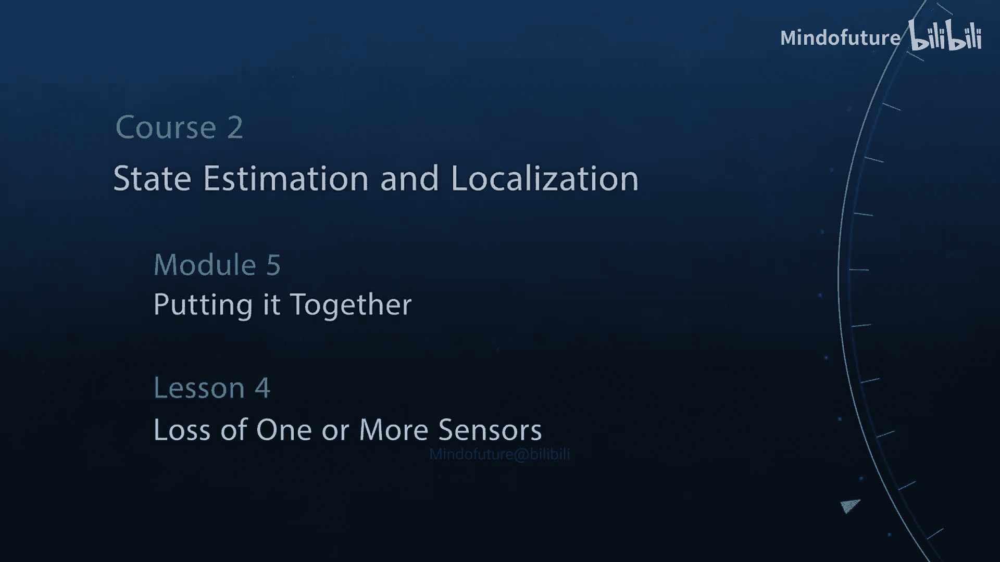
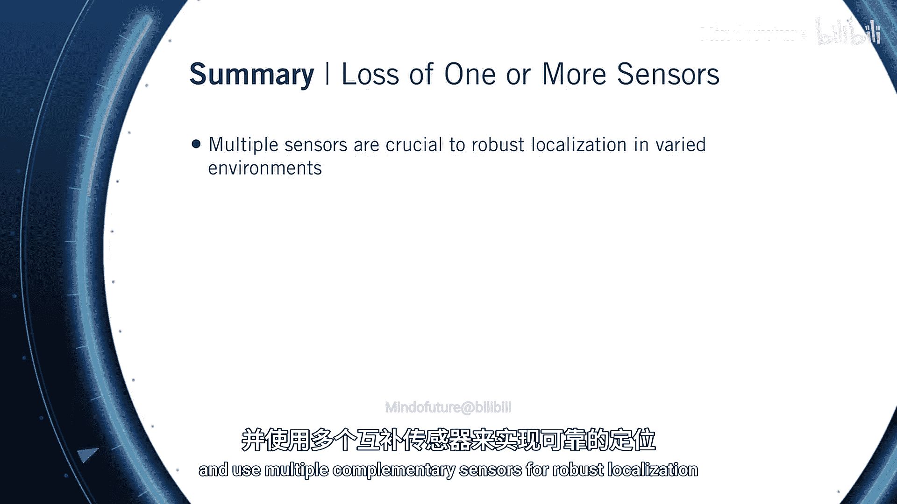
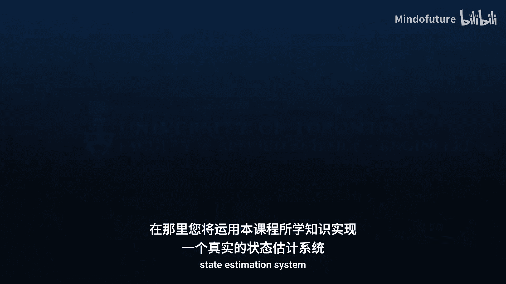

# 031：单传感器或多传感器失效应对

在本节课中，我们将要学习传感器冗余的重要性，并探讨当自动驾驶汽车的一个或多个传感器发生故障时，系统应如何应对以确保安全。

## 概述

任何硬件设备都可能出现故障，传感器也不例外。在自动驾驶汽车这类长期自主运行的系统中，传感器可能因天气损坏、固件故障或线路松动等多种原因而失灵。我们已经了解到，即使所有传感器都正常工作，使用多个互补的传感器也能提供更鲁棒、更精确的定位估计。那么，当一个传感器失效时会发生什么？本节将讨论传感器冗余对鲁棒定位的重要性，并分析几个定位中传感失效的例子。

## 传感器故障与安全考量

上一节我们介绍了多传感器融合的优势，本节中我们来看看当传感器失效时面临的挑战。构建安全的车辆，关键在于理解并描述当一个或多个传感器发生故障时的情况，以及维持安全运行所需的最少传感配置。

进行此类分析时，一个重要的考量因素是传感器的量程和工作限制。
*   GNSS接收器在桥下无法工作，在高楼之间精度也可能下降。
*   IMU可能对温度敏感，需要定期重新校准。
*   更重要的是，对于LiDAR、声纳、摄像头或雷达这类感知外部世界的传感器，它们的感知范围在安全运行中扮演着至关重要的角色。

## 感知范围与故障应对

大多数汽车都配备了长、中、短不同范围的传感器。如果其中之一发生故障，通常需要限制车辆运动，以免影响安全。

以下是不同范围传感器的典型作用：
*   在定位中，我们可能使用**短程传感器**进行泊车，并确保不与附近车辆发生碰撞。
*   **中程传感器**可能有助于检测行人和骑行者，并保持车道。
*   **长程传感器**可以帮助我们检测并预测远处障碍物的运动。

如果其中任何一个失效，我们必须采取适当的措施，以确保车内乘员或周围人员的安全不受影响。这意味着自动驾驶汽车工程师必须考虑执行上述每一步所需的最少允许传感设备。

## 冗余系统设计范例

对于这类冗余系统设计，我们可以参考一个以严格安全标准著称的行业范例：商业航空。

作为一个冗余系统的例子，可以考虑波音777的主飞行计算机。777遵循三重冗余原则运行。所有主要系统，包括飞行计算机，都有两个备份，每个备份拥有独立的电源、不同的编程和规格。在这里可以看到，每台飞行计算机都使用不同的处理器，以确保架构本身的缺陷不会同时影响所有三台计算机。如果一台计算机失效或发生故障，777会使用共识算法无缝切换到另一台。

## 缺乏冗余的后果案例

尽管自动驾驶技术已经取得了长足进步，但我们距离2007年DARPA城市挑战赛等早期自动驾驶赛事也才过去十多年。这里可以看到，安全冗余的缺乏导致了MIT和康奈尔大学的车队相互碰撞。如果这次碰撞发生在更高的速度下，结果可能会严重得多。

再看一个更近的例子，这是2015年国际无人驾驶车辆会议上的一辆车，由于未能正确启动自动刹车，撞上了一个充气袋鼠。

最后，考虑这段如今广为人知的记录：一辆特斯拉Model S在加州高速公路上几乎笔直地撞上了分道护栏。这是一个发人深省的提醒，对于设计自动驾驶汽车的工程师和架构师来说，仔细考虑并描述所使用的不同传感模式的各种故障模式至关重要，以确保一个故障组件不会导致悲剧。

## 总结

本节课中我们一起学习了传感器冗余在自动驾驶定位中的核心作用。始终考虑任何传感器组的局限性，并使用多个互补的传感器来实现鲁棒的定位，这一点至关重要。

---

本模块内容到此结束。接下来，你将开始课程项目，在那里你将运用在本课程中学到的一切知识，实现一个真实的状态估计系统。