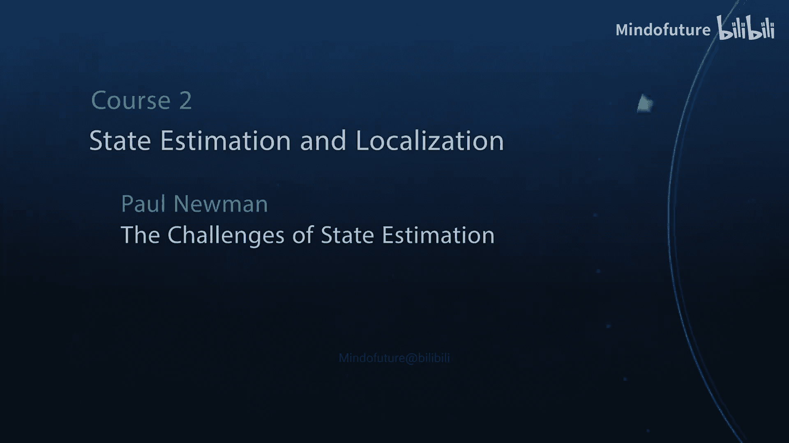
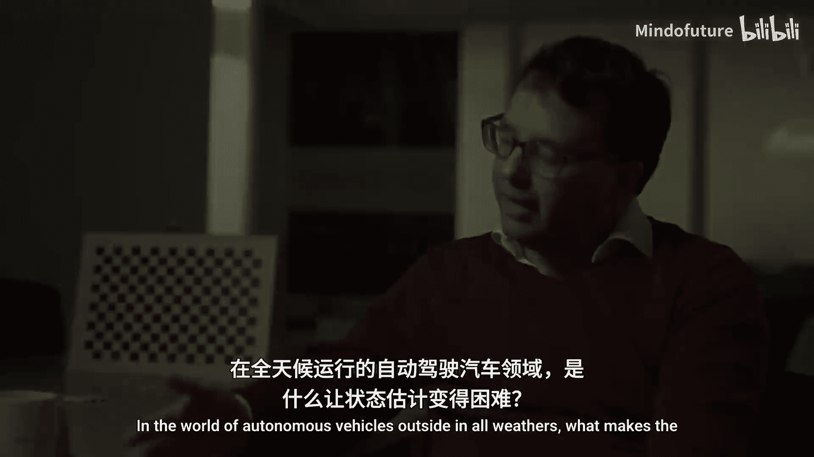

# 032：状态估计面临的挑战

## 概述
在本节课中，我们将要学习自动驾驶汽车状态估计所面临的核心挑战。我们将探讨为什么状态估计是一个困难的问题，并深入分析数据关联、传感器局限性和复杂环境条件如何共同构成了这些挑战。

## 状态估计为何困难？
上一节我们介绍了状态估计的重要性。本节中我们来看看为什么它不是一个简单的问题。

状态估计之所以困难，主要是因为我们需要处理的传感器数据本身就很复杂。系统需要回答“我在哪里”、“我如何移动”、“前方物体的运动趋势是什么”等问题，而处理这些问题的原始数据往往质量不佳。

数据可能难以解读且令人困惑。环境中存在阴影，可能有物体被风吹过街道。车辆自身在移动时可能也不清楚自己的精确位置，但同时却需要追踪和识别前方移动的个体。激光雷达数据可能很稀疏，阳光可能过强导致图像部分曝光不当，或者镜头上可能有雨水。这些情况都使得数据处理变得异常困难。

有时人们会说这是“噪声数据”。虽然传感器数据中确实存在噪声，但更常见的情况是数据本身就非常复杂。例如，处理雷达数据时，人们常说雷达噪声很大。实际上，并非噪声大，而是因为电磁波会从所有物体上反射回来，最终被接收器捕获，这个过程本身就极其复杂。相比之下，处理GPS数据可能显得简单一些，因为它几乎直接提供了位置信息，尽管也存在建筑物反射造成的信号杂乱问题。但处理雷达或激光雷达数据则要复杂得多。

因此，状态估计困难的一个常见原因就是处理复杂信号。其中，有一个特定问题尤其棘手，那就是**数据关联**。

## 数据关联的挑战
数据关联是指将你在数据中看到的某些元素和属性，与世界中的实体对应起来。

一个例子是：我想估计一群人的状态，并且我获得了许多速度测量值。那么，哪个测量值属于世界中的哪个实体？这是一个难题。或者，我有一个扫描的激光雷达，它看到了许多点，可能是角点。想象你在做一件简单的事：追踪激光数据中的角点。

当人或车辆移动时，我如何将扫描激光雷达返回的数据子集与一辆车关联起来？一开始没人告诉我那里有多少辆车。可能有一些车，或者那可能根本就是一个建筑的角落，一开始就没动过，但起初它看起来像一辆公交车。

所以，反复困扰我的就是这个状态关联问题。很多时候，如果我能知道自己的状态，即我知道自己在哪里以及周围有什么，那么数据关联问题就会变得微不足道。

但问题是，你必须解决数据关联问题才能解决状态估计问题，这就形成了一种可怕的递归循环。这既有趣又困难，并且在自动驾驶领域，几乎每天都会以不同的形式出现。

## 复杂环境条件的影响
在自动驾驶汽车所处的全天候户外世界中，是什么让状态估计变得困难？那就是当输入流（相机图像或激光雷达数据流）受到极具挑战性的条件影响时。

例如，使用相机时遇到暴雨和低角度的阳光。在英国，冬天太阳似乎总是紧贴地平线，大多数时候这都非常困难，因为所有东西都变得非常闪亮，世界的外观发生了变化。或者，你可能处于交通极其拥堵的情况下，使用激光雷达时，两辆巨型卡车停在你旁边，你基本上什么都看不见了，因为世界突然变成了卡车的墙壁。

当你要观察的目标和世界被遮挡，或者它们的外观发生变化时，这会令人困惑。或者当它们非常缓慢地经过你，而你实际上是静止的，并且此时你可能没有里程计信号。这再次回到了数据关联问题。

当数据关联问题变得困难，难以将你所看到的与你希望推断的信息联系起来时，状态估计就变得困难了。事实上，你可以将状态估计问题理解为：我能否写下一个方程，用我希望理解的状态估计来解释我所看到的现象？即，我能否用我的状态来解释一个测量值？我们有一些工具可以反推这个关系。

但是，如果你无法写出那种解释，例如，你无法用你的角加速度来解释为什么整个画面变白并且上面有雨滴，那么这就变得相当困难了。因此，总是输入信号的复杂性造成了这种困惑，否则我们只需运行一个标准的优化算法就能轻松完成任务了。

## 当前传感器的局限性
目前我们使用的传感器，没有一个是足够好的，无法完全满足我们的需求。

以相机为例。与我们的眼睛相比，它们在所能看到的动态范围方面差距很大。例如，当我从停车场驶出时，我的眼睛可以同时看清黑暗处的细节和即将驶入的明亮道路的细节。我们需要在这些相机技术上取得进步。目前有很多相关工作在进行，比如事件相机、高动态范围相机。我希望相机能变得可编程，这方面还有很多工作要做。

激光雷达也需要变得更好。它们仍然是基于飞行时间原理。我们发射出去的光子数量还远远不够，而且探测距离也不够远，所以这还不够好。

雷达则像是第零代产品，远未达到未来应有的水平。

但这里有一个非常棒的事实：就像计算机一样，所有这些技术都注定会变得更好。

## 技术与生态系统的共同演进
我们将用现有的传感器、现有的车辆、现有的软件、现有的算法、现有的数据以及当前已知的机器学习技术，来制造第一代自动驾驶汽车。

所有这些技术在三年后会变得更好，六年后会更好。就像计算机的发展一样：我们有更好的RAM、更好的硬盘、更好的处理器、更好的屏幕、更好的互联网、更好的网络。它们共同演进。正因为如此，我们现在才有了更好的软件。

所以，这是一个由硬件、软件和应用共同推进的类似生态系统。

## 总结
本节课中，我们一起学习了自动驾驶汽车状态估计面临的主要挑战。我们了解到，状态估计的困难主要源于**处理复杂的传感器数据**，尤其是**数据关联问题**——即如何将观测数据与真实世界中的实体正确匹配。此外，**恶劣的环境条件**（如暴雨、低角度阳光、遮挡物）会进一步加剧数据关联的难度。最后，我们认识到，尽管当前的各种传感器（相机、激光雷达、雷达）都远未达到理想状态，但整个技术生态系统会像计算机硬件和软件一样，随着时间的推移而共同演进和进步。理解这些挑战是设计更鲁棒的状态估计算法的第一步。