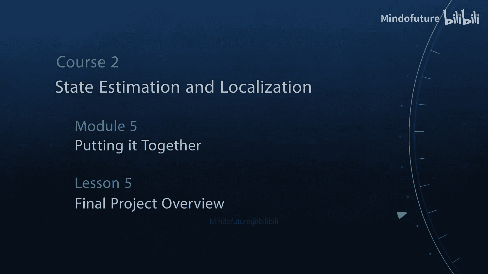

# 033：最终课程项目概述

在本节课中，我们将要学习本课程的最终项目概述。你已经学习了最小二乘法、线性和非线性卡尔曼滤波、用于位姿估计的GPS/INS传感以及激光雷达。现在是将所有知识整合起来，完成本课程最终项目的时候了。至此，你应该对车辆状态估计的常用方法有了扎实的理解，并准备好在一个更现实的场景中测试你的知识。

## 🎯 项目目标与背景

上一节我们介绍了课程的知识体系，本节中我们来看看如何将它们应用于实践。对于这个项目，你将有机会应用在整个课程中学到的大部分知识，并观察一个完整状态估计流程中各个组件的内部工作原理和相互作用。

项目将提供在CARLA模拟器中测试驾驶期间收集的数据集。该数据集包含一辆移动的自动驾驶汽车上传感器阵列的测量值。

以下是传感器阵列的组成：
*   **IMU**：惯性测量单元。
*   **GNSS接收机**：全球导航卫星系统接收机。
*   **LiDAR**：激光雷达。

这些传感器以不同的速率提供可靠性各异的测量值。在驾驶过程中，车辆会受到环境、传动系统和悬架引起的各种动态效应的影响。这些效应难以精确建模。因此，在自动驾驶场景中，车辆控制器将依赖于传感器获取的测量值。

你的目标是实现一个状态估计器，融合可用的传感器测量值，以提供对车辆位姿和速度的合理估计。

## 🔧 项目任务：实现误差状态扩展卡尔曼滤波

具体而言，你将实现**误差状态扩展卡尔曼滤波**，正如在第2模块中所描述的，因为它具有高度的鲁棒性，并且是状态估计中的主流方法。

我们将为你提供估计器流程的框架，你需要用自己的实现来填充其中的每个独立步骤。

以下是主滤波器循环中的关键步骤：
1.  **预测步骤**：首先使用IMU读数更新状态和不确定性。
2.  **更新步骤**：每当GNSS或LiDAR测量值可用时，执行相应的卡尔曼增益计算、状态和协方差更新。

你将能够访问轨迹大部分部分的真实位姿和速度值，因此可以将你的轨迹估计与真实数据进行比较。

项目的评分将基于你对**无法访问真实数据**的那部分轨迹的估计精度。

## 📝 总结与下一步

通过完成这个项目，你应该对构成自动驾驶汽车标准状态估计流程的主要组件有很好的理解。

如果你对本视频未解答的问题有疑问，编程作业本身包含进一步的说明，你也可以随时在讨论区寻求更多信息。

祝你最终项目进展顺利，完成后我们再见。祝你好运。

