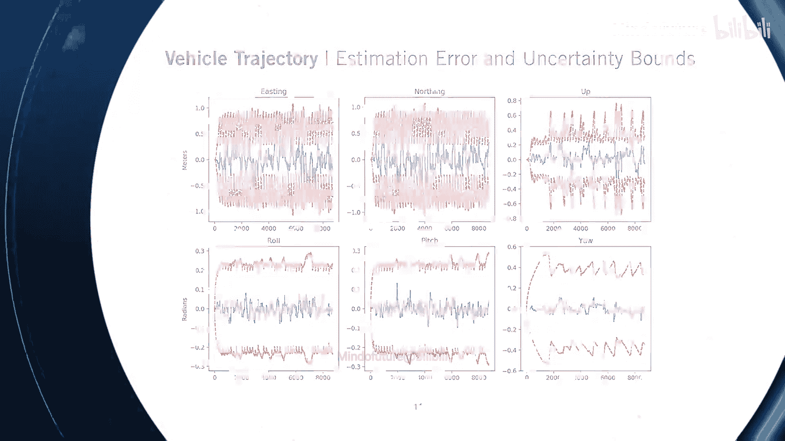

# 034：最终项目解决方案

在本节中，我们将回顾最终项目的解决方案。我们将一起分析误差状态扩展卡尔曼滤波器的实现结构，并逐步解读关键代码片段，了解如何融合IMU、GNSS和激光雷达数据来估计车辆的轨迹。

## 概述

首先，祝贺你完成了最终项目的提交。你使用无车模拟器的测量数据，成功生成了对车辆轨迹的估计。现在，你将有机会将自己的实现与我们的项目解决方案进行比较。

让我们先回顾一下误差状态扩展卡尔曼滤波估计器的一般结构。

## 滤波器结构回顾 🧠

IMU测量值用于以高更新率驱动运动模型向前推进，产生预测的状态估计。每当来自GNSS接收器或激光雷达单元的位置测量值到达时，我们通过执行卡尔曼滤波器的更新步骤来融合该测量值，从而得到修正后的状态估计。只要车辆在行驶，这个“预测-修正”循环就会持续进行。

## 状态与协方差初始化 📍

现在，让我们从检查解决方案代码的部分开始，首先是分配状态向量空间的代码行。状态向量包含了每个时间步长下车辆的位置、速度和姿态。

请注意，我们还为每个时间步长分配了一个9x9的协方差（或不确定性）矩阵空间。

我们的运动模型的输入将是来自IMU的比力和角旋转速率测量值。

在本视频和幻灯片中，我们将用浅灰色背景高亮显示代码块。

以下幻灯片上的代码是已经为你提供的。

我们将车辆的初始位姿（即位置和姿态）设置为等于轨迹开始时的真实位姿。

在这里，我们还将初始位姿协方差设置为0，因为真实位姿是精确的。

在提供给你的代码中，我们使用非零协方差初始化了状态。这主要是为了说明相对精确的GNSS和激光雷达测量值如何能快速降低位姿的不确定性。

## 主循环与运动模型预测 🔄

现在，让我们看看误差状态扩展卡尔曼滤波器的主循环。作为循环的一部分，我们遍历每个IMU测量值，将状态估计在时间上向前传播。

我们的解决方案使用了在模块5第2课中定义的非线性运动模型。该模型以IMU的比力和角旋转速率测量值为输入，输出一个更新的状态估计，即车辆的位姿和速度。请注意，我们利用上一个时间步长的位姿和速度估计来预测当前状态。随着时间的推移，这种航位推算方法会累积误差。

幻灯片上显示的运动模型方程可以直接且相当容易地翻译成Python代码。

我们假设车辆在短时间间隔 `ΔT` 内经历恒定的线性加速度和恒定的角旋转速率。

我们的解决方案代码与幻灯片上显示的方程有一个不同之处。

我们没有从增量旋转四元数（定义了车辆在时间间隔 `ΔT` 内的旋转）计算4x4矩阵 `Ω`，而是选择使用四元数乘法。四元数类已经支持四元数乘法，并且实际上在内部计算这个4x4矩阵。这段代码是提供给你的。

## 误差状态与线性化动力学 📐

我们已经将标称状态（即我们的预测）在时间上向前传播。然而，标称状态忽略了噪声和扰动。

误差状态扩展卡尔曼滤波器算法在误差状态向量中捕获了这些偏差，该向量包含了一个最小的三参数姿态误差。

我们的下一步是考虑系统的线性化动力学。

公式和相关矩阵显示在此幻灯片上。

推导这些雅可比矩阵相当复杂，因此我们将在这里使用它们而不进行完整的推导。矩阵 `L` 实际上是常数，因此我们可以预先分配它。

作为一个重要的注意事项，雅可比矩阵 `F` 具有其特定形式，是因为我们选择使用全局姿态误差表示，而不是局部姿态误差。对此推导细节感兴趣的学习者可以通过阅读Sola的广泛技术报告了解更多信息，链接在模块的资源部分提供。

## 协方差传播与测量更新 🧮

接下来，我们将状态不确定性在时间上向前传播。

我们将使用之前计算的雅可比矩阵 `F_{k-1}`。如前所述，矩阵 `L` 是常数，可以预先计算。协方差计算的结果是时间步长 `k` 处更新后的协方差矩阵。

请注意，在来自GNSS接收器或激光雷达传感器的测量值到达之前，我们可能会多次执行此传播步骤。

在滤波器内完成预测步骤后，我们检查是否有GNSS接收器或激光雷达测量值可用。

如果来自任一传感器的测量值已到达，我们则执行相应的测量更新，即修正步骤。请记住，IMU的更新速率远快于GNSS单元或激光雷达扫描仪，因此我们可能在两次测量更新之间执行多次预测步骤。

为了方便起见，我们定义了一个新函数来执行测量更新。

该函数接受当前状态和当前状态协方差。在我们的案例中，GNSS接收器和激光雷达传感器都直接提供位置更新，因此测量雅可比矩阵 `H` 是常数，可以预先计算。

GNSS更新和激光雷达更新之间的唯一区别是测量噪声的方差，如幻灯片所示。

为了执行测量更新或修正，我们首先计算当前时间步长和该测量值的卡尔曼增益矩阵 `K_k`。

卡尔曼增益的方程可以很容易地翻译成Python代码。

我们使用卡尔曼增益矩阵来计算误差状态，考虑我们的预测车辆位置 `p̂_k` 与测量位置 `y_k` 之间的新息或差值。

然后，误差状态向量用于更新标称状态向量。

对于位置和速度状态，更新涉及简单的加法。然而，对于姿态更新，我们需要使用四元数乘法。另外，请注意，我们选择在全局坐标系中表示我们的姿态误差，因此四元数乘法是在左侧使用误差状态四元数进行的。

最后，我们计算修正后的标称状态协方差矩阵 `P̂_k`。

修正后的状态和状态协方差由函数返回。

## 结果评估与总结 📊

基本上就是这样。我们已经完成了用于车辆导航的完整误差状态扩展卡尔曼滤波器的实现。

尽管我们使用的传感器模型在某种程度上是简化的，但你构建的滤波器本质上与在真实自动驾驶汽车上运行的滤波器相同。

然后，可以将得到的轨迹估计值与真实值进行比较。

观察真实值和我们的估计值，我们看到车辆沿着一条有几个转弯的弯曲路径行驶。我们只绘制了预先提供给你的那部分轨迹的真实值。用于测试你代码的剩余轨迹被保留下来用于验证。然而，你可以通过检查估计器输出来查看完整轨迹的样子，结果确实相当准确。

现在，让我们看看我们的估计器相对于真实值的误差。

在这些图表上，红色虚线代表根据我们的估计器得出的三个标准差范围。这说明了我们的模型与车辆实际动力学的拟合程度，以及估计器的整体性能。估计误差应始终保持在三个西格玛界限内，正如这里所示。

这是最终项目第一部分的解决方案。在第2和第3部分中，你研究了传感器标定错误和传感器失效的影响。然而，你编写的滤波器代码在这些情况下不应改变。你应该只需要对某些参数进行一些小的调整。

## 扩展思考 💡

你本可以实现其他估计器来解决这个问题，例如普通的扩展卡尔曼滤波器或无迹卡尔曼滤波器。欢迎将这些实现与误差状态扩展卡尔曼滤波器进行比较，并告诉我们它们的表现如何。

再次祝贺你完成了课程2的最终项目。

状态估计是任何自动驾驶汽车软件栈的重要组成部分。除了GNSS和激光雷达测量值，自动驾驶汽车通常还使用许多其他传感器和信息源来产生可靠的估计。在专业课程的下一门课中，你将学习一个非常重要的传感器——摄像头，以及如何将其用于视觉感知。

继续努力。