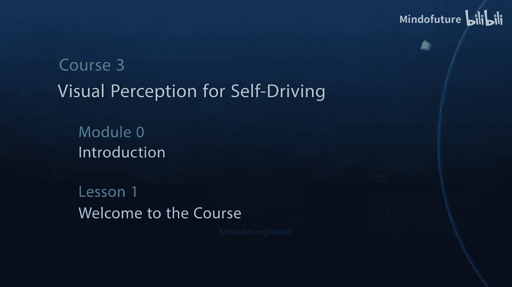
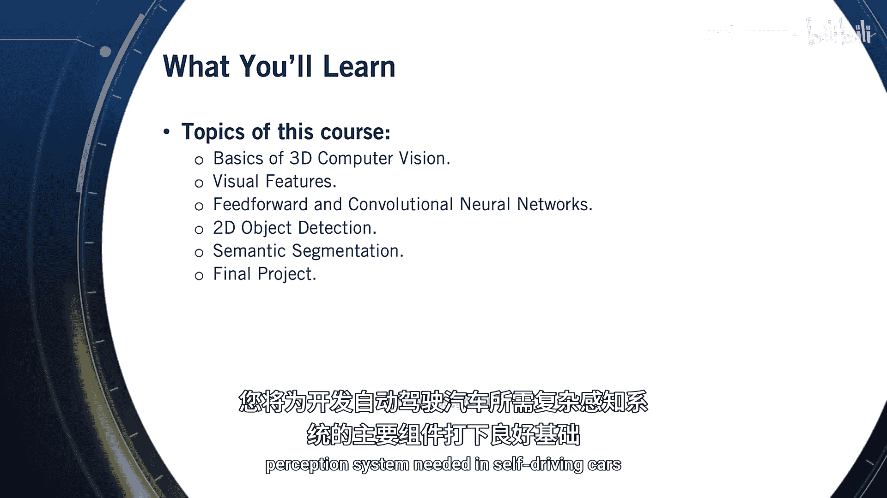
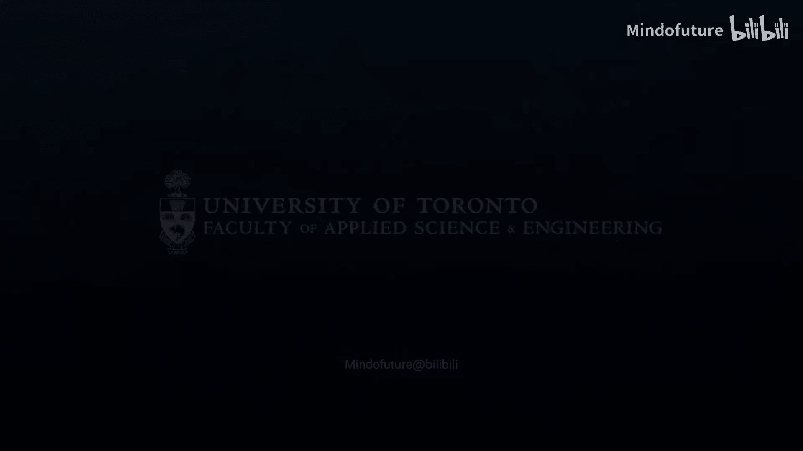

自动驾驶汽车视觉感知：P02：课程概述与大纲

在本节课中，我们将概述多伦多大学自动驾驶汽车专项课程中的视觉感知课程。我们将介绍课程目标、核心内容以及每周的学习计划。

欢迎来到多伦多大学自动驾驶汽车专项课程的视觉感知课程。我是Steve，将再次担任本课程的讲师。至此，您应该已经完成了自动驾驶汽车专项课程的前两门课程。在前两门课程中，您学习了如何使用包括GPS、IMU和激光雷达在内的多种传感器来构建模型、控制并定位自动驾驶汽车。

本课程将聚焦于自动驾驶汽车中最通用的传感器之一：摄像头。😊

摄像头充当自动驾驶汽车的“眼睛”。汽车使用摄像头来检测道路上的其他交通参与者，对其运动和行为进行建模。来自摄像头的图像也可用于检测和定位道路标记、信号和标志，以实现安全且合法的驾驶行为。我们还可以像使用激光雷达传感器一样，利用摄像头进行定位。

在本课程结束时，您将能够使用并校准这些摄像头，为自动驾驶汽车构建基础的感知系统。

现在，让我们浏览课程大纲，了解每周的学习内容。😊

以下是本课程各模块的详细内容：

**第一周：3D计算机视觉基础**
本模块将介绍3D计算机视觉的基础知识。您将学习图像是如何形成的、相机投影几何、如何校准相机，以及如何通过立体视觉从相机生成3D点云。最后，您将学习如何使用常见的图像滤波器处理图像。

**第二周：手工特征提取与视觉里程计**
在第二模块中，您将学习如何通过手工设计的特征从图像中提取有用信息。您将学习如何提取这些特征、为它们提供描述符，并学习如何匹配这些特征。最后，我们将利用这些匹配的特征来定位相机，这个过程被称为视觉里程计。

**第三周：神经网络基础**
第三模块将涵盖神经网络，这个概念已经改变了我们对自动驾驶汽车感知的思考方式。在本模块中，您将学习前馈神经网络的构建模块、如何训练这些网络以及如何评估其性能。同时，您还将学习一种特殊类型的前馈神经网络——专为处理相机图像而设计的卷积神经网络。

**第四周：2D目标检测**
在第四模块中，您将使用神经网络执行2D目标检测，这是一个联合分类与回归任务。您将学习如何构建2D目标检测问题、如何评估2D目标检测模型、如何构建执行2D目标检测任务的神经网络，以及如何在自动驾驶汽车的背景下使用2D目标检测器的输出。具体来说，您将使用2D目标检测结果来预测3D位置并跟踪道路场景中感兴趣的物体。

**第五周：语义分割**
课程的第五周将涵盖语义分割，这是自动驾驶汽车感知系统的另一个重要组成部分。与2D检测模块类似，您将学习如何构建语义分割问题、评估语义分割模型，并使用卷积神经网络执行语义分割任务。最后，您将学习如何使用语义分割输出来执行可行驶空间估计和车道边界检测。

**第六周：课程项目**
在课程的最后一周，您将应用所学的一切知识来完成最终的课程项目。该项目要求您仅使用相机数据作为输入，实现一个自动驾驶汽车避障系统。

完成本课程后，您将为开发自动驾驶汽车所需的复杂感知系统的主要组成部分打下良好的基础。

希望您会发现这门课程既有趣又有益于您的职业生涯。无论您想成为自动驾驶汽车研究员、感知系统开发者还是系统集成工程师，现在都是构建自动驾驶汽车的好时机。

在本节课中，我们一起学习了视觉感知课程的总体目标、摄像头在自动驾驶中的核心作用，以及涵盖从3D视觉基础到神经网络应用、再到最终实践项目的完整课程大纲。