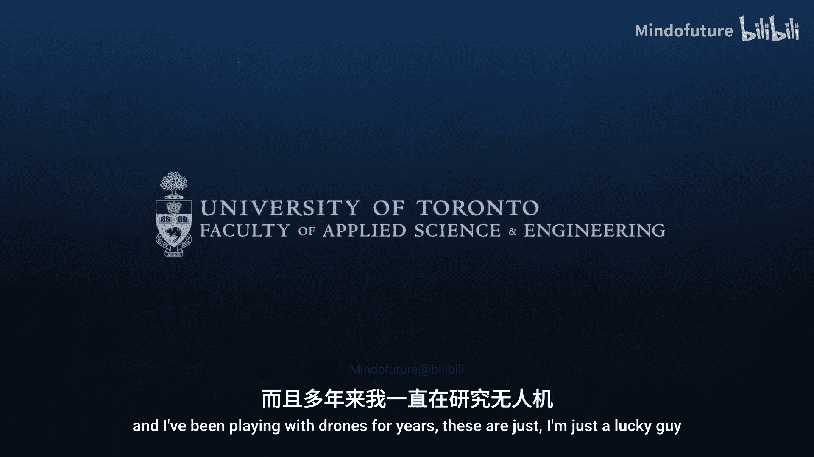

# 003：认识讲师史蒂文·瓦斯兰德

在本节课中，我们将通过讲师史蒂文·瓦斯兰德的个人经历与职业发展，了解他如何从一名广泛的兴趣爱好者成长为自动驾驶与机器人领域的研究者，并探讨该领域的核心挑战与学习路径。

---

## 童年与广泛的兴趣

我童年时兴趣广泛，热爱各种事物。我曾认为自己可以成为一名科学家，或许是物理学家，也可能是化学家，但当时对未来并没有明确的想法。我的成长过程是懵懂的。

我是一名重度运动爱好者，热爱越野滑雪和山地自行车。这些活动占据了我的大部分时间，我并未过多担忧未来，度过了一个田园诗般的童年。

## 青年时期的挑战与方向

大约在16至18岁时，我开始思考必须做一些有趣的事情来度过人生。正是在这个阶段，我开始接受各种挑战，并逐渐认识到是什么在持续驱动着我前进。

我热爱解决数学问题，也喜欢在放学后与朋友们一起研究化学或微积分难题。这些都是我在没有明确目标的情况下，利用课余时间所做的事情。

直到我开始认真尝试选择一项事业时，我才发现，在这些特定的应用领域中，我所喜爱的事情会频繁出现。

---

## 职业生涯的起点：航空航天工业

大学毕业后，我在普拉特·惠特尼加拿大公司工作，这是一家小型喷气发动机制造商。在普拉特·惠特尼工作期间，经历非常吸引人。

我们有机会测试喷气发动机控制系统，这让我接触到了许多有趣的航空学知识。然而，航空学领域的挑战在于其极其严格的安全要求。

你所做的每一件事都必须严谨可靠，并且每次执行都必须精确无误。因此，该领域的发展实际上受制于经过反复验证的、已有30年历史的技术。

作为一名试图推动变革、改变世界的年轻工程师，这让我感到非常沮丧。于是，我带着从航空航天工业中获得的宝贵经验以及对安全的专注，进入了研究生阶段的学习。

## 转向机器人学与无人机研究

我进入了航空与航天领域，并开始建造无人机。这本质上是解决问题和开发算法。

例如，让无人机降落在行驶的汽车上，或者让自动驾驶汽车自行泊车、穿越障碍区域。所有这些问题都非常实际，具有高度应用性。

在构建过程中，你可以直观地看到结果。如果无人机错过了汽车，它就会坠毁失败。这其中有一种令人兴奋的趣味性。

---

## 构建自动驾驶汽车的基础步骤

要制造一辆自动驾驶汽车，首先必须将一辆普通汽车改造成线控驾驶车辆。这意味着你可以将计算机接入汽车，并向油门、转向和刹车系统发送指令，汽车将实际执行这些操作。

一旦具备了这种能力，你就可以开始编程让它执行任何你想要的指令。

接下来，你必须在后备箱中添加一整套传感器和计算设备。拥有了所有这些部件，你就可以开始构建自己的自动驾驶车辆。

## 研究重点与学术使命

我的研究实验室围绕一个理念建立：如果我们拥有一个真实的测试平台，并将其置于真实情境中，我们就能更快地了解当前方法的局限性。

我们真正关注的是寻找特别适合学术界的研究问题。例如，处理恶劣天气条件、应对某些边缘情况，或者试图从理论上证明我们所使用的方法具有可量化的安全性。

在学术界，我们确实可以研究许多具体问题。我们可以尝试各种大胆的想法，可以比工业界更自由、或许更快地探索可能的解决方案空间。

---

## 行业展望与当前挑战

我们肯定会看到这些车辆的性能不断提升。例如，特斯拉的自动驾驶系统每年都会变得越来越好。我们还将看到真正自主的车队在受限领域内运行，这些领域被认为是安全的。

但我仍然认为，要实现最终的、在任何你想驾驶的地方都能实现的完全自动驾驶，我们还有很多工作要做。

这仅仅是因为汽车可能失败的方式太多，它们必须理解的情境太复杂，有太多无法提前预测的奇怪状况。

## 给新学习者的建议

如果你是自动驾驶领域的新手，认为这是一个美妙的领域并想尝试，我认为你首先应该完成这个Coursera专项课程。

除此之外，还有数百种方法可以丰富你的知识，并更好地了解如何进入这个领域。整个领域依赖于机器人学、计算机视觉、神经网络与深度学习的基础。

这些领域你可以进行广泛学习，其有趣之处在于它们也适用于其他美妙的应用。例如机器人操纵器、手机摄像头系统与视频拍摄功能的改进、无人机飞行与物体跟踪等。你可以用这些知识做很多事情。

对于那些正在思考自动驾驶是否是一个值得探索的方向的人来说，这个市场显然将持续增长。对我们项目中毕业生的需求是巨大的，这非常惊人。

---

## 总结与个人感悟

距离我在放学后随意研究数学难题已经过去很久了。想到我现在从事自动驾驶汽车的研究，并且已经玩转无人机多年，我只是一个幸运的人。

在本节课中，我们一起了解了史蒂文·瓦斯兰德如何将广泛的兴趣与实际问题解决相结合，最终投身于自动驾驶与机器人技术的前沿研究。我们探讨了构建自动驾驶系统的关键步骤、学术界的研究重点、行业面临的挑战，并为初学者提供了清晰的学习路径指引。这个领域充满活力与机遇，正等待着新的探索者。