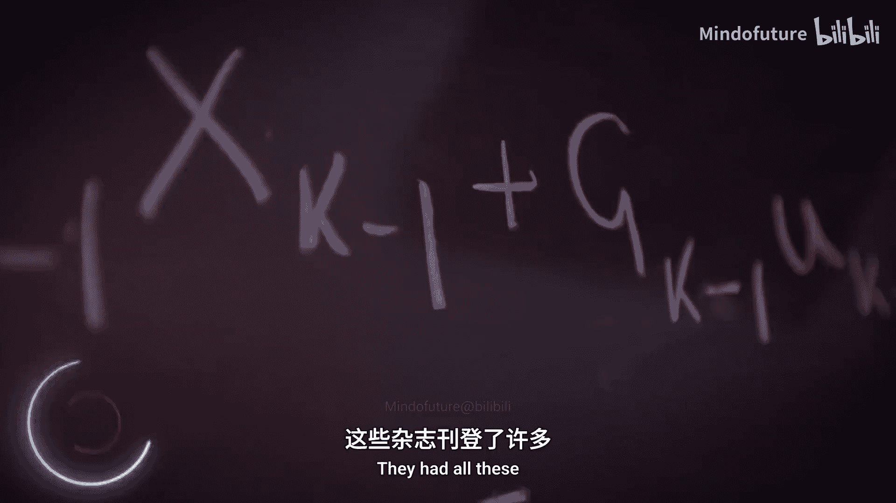

# 004：认识讲师乔纳森·凯利

## 概述
在本节课中，我们将认识本课程的讲师乔纳森·凯利教授，了解他的个人背景、职业选择动机，以及他对自动驾驶技术安全性与创新性的看法。

---

我的名字是乔纳森·凯利，我是加拿大多伦多大学航空航天研究所的一名助理教授。

童年时期，我每个月都喜欢去杂志店。我总是阅读《大众机械》或《大众科学》这类杂志。

这些杂志包含了从太空旅行到新型交通工具，再到新计算设计的各种有趣文章。内容确实非常吸引人。

因此，这最终促使我开始将科学技术视为一个可能的职业选择。

在我还很小的时候，发生了一件事，即第一次航天飞机灾难——挑战者号灾难。我至今仍清楚记得那一幕。

我当时想，天哪，一定是出了什么严重的问题，后果是多么可怕。那时发生了巨大的爆炸。

我记得当时震惊地坐着，认为技术似乎总是有效的。这是我的看法：技术总是有效的，它不会失败。汽车不会就这样爆炸。

在电视上看到这一幕，让我真切地认识到，工程确实至关重要。在这些威胁生命或可能改变人生的情境中，扎实的工程是极其重要的。

自动驾驶汽车在许多方面非常相似。作为工程师，我们有责任将这些系统设计得尽可能安全可靠。

这是最令人兴奋的技术革命之一，它真的即将到来。新的想法、新的技术、新的设计每天都在涌现。

我经常坐在办公桌前，看到人们提出的创新性新想法和技术时，都会感到眼前一亮。

这种兴奋感也来自于它实际上正在改变技术格局，并且正在做一些可能惠及许多人的事情。

---

## 总结
本节课我们一起认识了乔纳森·凯利教授。我们了解到他从小对科学技术的兴趣如何引导他走向工程师生涯，以及挑战者号灾难如何让他深刻认识到工程安全的重要性。最后，他表达了对自动驾驶技术革命性潜力的兴奋，并强调了工程师在确保系统安全可靠方面的重大责任。