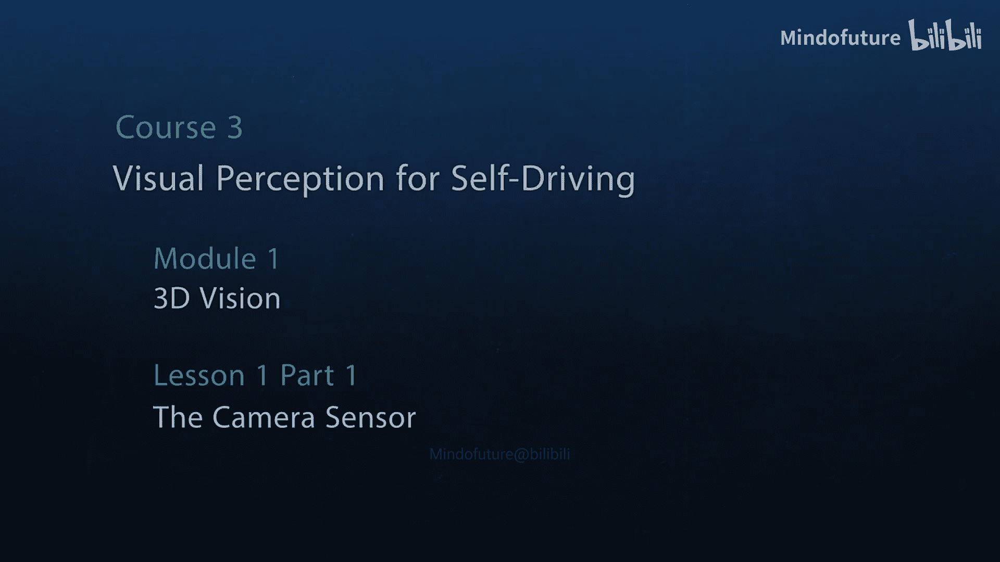
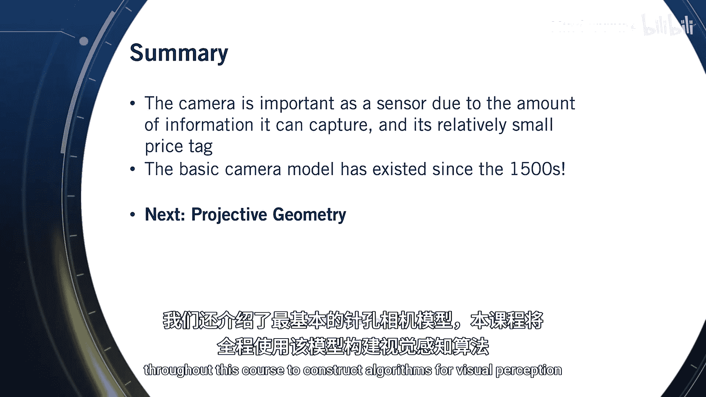

# 005：摄像头传感器

在本节课中，我们将要学习摄像头作为自动驾驶汽车核心传感器的重要性，并介绍图像形成的基本原理——针孔相机模型。

## 为什么摄像头至关重要？📷

在自动驾驶领域，大多数主要厂商都将摄像头作为其车辆传感器套件中的主要传感器。摄像头是一种信息丰富的传感器，能够捕捉车辆周围环境的惊人细节，但需要大量的处理才能利用图像中的信息。

在所有常见的自动驾驶传感器中，摄像头提供了来自环境中物体的最详细的外观信息。外观信息对于场景理解任务（如物体检测、分割和识别）特别有用。正是外观信息使我们能够区分路标或交通灯状态、跟踪转向灯，并将重叠的车辆解析为独立的个体。

由于其高分辨率的输出，摄像头能够收集并提供比自动驾驶中使用的其他传感器多几个数量级的信息，同时成本相对较低。高价值的外观信息和低成本的结合，使摄像头成为我们传感器套件中必不可少的组成部分。

## 图像是如何形成的？🔍

让我们看看摄像头是如何收集如此大量信息的。摄像头是一种被动的外感受传感器。它使用成像传感器来捕捉由世界物体发出的光线所传递的信息。

光线从物体上的每一点向各个方向反射，其中一部分光线射向相机传感器。然而，如果使用一个简单的开放式传感器设计，我们最终会得到模糊的图像，因为成像传感器在同一位置收集了来自物体上多个点的光线。

## 针孔相机模型📐

解决这个问题的方案是在成像传感器前放置一个屏障，屏障中心有一个微小的孔或光圈。该屏障只允许少量光线通过光圈，从而减少图像的模糊度。这个模型被称为**针孔相机模型**，它描述了世界中的一个点与其在图像平面上相应投影之间的关系。

针孔相机模型中两个最重要的参数是：
1.  **焦距**：针孔与图像平面之间的距离，用 `f` 表示。焦距定义了物体投影到图像上的大小，在使用镜头改善相机性能时，对相机对焦起着重要作用。
2.  **相机中心**：针孔中心的坐标，用 `(c_x, c_y)` 表示。这些坐标定义了物体投影将占据的成像传感器上的位置。

尽管针孔相机模型非常简单，但它能很好地表示图像创建过程。通过确定特定相机配置的焦距和相机中心，我们可以用数学方法描述从世界物体发出的光线将击中图像平面的位置。这使我们能够为状态估计和物体检测建立一个图像形成的测量模型。

## 历史实例与现代发展🚀

针孔相机模型的一个历史实例是**暗箱**。历史证据表明，这种成像形式早在公元前470年就在古代中国和希腊被发现。其简单的结构——在成像表面前有一个针孔光圈——使其易于自行重现。

自暗箱发明以来，我们已经取得了长足的进步。当今的相机使我们能够收集极高分辨率的数据。由于先进的光学镜头可以收集大量光线并将其精确聚焦在图像平面上，它们可以在弱光条件下或远距离工作。相机传感器的分辨率和灵敏度不断提高，使相机成为地球上最普遍的传感器之一。

这些进步对于理解自动驾驶汽车周围的环境也极为有益。正如我们在第一门课程中讨论的，专为自动驾驶汽车设计的摄像头需要在各种光照条件和物体距离下都能良好工作。这些特性对于在所有操作条件下安全驾驶至关重要。

## 总结📝

在本节课中，我们一起学习了摄像头作为自动驾驶传感器的实用性。我们还看到了最基本形式的针孔相机模型，我们将在整个课程中使用它来构建视觉感知算法。

在下一个视频中，我们将描述图像是如何形成的，这个过程被称为**投影几何**，它将世界中的物体与其在成像传感器上的投影联系起来。

