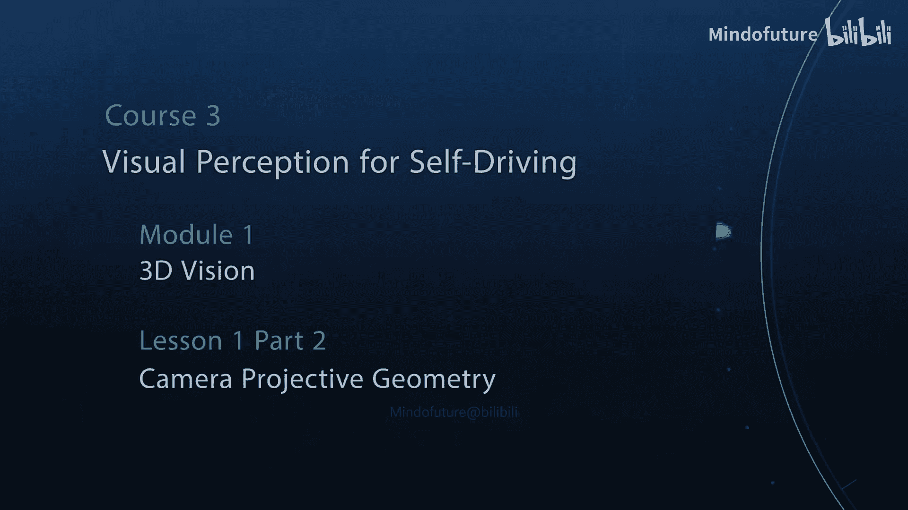
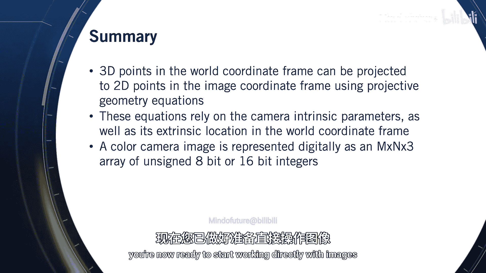
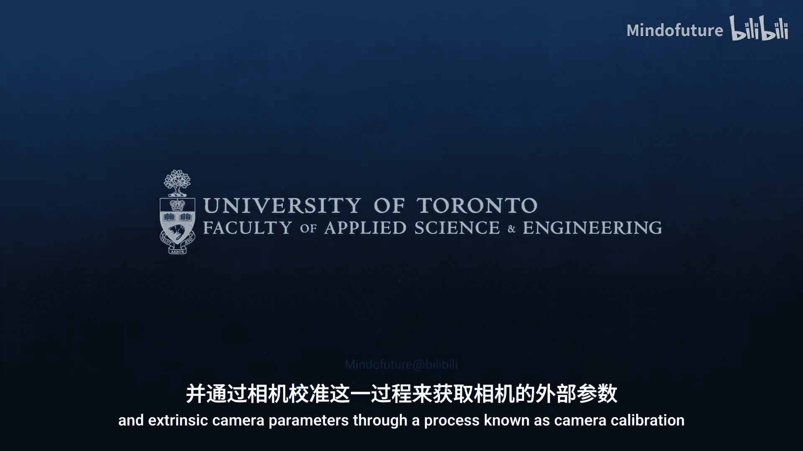

# 006：相机投影几何 📷

在本节课中，我们将学习如何通过坐标系变换来建模相机的投影几何。这些变换可用于将世界坐标系中的点投影到图像坐标系中。我们将基于上一节介绍的针孔相机模型，使用矩阵代数来建模这些变换，并将其应用于一个三维点，以获取其在二维图像平面上的投影。最后，我们将了解相机拍摄的二维图像在软件中是如何表示的。掌握了投影方程和图像定义后，您将能够在后续课程中创建用于检测三维物体和定位自动驾驶汽车的算法。

## 问题定义

首先，让我们定义需要解决的问题。假设在世界坐标系中有一个点 **O_world**。我们的目标是将这个点从世界坐标系投影到相机的图像平面上。

光线从物体上的点 **O_world** 出发，穿过相机光圈，到达传感器表面。您会发现，通过光圈在传感器表面上的投影会导致世界中的物体图像发生翻转。为了避免这种混淆，我们通常在相机中心前方定义一个虚拟图像平面。

让我们用这个虚拟传感器平面重新绘制相机模型，以取代相机镜头后方真实的图像平面。我们将此模型称为简化相机模型，并需要建立一个模型来描述如何将点从世界坐标 (X, Y, Z) 投影到图像坐标 (U, V)。

## 相机参数定义

以下是解决此问题所需定义的相机相关特性。

首先，我们选择一个世界坐标系，用于定义所有物体和相机的位置坐标。

其次，我们将相机坐标系定义为附着在镜头光圈中心（即光学中心）的坐标系。

正如我们在第二门课程中学到的，我们可以定义一个平移向量和一个旋转矩阵来建模任意两个坐标系之间的变换。在本例中，我们将处理世界坐标系和相机坐标系之间的变换。

我们将相机位姿的参数称为**外参**，因为它们相对于相机是外部的，并且特定于相机在世界坐标系中的位置。

接着，我们定义图像坐标系，它附着在从光学中心发出的虚拟图像平面上。

然而，图像像素坐标系附着在虚拟图像平面的左上角。因此，我们需要将像素位置调整到图像坐标系中。

最后，我们定义**焦距**，即相机坐标系与图像坐标系之间沿相机坐标系 Z 轴的距离。

## 投影步骤

我们的投影问题简化为两个步骤。

首先，我们需要将点从世界坐标投影到相机坐标。然后，我们再将其从相机坐标投影到图像坐标。之后，我们可以通过缩放和偏移将图像坐标转换为像素坐标。

现在，我们有了几何模型，可以随时将点从世界坐标系投影到图像坐标系。

## 数学建模

现在，让我们用线性代数来构建执行此投影所需的数学工具。

首先，从世界坐标到相机坐标的变换。这是通过刚体变换矩阵 **T** 完成的，其中包含旋转矩阵 **R** 和平移向量 **t**。

下一步是将相机坐标变换为图像坐标。为了执行此变换，我们定义一个 3x3 矩阵 **K**。这个矩阵取决于相机的**内参**，即相机内部的组件，如相机几何结构和镜头特性。

由于这两个变换都是矩阵乘法，我们可以定义一个矩阵 **P = K * [R|t]**，将点从世界坐标系直接变换到图像坐标系。

世界坐标系中点 **O_world** 的坐标现在可以通过方程 **O_image = P * O_world** 投影到图像平面上，即 **O_image = K * [R|t] * O_world**。

## 齐次坐标与最终变换

让我们看看计算这个方程还缺少什么。当我们检查矩阵维度时，会发现矩阵乘法无法执行。为了解决这个问题，我们将点 **O_world** 的坐标转换为**齐次坐标**，方法是在其三维坐标末尾添加一个 1，正如我们在状态估计课程中所见。现在维度匹配，我们可以开始计算投影了。

现在我们需要执行最后一步，将图像坐标转换为像素坐标。我们通过将 X 和 Y 除以 Z 来得到图像平面上的齐次坐标。

您已经完成了基本的相机投影模型。在实践中，我们通常会对更复杂的现象进行建模，例如非方形像素、相机轴倾斜、畸变和非单位纵横比。幸运的是，这只会改变相机矩阵 **K**，您学到的方程只需添加几个额外参数即可直接使用。

## 图像的数字表示

既然我们已经建立了三维点投影到二维图像平面的坐标公式，接下来我们想定义二维彩色图像坐标中的值是什么。

我们将从灰度图像开始。首先，我们将图像的**宽度 N** 和**高度 M** 定义为其具有的行数和列数。三维空间中的每个点都投影到图像上的一个像素，该像素由我们之前推导出的 UV 坐标定义。

放大后，我们可以看到这些像素组成一个网格。在灰度图像中，每个像素的亮度信息被写为一个无符号 8 位整数。一些相机可以生成无符号 16 位整数以获得更高质量的图像。

对于彩色图像，我们有一个值为 3 的第三维度，我们称之为**深度**。这个深度的每个通道代表图像中某种颜色的含量。虽然存在许多其他颜色表示方法，但在本课程中我们将使用 **RGB** 表示法，即红、绿、蓝。

总而言之，图像在数字上表示为一个 M x N x 3 的像素数组，每个像素代表一个三维点在二维图像平面上的投影。

## 总结

在本节课中，您学习了如何将世界坐标系中的三维点投影到图像坐标系中的二维点。您看到执行此投影的方程依赖于相机的内参以及相机在世界坐标系中的位置。正如我们将在后续课程中看到的，这个投影模型用于我们开发的每一个视觉感知算法，从物体检测到可行驶空间估计。最后，您还学习了图像在软件中如何表示为一个代表像素位置的数组。现在，您已经准备好开始直接在软件中处理图像，正如您将在本周的评估中所做的那样。

在下一个视频中，您将学习如何通过一个称为**相机标定**的过程，计算特定相机的内参和外参，从而定制相机模型。