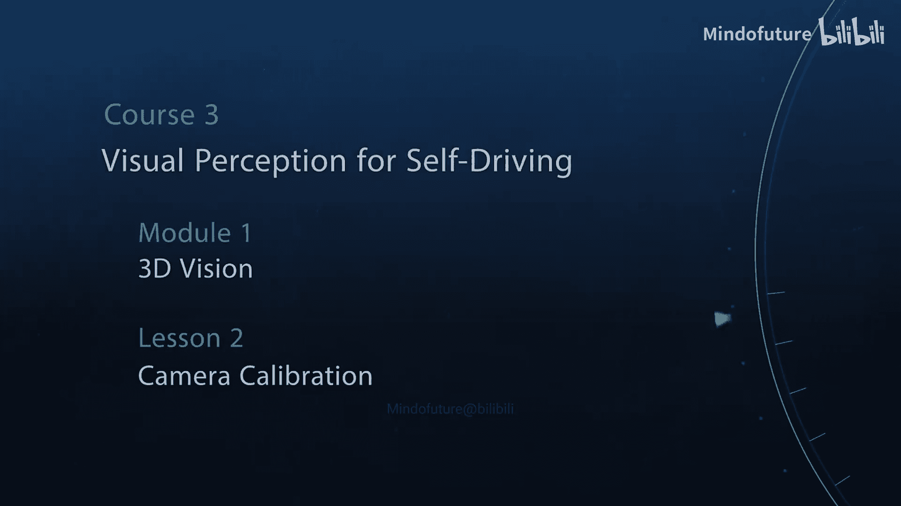
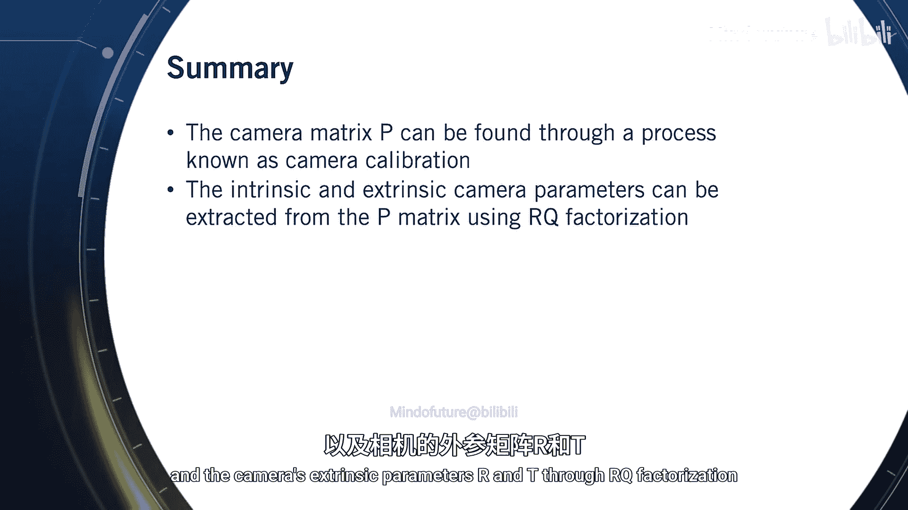
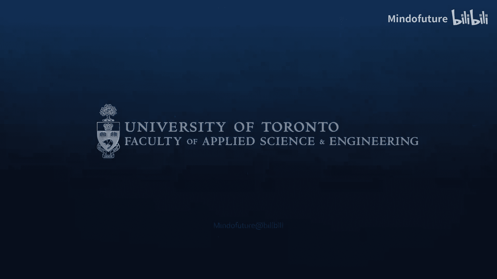

# 007：相机校准

在本节课中，我们将学习如何通过数学工具进行相机校准，以获取投影几何所需的相机参数。

## 概述 📋

上一节我们介绍了投影几何所需的相机参数。本节中，我们将学习如何通过相机校准这一数学过程来获取这些未知参数。核心在于，通过已知几何形状的场景（如棋盘格），建立3D点与其在2D图像上投影点之间的对应关系，从而求解出相机的内参和外参矩阵。

## 投影方程回顾 🔄

首先，让我们回顾一下之前学过的投影方程。三维空间中的齐次坐标点 `[X, Y, Z, 1]^T` 可以通过相机投影矩阵 **P** 变换到相机平面。矩阵 **P** 包含了相机的内参和外参。

投影后的齐次坐标需要转换为非齐次形式，以获得像素坐标系下的 `u` 和 `v` 坐标。这是通过将图像坐标除以 Z 分量实现的。

最后，`u` 和 `v` 可以乘以一个任意尺度因子 **s**。引入尺度因子 **s** 有助于后续构建校准问题的公式。

需要重点注意的是，尺度在理解单目图像信息时扮演着挑战性的角色。因为一旦点从3D世界投影到2D图像平面，深度信息就丢失了。沿着从相机中心出发的同一条射线上的所有3D点，都会投影到图像平面的同一个位置。因此，仅凭图像信息无法直接确定点的深度。

## 相机校准问题定义 🎯

相机校准问题定义为：在给定未知的3D点坐标及其在图像平面上的对应投影点的情况下，求解图中标红的未知相机内参和外参。

我们的方法将包括先获取投影矩阵 **P**，然后将其分解为内参矩阵 **K**、外参旋转矩阵 **R** 和平移向量 **T**。

## 校准方法：使用已知几何场景 🧩

为了进行校准，我们使用一个已知几何形状的场景，以便从2D图像中获取3D点的位置。通过测量图像中观察到的点之间的实际3D距离，可以解决尺度问题。

最常用的例子是一个已知方格尺寸的3D棋盘格，它提供了一个固定的、可观测的点位置图。

我们定义世界坐标系（图中黄色坐标系），计算3D点坐标及其在图像中的投影。将3D点与2D投影点关联起来，可以手动完成（例如点击紫色点），也可以使用棋盘格检测器自动完成。

然后，我们可以建立一个方程组来求解 **P** 矩阵的未知参数。

## 建立线性方程组 ➗

现在，让我们构建需要求解的线性方程组。

首先，通过矩阵乘法将投影方程展开为三个方程，使等式右边得到 `[0, 0, 0]^T`。我们将每个方程的右边移到左边。

然后，将第三个方程代入方程1和方程2，最终每个点得到两个方程。因此，如果我们有 `n` 个点，就有 `2n` 个关联方程。

将这些方程写成矩阵形式，就得到了所示的齐次线性系统。

由于这是一个齐次线性系统，我们可以使用伪逆，或者更好的方法是使用奇异值分解来获得最小二乘解。

## 线性校准方法的优缺点 ⚖️

我们这种简单的线性校准方法有几个优点：易于公式化、有闭式解，并且通常能为非线性校准方法提供非常好的初始点。

以下是该方法的一些缺点：

*   求解 **P** 矩阵的缺点是，我们不能直接得到相机的内参和外参。
*   我们的线性模型没有考虑复杂的现象，例如径向畸变和切向畸变。
*   由于我们通过线性最小二乘法求解，因此无法对解施加约束，例如要求焦距为非负值。

## 从 P 矩阵分解出 K, R, T 🔧

相机投影矩阵 **P** 本身可用于将3D点投影到2D，但它有几个缺点：它不告诉你相机的姿态，也不揭示相机的内部几何结构。

幸运的是，我们可以使用一种称为 **RQ 分解** 的线性代数运算，将 **P** 分解为内参矩阵 **K**、旋转矩阵 **R** 和平移向量 **T**。

让我们看看如何进行这种分解。

首先，我们将 **P** 的表示改为相机中心 **C** 的函数。**C** 是当乘以 **P** 时投影到 `[0, 0, 0]^T` 的点。我们将 **K** 乘入矩阵，形成两个子矩阵：**K R** 和 **-K R C**。我们将 **K** 和 **R** 的组合称为 **M** 矩阵。

现在，我们可以将投影矩阵 **P** 表示为 `[M | -M C]`。

从这里，我们利用任何方阵都可以分解为一个上三角矩阵 **R** 和一个正交基 **Q** 这一事实，将 **M** 分解为上三角矩阵 **R** 和正交基 **Q**。在线性代数中，这个过程称为 **RQ 分解**，它是更常提到的 **QR 分解** 的一种变体（在QR分解中，正交矩阵 **Q** 在前，上三角矩阵 **R** 在后）。

请注意，RQ 分解输出的 **R** 与我们的旋转矩阵 **R** 是不同的变量，不要混淆。

现在，让我们看看如何通过比对这两个表达式，利用矩阵 **M** 的 RQ 分解输出来获取 **K**、**R** 和 **T**。

*   内参校准矩阵 **K** 是 **M** 的 RQ 分解输出的上三角矩阵 **R**。
*   旋转矩阵 **R** 是正交基 **Q**。
*   最后，我们可以直接从 **K** 和 **P** 矩阵的最后一列提取出平移向量 **T**。

## 关于分解的唯一性 💡

RQ 分解是从相机 **P** 矩阵计算 **K**、**R** 和 **T** 的强大工具。然而，需要做一些数学假设来保证这些矩阵解的唯一性。我们将在本课的实践 Jupyter Notebook 中更详细地探讨这些假设。

## 工具与实现 🛠️

单目相机校准是一项成熟的技术，在 C++、Python 和 MATLAB 中都有优秀的实现。你可以通过补充材料中提供的链接，测试一些最常见的实现。

## 总结 📝

本节课中我们一起学习了：
1.  可以通过称为相机校准的过程来找到相机投影矩阵 **P**。
2.  这个矩阵可以通过 **RQ 分解** 被分解为相机内参矩阵 **K** 和相机外参（旋转矩阵 **R** 和平移向量 **T**）。

接下来，我们将讨论如何通过立体视觉从两个相机传感器获取深度信息。下次见。

