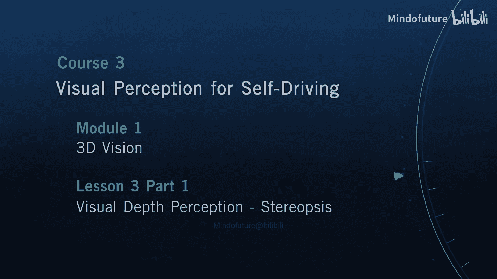
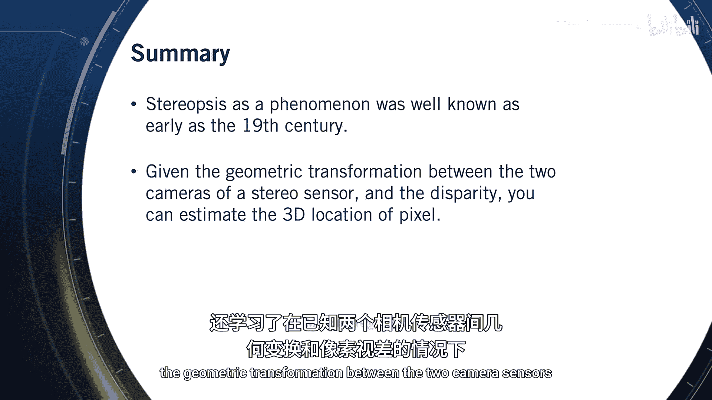

# 008：立体视觉

在本节课中，我们将学习立体视觉的基本原理。自动驾驶汽车需要精确的深度感知来确保安全运行。我们将探讨如何利用两个或多个摄像头，通过多视图几何学来获取深度信息，并重点介绍双目立体相机的几何模型及其三维坐标计算方法。

## 立体视觉的历史背景 👁️

上一节我们提到了深度感知的重要性，本节中我们来看看立体视觉这一概念是如何被发现的。

立体视觉的过程被称为立体视差。查尔斯·惠斯通在1838年首次描述了这一过程。他认识到，由于每只眼睛从略微不同的水平位置观察视觉世界，因此每只眼睛看到的图像存在差异。距离眼睛不同距离的物体，在两只眼睛中成像的水平位置也不同，从而产生了被称为双目视差的水平视差深度线索。

然而，历史证据表明立体视觉的发现远早于此。事实上，列奥纳多·达·芬奇的一些画作就描绘了通过立体视差感知深度的精确几何关系。

直到19世纪，立体视差现象主要被用于娱乐。人们使用红蓝立体图，通过佩戴不同颜色的眼镜（通常是红色和青色）来观看，以产生立体3D效果。

如今，我们使用立体相机和复杂的算法，从两幅图像中推导深度，其概念与达·芬奇的画作相似。

## 立体相机的几何模型 📐

现在，让我们深入探讨立体传感器的几何结构。

为了简化问题，立体传感器通常由两个具有平行光轴的相机构成。大多数制造商会进一步对齐两个相机在三维空间中的位置，使得两个成像平面仅在X轴方向上有偏移。

给定两个相机之间已知的旋转和平移关系，以及一个三维空间点 **O** 在两个相机坐标系下的投影像素位置 **p_L** 和 **p_R**，我们可以建立必要的方程来计算点 **O** 的三维坐标。

为了使计算更简单，我们做出一些假设：
*   首先，我们假设用于构建立体传感器的两个相机是相同的。
*   其次，我们假设在制造立体传感器时，我们尽可能保持两个相机的光轴对齐。

以下是立体传感器的一些重要参数定义：
*   **焦距**：相机中心到成像平面的距离。
*   **基线**：左相机中心和右相机中心沿共享X轴的距离。

通过定义一个基线 **B** 来表示两个相机坐标系之间的变换，我们假设旋转矩阵是单位矩阵，且平移向量中只有X分量非零。因此，R和T变换简化为单个基线参数 **B**。

在继续之前，我们将上图投影到鸟瞰图以便于可视化。

## 三维坐标计算 🧮

上一节我们定义了立体相机的几何模型，本节中我们来推导计算三维坐标的公式。

我们想要计算点 **O** 相对于左相机坐标系的 **X** 和 **Z** 坐标。在计算出 **X** 和 **Z** 坐标后，**Y** 坐标可以很容易地估算出来。

我们已知基线 **B**、焦距 **f**，以及点 **O** 在左右成像平面上的投影坐标。

我们可以从左侧相机的测量值中看到两个相似三角形：由深度 **Z** 和位置 **X** 构成的三角形，与由焦距 **f** 和左侧测量值X分量 **x_L** 构成的三角形相似。

根据相似性，我们可以构建方程：
**Z / f = X / x_L**

对于右侧测量值，我们可以进行同样的推导，但需要包含基线的偏移量。在这种情况下，两个三角形由 **Z** 和距离 **X - B**，以及焦距 **f** 和右侧测量值X分量 **x_R** 定义。

类似地，我们可以得到第二个通过右相机参数和测量值关联 **Z** 和 **X** 的方程：
**Z / f = (X - B) / x_R**

## 从视差到三维坐标 🎯

从这两个方程出发，我们现在可以推导出点 **O** 的三维坐标。

我们定义**视差 D** 为同一像素点在左右图像中图像坐标的差值：**D = x_L - x_R**。

我们可以使用X和Y偏移量 **u_0** 和 **v_0** 在图像坐标和像素坐标之间轻松转换。

然后，我们利用两个相似三角形关系方程来求解 **Z** 的值，过程如下：

1.  由 **Z / f = X / x_L** 得 **X = (Z * x_L) / f**
2.  由 **Z / f = (X - B) / x_R** 得 **X = (Z * x_R) / f + B**
3.  令两式相等：**(Z * x_L) / f = (Z * x_R) / f + B**
4.  整理得：**Z * (x_L - x_R) / f = B**
5.  代入视差 **D = x_L - x_R**，最终得到深度公式：
    **Z = (f * B) / D**

计算出 **Z** 的值后，我们使用以下表达式计算 **X**：
**X = (Z * x_L) / f**

最后，我们可以在Y方向上重复相同推导过程，得到 **Y** 的表达式：
**Y = (Z * y_L) / f**

现在，点位置的三维分量可以从我们已有的两组像素测量值中明确得出。

## 实践中的挑战与总结 📝

现在我们已经建立了从立体传感器计算三维坐标所需的方程，但要执行此计算，会出现两个问题。

首先，我们需要计算焦距、基线和X、Y偏移量，即我们需要**校准立体相机系统**。其次，我们需要找到每个左右图像像素对之间的**对应关系**，以便计算它们的视差。

幸运的是，校准问题可以通过立体相机标定来解决。这是我们上一视频讨论的单目相机标定过程的扩展，已有成熟的实现方案。

然而，对应关系问题需要专门的算法来高效执行匹配并计算左右图像像素之间的视差，我们将在下一个视频中进一步讨论。

立体视觉输出的深度存在一些局限性，尤其是当点远离立体相机时。然而，给定一个良好的视差估计算法，其输出对于自动驾驶汽车来说，在较近距离内仍然是一个有用的密集深度信息来源，其密度超过了普通激光雷达传感器所能达到的水平。

## 课程总结

本节课中，我们一起学习了以下内容：
*   立体视觉的历史背景。
*   立体相机的几何模型和关键参数（焦距、基线）。
*   如何根据两个相机传感器之间的几何变换以及像素之间的视差，来估算像素三维坐标的公式，核心公式为：
    **Z = (f * B) / D**
    **X = (Z * x_L) / f**
    **Y = (Z * y_L) / f**

在下一课中，我们将学习更多关于视差生成算法的知识，并使用Python和OpenCV展示如何从立体图像对计算视差的完整示例。

我们下次见。

