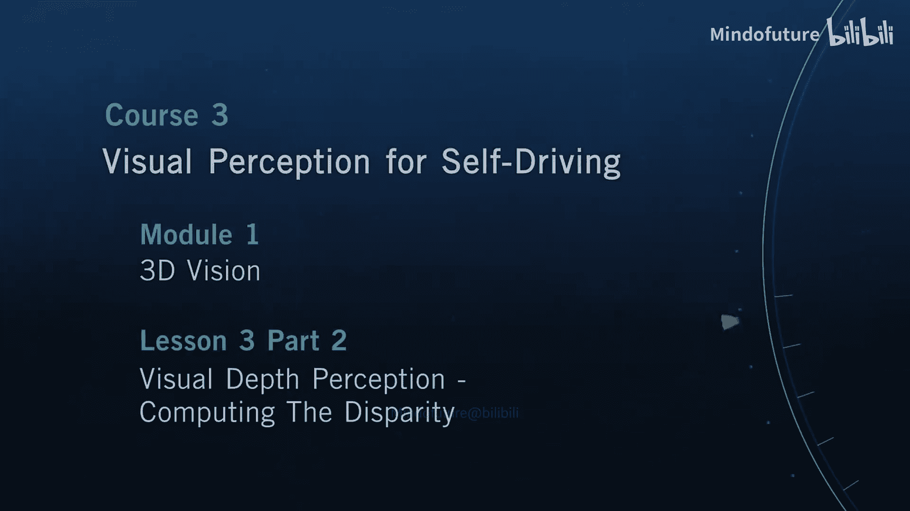
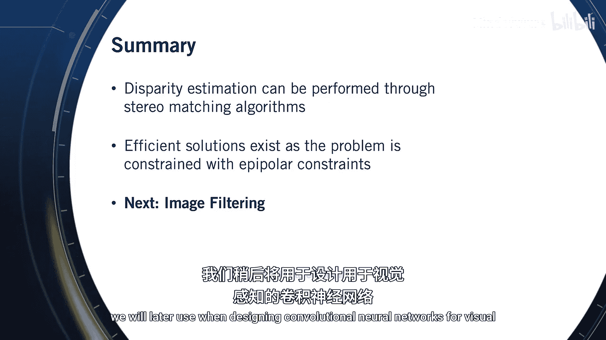

# 009：视觉深度感知与视差计算

在本节课中，我们将学习如何从立体图像对中提取三维信息。具体来说，我们将重点探讨如何通过立体匹配来估计视差，这是计算深度的关键步骤。我们还将了解极线约束如何将复杂的二维搜索问题简化为高效的一维搜索。

## 回顾与问题定义

上一节我们介绍了从立体图像对中提取三维信息的基本公式。然而，我们遇到了一些需要估计的未知参数。

本节中，我们来看看如何估计这些缺失的参数，特别是通过立体匹配来计算视差。我们还将了解到，由于极线约束的存在，高效的视差估计成为可能。

## 立体匹配问题

视差是指同一个三维点在两个不同相机图像中位置的差异。计算视差，就需要在左右立体相机图像中找到相同的点。

这个问题被称为立体对应问题。

以下是解决此问题最朴素的方法：

*   **穷举搜索**：对于左图像的每一个像素，在整个右图像中进行搜索。这种解决方案效率极低，通常无法在自动驾驶汽车上实时运行。同时，由于许多像素具有相似的局部特征，正确匹配它们也很困难。

## 极线约束简化搜索

幸运的是，我们可以利用立体几何将搜索问题从整个图像空间的二维搜索，约束到一条一维的线上。

让我们重新审视立体相机设置，看看为什么这种简化是有效的。

我们已经确定了一个点如何投影到两个相机。现在，让三维点沿着连接它与左相机中心的直线移动。它在左相机成像平面上的投影不会改变。

然而，在右相机平面上的投影呢？投影会沿着一条水平线移动。这条线被称为**极线**，它直接源于立体相机对中两个相机固定的横向偏移和成像平面对齐。

我们可以将对应对的搜索约束在极线上，从而将搜索从二维简化到一维。

需要注意的一点是，**只有当两个相机的光轴平行时，才会出现水平的极线**。如果光轴不平行，极线是倾斜的。在这种情况下，我们将不得不求助于多视图几何，这超出了本课程的范围。

对于两个已校准的视图（如我们的立体相机），倾斜的极线并不是一个大问题。事实上，我们可以通过一个称为**立体校正**的过程，将光轴扭曲为平行。校正后，我们就回到了水平的极线。我们不会详细介绍如何进行校正，因为标准计算机视觉库（如OpenCV和MATLAB）中都有现成的实现。

## 基础立体匹配算法

综上所述，我们将介绍第一个基础的立体匹配算法。

对于每一条极线，执行以下步骤：

1.  **选取左图像点**：在左图像的这条极线上选取一个像素。
2.  **比较与匹配**：将这个左图像像素与右图像同一条极线上的每一个像素进行比较。通过最小化一个**代价**来选择与左像素最匹配的右图像像素。例如，一个非常简单的代价可以是像素强度的平方差。
3.  **计算视差**：通过从左图像位置减去右图像位置来计算视差，公式为：`d = u_left - u_right`。

## 立体匹配的深入研究

立体匹配是计算机视觉中一个被深入研究的问题。人们定义了更复杂的代价函数和搜索区域，试图提高计算效率或视差精度。

存在多种方法，包括局部方法和全局方法，它们在识别对应点和计算视差时所考虑的主要图像区域有所不同。

与计算机视觉中的大多数问题一样，立体视觉算法也在公共基准上进行评估，其中最著名的是**Middlebury立体基准**。如果你感兴趣，许多性能最佳的立体匹配算法都在那里发布了结果，并且也提供了代码。

## 总结与展望

通过本节课，你现在应该了解了立体传感器如何通过视差估计从图像生成深度。本周的作业将给你一个机会计算自己的视差图，并用它们来创建你自己的“碰撞时间”驾驶员辅助模块。

在下一课中，我们将描述图像滤波，这是我们在后续为视觉感知设计卷积神经网络时将使用的一个重要概念。

感谢观看，下次再见。