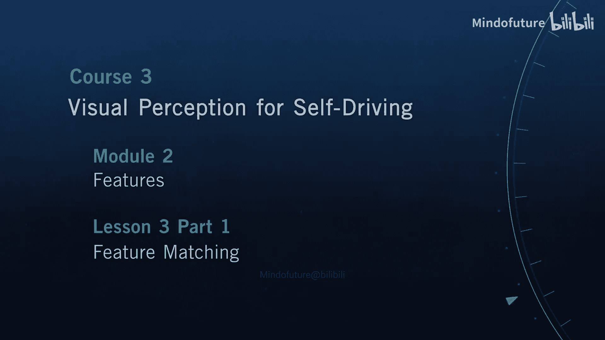
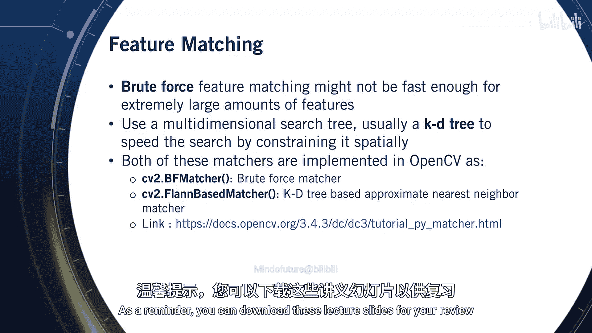

**自动驾驶汽车的视觉感知：第3课第1部分：特征匹配** 🚗👁️

在本节课中，我们将要学习特征匹配，这是将图像特征应用于自动驾驶视觉感知任务的最后一步。特征匹配的目标是，在不同图像中找到对应同一个真实世界点的特征。我们将介绍距离函数的概念，并详细讲解一种简单而强大的匹配算法——暴力匹配法。

---

### **概述：特征匹配流程回顾**

在深入细节之前，让我们简要回顾一下使用特征进行视觉感知的三个核心步骤：
1.  **特征检测**：在图像中识别出独特的点（特征点）。
2.  **特征描述**：为每个特征点从其周围邻域提取一个描述符（一个向量），用于表征该点的外观。
3.  **特征匹配**：比较不同图像中特征的描述符，找到彼此对应的特征对。

匹配得到的特征对可以用于多种应用，包括状态估计、视觉里程计和物体检测。然而，正确匹配至关重要，因为频繁的错误匹配会导致这些应用发生灾难性的失败。因此，特征匹配在构建自动驾驶汽车鲁棒的感知方法中扮演着关键角色。

---

### **特征匹配问题定义**

特征匹配的核心问题可以描述为：给定图像1中的一个特征及其描述符，我们试图在图像2中找到与之最匹配的特征。

那么，如何解决这个问题呢？

---

### **暴力匹配算法**

解决匹配问题最简单的方法被称为**暴力特征匹配**。其算法描述如下：

首先，定义一个**距离函数 D**，用于比较两个特征 `Fi` 和 `Fj` 的描述符，并计算它们之间的距离。两个描述符越相似，它们之间的距离就越小。

其次，对于图像1中的每一个特征 `F`，我们使用距离函数 `D` 计算它与图像2中每一个特征 `FJ` 的距离。

最后，我们选择图像2中与图像1的特征 `Fi` 距离最小的那个特征 `FC` 作为匹配结果。这个特征被称为**最近邻**，即在描述符空间中最接近原始特征的点。

**核心距离函数**

最常用的描述符比较距离函数是**平方差之和**：

`SSD = Σ (descriptor1[i] - descriptor2[i])^2`

SSD对描述符之间的差异进行二次惩罚，因此对大的变化非常敏感，而对小的变化不敏感。其他可用的距离函数还包括**绝对差之和**（对所有变化平等惩罚）和**汉明距离**（专用于描述符元素均为二进制值的特征）。

在接下来的示例中，我们将使用SSD距离函数。

---

### **暴力匹配实践与潜在问题**

我们的匹配技术和距离选择看起来相当简单。但你认为我们提出的最近邻匹配技术可能会出什么问题呢？

让我们通过两个案例来看看。

**案例一：成功匹配**

假设图像1中黄色边界框内的特征有一个四维描述符 `F1`。我们计算 `F1` 与图像2中第一个特征 `F2` 的SSD，得到值9。再计算 `F1` 与图像2中第二个特征 `F3` 的SSD，得到值652。继续计算与其他所有特征的距离，发现其他距离值都相对很大。因此，我们选择具有最小距离（9）的特征 `F2` 作为匹配。从视觉上看，`F1` 和 `F2` 确实是场景中同一个兴趣点，匹配正确。

**案例二：无对应匹配时的错误**

现在考虑另一种情况：图像1中的特征 `F1` 在图像2中**没有**对应的特征。按照相同的流程，我们计算 `F1` 与图像2中所有特征的SSD。假设 `F2` 和 `F3` 是最近邻，其中 `F2` 的距离值441是最小的。尽管441这个值已经表明 `F2` 与 `F1` 相当不相似，但暴力匹配算法仍会返回 `F2` 作为最佳匹配。这显然是错误的，因为 `F1` 和 `F2` 并非场景中同一个点。

---

### **改进：引入距离阈值**

如何解决上述问题呢？我们可以通过设置一个**距离阈值 Δ** 来改进匹配的接受标准。

这意味着，图像2中任何与 `F1` 的距离大于 Δ 的特征，即使它是所有特征中距离最小的，也不会被认定为有效匹配。

以下是更新后的暴力匹配算法步骤：
1.  定义距离函数 `D`，用于量化两个特征描述符的相似性。
2.  设定一个可接受匹配的最大距离阈值 **Δ**（通常根据具体应用和使用的描述符凭经验确定）。
3.  对于图像1中的每个特征，计算其与图像2中每个特征的距离。
4.  找出最近邻（最短距离），**仅当**该最短距离小于阈值 Δ 时，才将其视为有效匹配。

---

### **算法复杂度与实用工具**

暴力匹配在待匹配特征数量合理时是合适的，但其计算复杂度是**二次方的**（O(N²)），随着特征数量增加，会变得效率低下。

对于大规模特征集，通常会使用特殊的数据结构（如 **Kd树**）来加速最近邻搜索，提升计算效率。

无论是暴力匹配还是基于Kd树的匹配，都在OpenCV库中有所实现，方便开发者直接使用。

---

### **总结**

本节课我们一起学习了特征匹配。我们回顾了特征检测、描述和匹配的完整流程，并深入探讨了**暴力匹配算法**。该算法通过计算描述符之间的距离（如SSD）来寻找最近邻。我们还发现了简单最近邻匹配的缺陷——当查询特征在目标图像中没有真实对应时，仍会返回一个“最佳”匹配。为此，我们引入了**距离阈值 Δ** 来过滤掉不可靠的匹配，从而提高匹配的准确性。

暴力匹配法简洁有效，但为了构建安全可靠的自动驾驶汽车感知系统，我们还需要更精确的结果。在下一课中，我们将学习如何改进暴力匹配器，以处理那些经常导致错误结果的、棘手的模糊匹配。

我们下节课再见！ 👋