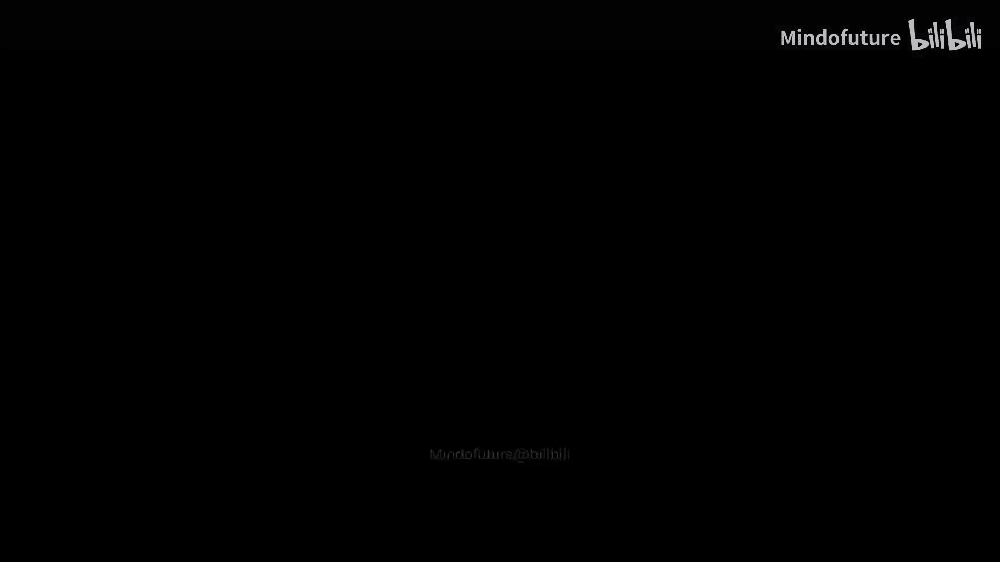
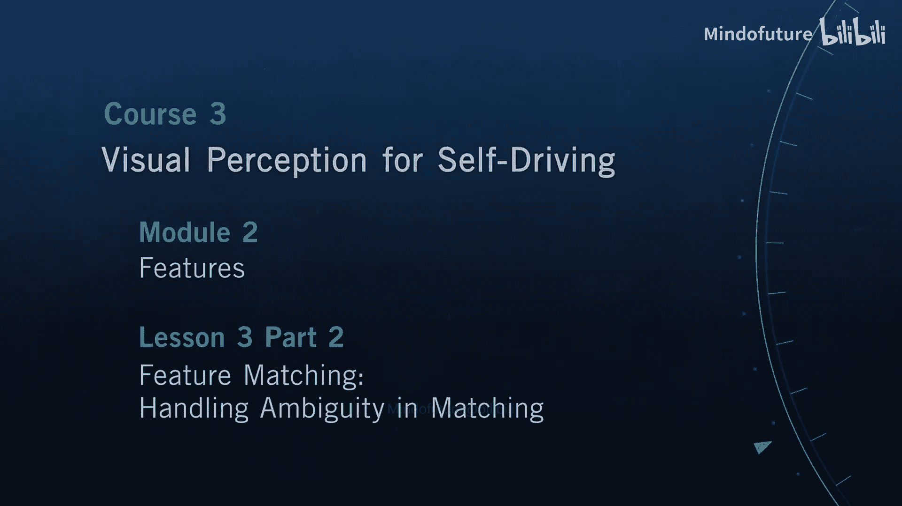
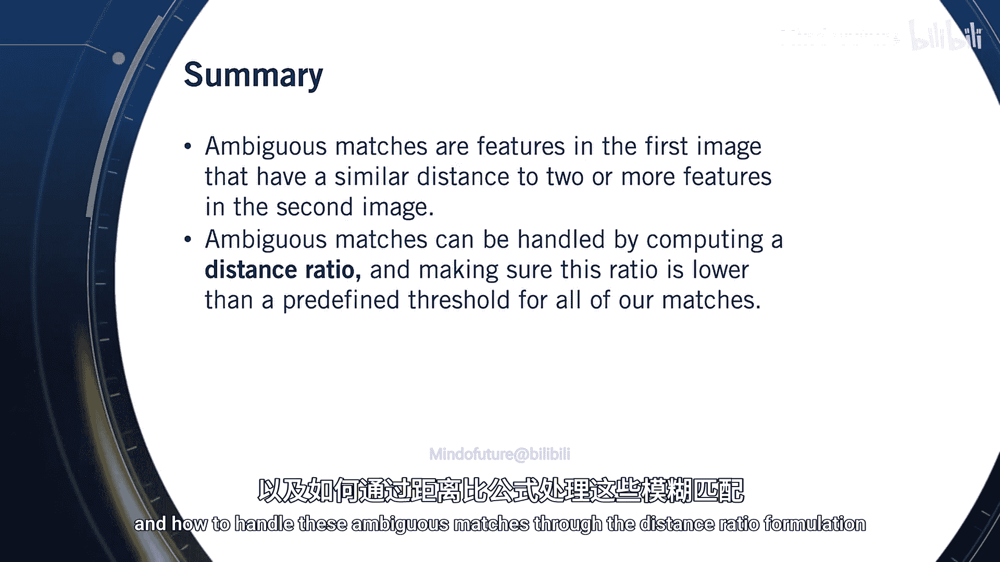

# 014：特征匹配 - 处理匹配中的歧义

在本节课中，我们将要学习特征匹配中的一个常见问题——匹配歧义，并介绍一种通过距离比率公式来处理此问题的方法，从而使我们的匹配结果更加鲁棒。

## 概述

到目前为止，我们已经学习了如何检测特征、计算其特征描述符，以及如何使用距离函数进行暴力匹配。我们即将开始将特征检测、描述和匹配应用于自动驾驶汽车的感知任务。在本节中，我们将探讨匹配歧义问题，并学习如何通过距离比率公式，使匹配对由相似特征描述符引起的匹配错误更具鲁棒性。

## 回顾：特征匹配的两种情况

首先，让我们回顾上一课讨论的两种特征匹配情况。

在第一种情况下，我们有一个有效的特征描述符，它与图像2中的特征F2的距离很小，而与其他特征的距离很大。在这种情况下，我们可以成功地在图像2中找到与图像1中特征F1的正确匹配。我们的暴力匹配算法在这种情况下效果很好，能够无缝地找到正确的匹配。

在第二种情况下，图像1中的特征F1在图像2中根本没有匹配项。我们通过设置距离阈值Delta来修改暴力匹配算法，以消除此类情况下的错误匹配。由于图像2中的两个特征与F1的距离都大于阈值Delta，匹配器会拒绝将F2和F3作为潜在匹配项，因此不返回任何匹配。

## 引入：第三种情况——匹配歧义

现在，让我们考虑第三种情况。我们再次尝试将图像1中的特征F1与图像2中的对应特征进行匹配。

这里展示的特征向量中，特征F1与图像2中特征F2的SSD值为9。当我们测试另一个特征F3时，得到的SSD值也是9。这两个特征的SSD值都小于本例中设定的阈值20，因此它们都是有效的匹配。那么，我们应该怎么做呢？

我们将情况三中的特征F1称为具有**歧义匹配**的特征。

## 解决方案：距离比率公式

David Lowe在1999年提出了一个优雅的解决方案。该方案步骤如下：

1.  首先，计算图像1中特征FI与图像2中所有特征Fj之间的距离。
2.  与我们之前的算法类似，我们选择图像2中与特征FI距离最小的特征FC作为**最近邻匹配**。
3.  接着，我们找到图像2中与特征FI距离第二小的特征FS，即**次近邻匹配**。
4.  最后，我们计算最近邻匹配FC比次近邻匹配FS近多少。这可以通过**距离比率**来完成。

距离比率可以定义为：特征FI与图像2中最近邻匹配FC之间的距离，除以特征FI与图像2中次近邻匹配FS之间的距离。

**公式**：`距离比率 = 距离(FI, FC) / 距离(FI, FS)`

如果距离比率接近1，则意味着根据我们的描述符和距离函数，特征FI同时匹配FS和FC。在这种情况下，我们不想在后续处理中使用这个匹配，因为我们的匹配器显然无法确定图像2中的哪个位置对应图像1中的特征。

## 更新匹配算法

让我们用距离比率公式来更新我们的暴力匹配器算法。更新内容是用距离比率作为保留匹配的度量标准，取代了单一的距离值。

我们通常将距离比率阈值（记为ρ）设置在0.5左右。这意味着我们要求最佳匹配至少比次佳匹配距离初始特征描述符近两倍。

重新审视情况三，我们可以看到，使用距离比率并将相应阈值ρ设为0.5，我们可以丢弃歧义匹配，只保留正确的匹配。

以下是算法更新后的核心步骤：

1.  对于图像1中的每个特征FI，在图像2中找到两个最近邻特征（FC和FS）。
2.  计算距离比率：`距离(FI, FC) / 距离(FI, FS)`。
3.  如果该比率小于阈值ρ（例如0.5），则接受FC作为有效匹配；否则，拒绝该匹配。

## 总结与展望

本节课中，我们一起学习了什么是歧义匹配，以及如何通过距离比率公式来处理这些歧义匹配。

然而，即使采用了距离比率公式，在使用现代描述符时，仍然可能有高达50%的典型匹配是错误的。这是因为图像中的重复模式以及像素值的微小变化，常常足以干扰匹配过程。我们称这些错误匹配为**异常值**。

在下一课中，我将介绍一种方法，以便在使用匹配特征进行进一步的感知任务之前，能够考虑并消除这些异常值。