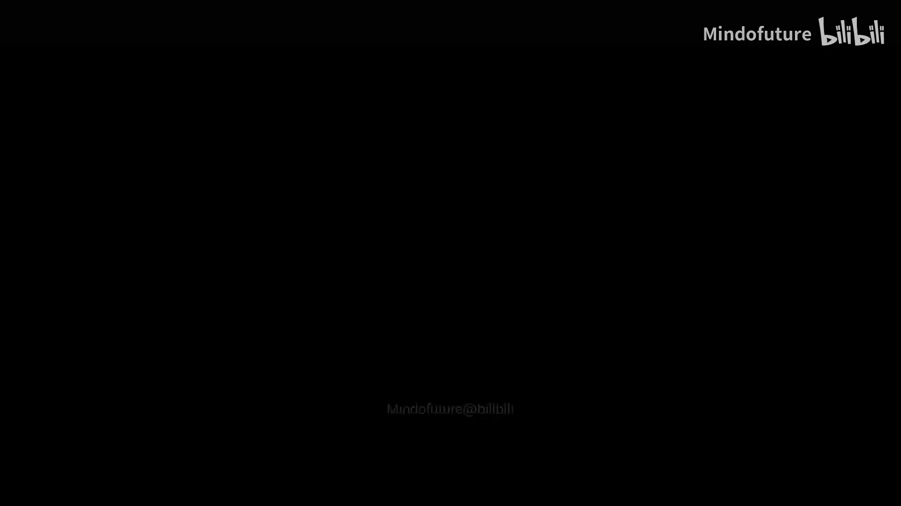
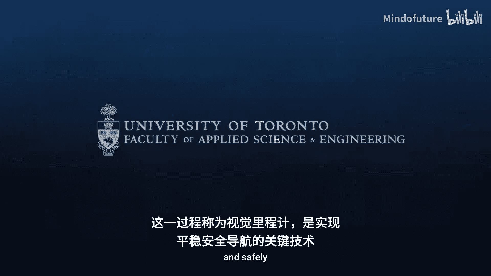

# 015：异常值剔除

## 概述
在本节课中，我们将学习如何将图像特征应用于自动驾驶车辆定位，并重点解决特征匹配中出现的“异常值”问题。我们将介绍一种强大的异常值处理方法——随机抽样一致性算法，并展示它如何提升定位结果的鲁棒性。

## 车辆定位问题定义
上一节我们介绍了特征提取、描述和匹配的三步框架。本节中，我们来看看如何利用这个框架解决一个实际问题：车辆定位。

我们的定位问题定义如下：给定同一场景、不同视角的两张图像，找到第一张图像（红色坐标系）与第二张图像（绿色坐标系）之间的平移量 **T**。为简化问题，我们暂不考虑因视角不同带来的尺度和倾斜变化，专注于平移。

要解决此问题，我们需要执行以下步骤：
1.  找到图像1在图像2的U轴上的位移，记为 **T_u**。
2.  找到图像1在图像2的V轴上的位移，记为 **T_v**。

我们将通过匹配图像间的特征，然后求解能最佳对齐这些匹配特征的位移量来找到 **T_u** 和 **T_v**。

## 特征匹配与数学模型
我们首先在图像1和图像2中计算特征及其描述符，然后使用上一课开发的暴力匹配器进行匹配。

你是否注意到匹配结果有些不对劲？我们稍后会回到这个问题。首先，让我们用匹配到的特征来数学化地定义我们的解决方案。

我们将来自图像1和2的一个特征对表示为 **F1_i** 和 **F2_i**，其中 **i** 的范围在0到 **n** 之间（**n** 是匹配算法返回的特征对总数）。每个特征由其像素坐标 **(u_i, v_i)** 表示。

假设应用平移 **T_u** 和 **T_v** 后，图像1中的每个像素都应与图像2中的对应像素重合。我们可以用特征对来建模这个平移关系：

**F2_i = F1_i + [T_u, T_v]^T**

这里，**T_u** 和 **T_v** 对所有特征对都是相同的，因为我们假设是刚体运动。现在，我们可以使用最小二乘估计来求解 **T_u** 和 **T_v**。最小二乘问题的解是使所有特征对像素之间误差平方和最小的 **T_u** 和 **T_v** 值。

## 异常值的出现与影响
现在我们已经定义了定位问题，让我们回到特征匹配的结果。

通过视觉观察特征位置，可以发现紫色圆圈中的特征对实际上是一个错误的匹配。即使我们使用了距离比率法，这种情况也经常发生。我们称这样的特征对为**异常值**。

异常值可能在我们特征集中占很大一部分，并且通常对我们的模型解（尤其是使用最小二乘估计时）产生不成比例的负面影响。让我们看看是否能识别这些异常值，并避免在最小二乘解中使用它们。

## 随机抽样一致性算法
异常值可以使用一种基于模型的异常值剔除方法处理，即**随机抽样一致性算法**。该算法由 Martin Fishler 和 Robert Bolles 于 1981 年提出，是机器人学中最常用的基于模型的异常值剔除方法之一。

以下是 RANSAC 算法的步骤：

首先，给定一个用于从一组数据点中识别问题解的模型，确定计算该模型参数所需的最少数据点数量 **M**。在我们的案例中，问题是定位，模型参数是最小二乘解的 **T_u** 和 **T_v** 偏移量。

以下是算法的具体迭代过程：
1.  从数据中随机选择 **M** 个样本。
2.  仅使用选中的 **M** 个样本来计算模型参数。
3.  使用计算出的参数，统计剩余数据点中有多少个符合这个计算出的解。被接受的点被保留，称为**内点**。
4.  如果内点数量 **C** 令人满意，或者算法已达到预设的最大迭代次数，则终止并返回计算出的解和内点集；否则，返回步骤 1 重复。
5.  最后，根据最佳内点集（即内点数量最多的那个集合）重新计算并返回模型参数。

## 应用 RANSAC 解决定位问题
现在我们可以重新审视我们的定位问题，并尝试处理特征匹配中的异常值。

提醒一下，我们的模型参数 **T_u** 和 **T_v** 将每个特征对从第一张图像同等位移到第二张图像。要估计 **T_u** 和 **T_v**，我们只需要一个特征对。

现在，让我们针对此问题走一遍 RANSAC 算法。

首先，我们从匹配样本中随机选择一个特征对。然后，我们使用这个特征对来估计模型，计算沿 U 轴的位移 **T_u** 和沿 V 轴的位移 **T_v**。

接着，我们需要通过计算内点数量来检查模型是否有效。这里我们使用一个容差来确定内点，因为模型很难达到 100% 的精确匹配。

不幸的是，我们的第一次迭代选择了一个糟糕的特征匹配来计算模型参数。当使用这个模型来计算图像1中有多少特征能平移到图像2中的匹配位置时，我们发现没有一个能做到。由于内点数为零，我们返回并随机选择另一个特征对，重新启动 RANSAC 过程。

我们再次使用新的随机采样特征对计算 **T_u** 和 **T_v**，得到新的模型参数。使用这个模型，我们计算图像1中有多少特征能平移到图像2中的匹配位置。这次我们可以看到，大多数特征实际上都符合这个模型。事实上，12个特征中有11个被认为是内点。由于我们的大多数特征都是内点，我们对这个模型感到满意，可以停止 RANSAC 算法。

## 总结
本节课中，我们一起学习了如何将图像特征正确应用于自动驾驶车辆应用。你了解了在特征匹配范围内什么是异常值，以及如何通过 RANSAC 算法处理异常值。异常值剔除是提高特征匹配鲁棒性的关键过程，能极大地提升定位结果的质量。

在下一个视频中，我们将利用目前所学，使用相机图像特征来估计自动驾驶车辆的位置。这将帮助我们跟踪车辆在环境中的运动，这个过程被称为视觉里程计，对于平稳安全的导航至关重要。