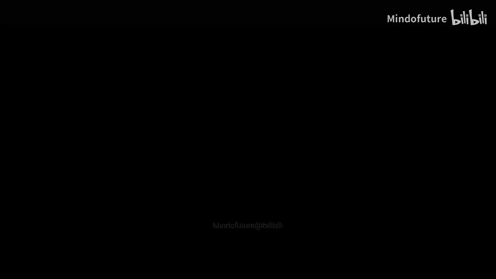
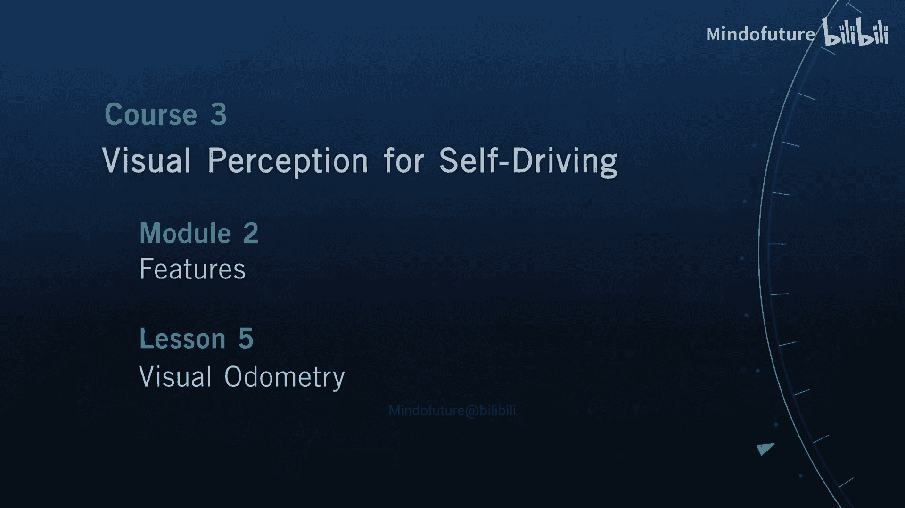
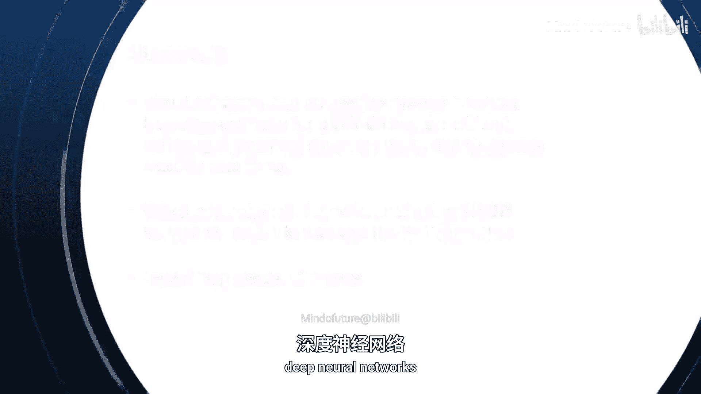

# 016：视觉里程计

在本节课中，我们将学习视觉里程计，这是自动驾驶汽车基于视觉进行状态估计的一项基础任务。我们将了解其定义、优势与挑战，并深入探讨其数学定义和核心处理流程，特别是3D到2D运动估计的方法。

## 概述

在本模块中，我们已经学习了如何检测、描述和匹配特征，以及如何处理特征匹配结果中的异常值。我们还探讨了如何使用特征在图像中定位物体，这可用于从一对图像中估计物体的深度。本节课，我们将学习如何执行视觉里程计。

## 什么是视觉里程计？

视觉里程计，简称VO，可以定义为通过检查运动对其车载摄像头图像所引起的变化，来增量式估计车辆姿态的过程。它与您在第二门课程中学到的**轮式里程计**概念相似，但使用的是摄像头而非编码器。

那么，对于自动驾驶汽车而言，使用视觉里程计可能比常规轮式里程计提供哪些优势呢？

*   **不受车轮打滑影响**：在转弯或不平坦地形上，视觉里程计不受车轮打滑的影响。
*   **轨迹估计更准确**：与轮式里程计相比，由于图像能提供更大量的信息，视觉里程计往往能产生更准确的轨迹估计。

然而，视觉里程计也存在一些挑战：

*   **无法估计绝对尺度**：这意味着从单个摄像头估计的运动可以在3D世界中拉伸或压缩，而不会影响像素特征位置，只需调整两幅图像之间的相对运动估计即可。因此，我们通常至少需要一个额外的传感器（通常是第二个摄像头或惯性测量单元）来在使用VO时提供准确缩放的轨迹。
*   **对光照敏感**：摄像头对极端光照变化敏感，使得在夜间以及存在车灯和街灯的情况下难以执行VO。
*   **存在漂移**：与其他里程计估计机制一样，VO的位姿估计会随着估计误差的累积而随时间漂移。因此，我们通常以**单位行驶距离的百分比误差**来引用VO的性能。

## 视觉里程计的数学定义

让我们从数学上定义视觉里程计问题。给定两个连续的图像帧 **Ik-1** 和 **Ik**，我们希望估计一个由平移 **t** 和旋转 **R** 定义的变换矩阵 **Tk**。

**Tk = [R | t]**

将从时间步 **k=1** 到 **K** 估计的每个变换序列连接起来，将为我们提供摄像头在图像序列上的完整轨迹。由于摄像头刚性连接在自动驾驶车辆上，这也代表了车辆轨迹的估计。

## 视觉里程计的一般流程

现在我们描述视觉里程计的一般流程。我们被给予两个连续的图像帧 **Ik** 和 **Ik-1**，并且想要估计这两个帧之间的变换 **Tk**。

以下是核心步骤：

1.  **特征检测与描述**：我们最终得到一组特征：图像 **k-1** 中的 **Fk-1** 和图像 **k** 中的 **Fk**。
2.  **特征匹配**：我们随后匹配两个帧之间的特征，以找出在两个目标帧中都出现的特征。
3.  **运动估计**：之后，我们使用匹配的特征来估计两个摄像头帧之间的运动，该运动由变换 **Tk** 表示。

运动估计是VO中最重要的一步，也将是本节课的主题。

我们执行运动估计步骤的方式取决于我们拥有的特征表示类型。

*   **2D到2D运动估计**：两个帧中的特征匹配纯粹用图像坐标描述。这种形式的视觉里程计非常适合在图像帧中跟踪物体，例如在摄像中的视觉跟踪和图像稳定方面极其有用。
*   **3D到3D运动估计**：特征匹配在世界3D坐标系中描述。这种方法需要能够在3D空间中定位新的图像特征，因此与深度摄像头、立体摄像头和其他可以提供深度信息的多摄像头配置一起使用。

这两种情况都很重要，并遵循我们将在本课剩余部分使用的相同的一般视觉里程计框架。

## 深入探讨：3D到2D运动估计

让我们更仔细地看看**3D到2D运动估计**，其中来自帧 **k-1** 的特征在3D世界坐标中指定，而它们在帧 **k** 中的匹配则在图像坐标中指定。

以下是执行3D到2D运动估计的方法：

我们被给予帧 **k-1** 中的特征集及其3D世界坐标的估计。此外，通过特征匹配，我们还拥有这些相同特征在新帧 **k** 中的2D图像坐标。请注意，由于我们无法直接从单目视觉里程计恢复尺度，因此在从图像坐标形成齐次特征向量时，我们包含了一个缩放参数 **s**。

我们想利用这些信息来估计两个摄像头帧之间的旋转矩阵 **R** 和平移向量 **t**。

这个图示是否让您想起了我们之前学过的东西？如果您想到了**相机标定**，那么您是正确的。事实上，我们在视觉里程计中也使用了与标定相同的投影几何方程。

需要注意的标定和VO之间的一个简化区别是，相机内参标定矩阵 **K** 是已知的，因此我们不需要再次求解它。我们的问题现在简化为从使用所有匹配特征构建的方程组中估计变换分量 **R** 和 **t**。

## PnP算法：求解旋转和平移

求解旋转 **R** 和平移 **t** 的一种方法是使用**透视n点算法**。给定3D中的特征位置、它们在2D中的对应投影以及相机内参标定矩阵 **K**，PnP求解外参变换如下：

1.  **直接线性变换**：PnP首先使用直接线性变换来求解 **R** 和 **t** 的初始猜测。用于估计 **R** 和 **t** 的DLT方法需要一个线性模型，并构建一组线性方程来使用SVD等标准方法求解。
2.  **非线性优化**：然而，我们拥有的方程在 **R** 和 **t** 的参数上是非线性的。在下一步中，我们使用迭代非线性优化技术（例如**列文伯格-马夸尔特方法**）来细化初始DLT解。
3.  **所需点数**：PnP算法至少需要三个特征来求解 **R** 和 **t**。当只使用三个特征时，会产生四种可能的解，因此需要第四个特征点来决定哪个解是有效的。
4.  **集成RANSAC**：最后，可以通过假设PnP在四个点上生成的变换是我们的模型，将RANSAC集成到PnP中。然后，我们选择所有特征匹配的一个子集来评估该模型，并检查所产生的内点百分比，以确认所选点匹配的有效性。

PnP方法是解决视觉里程计问题的一种高效方法，但仅使用可用匹配的一个子集来计算解。

## 改进与扩展

我们可以通过应用您在课程2中学到的**批量估计技术**来改进PnP。通过这样做，我们还可以整合来自其他车载传感器的额外测量值，并将视觉纳入状态估计流程中。有了视觉的加入，我们可以更好地处理GPS拒止环境，并提高我们位姿估计的准确性和可靠性。

在实现VO算法时，还有许多更有趣的细节需要考虑。幸运的是，PnP方法在OpenCV中有一个稳健的实现。事实上，OpenCV甚至包含了一个集成了RANSAC用于异常值剔除的PnP版本。您可以在补充阅读的链接中找到关于如何在OpenCV中使用PnP的描述。

## 总结

在本节课中，您学习了为什么视觉里程计是估计自动驾驶汽车轨迹的一个有吸引力的解决方案，以及如何为3D到2D对应关系执行视觉里程计。下周，我们将深入探讨一种从图像中提取信息用于自动驾驶汽车感知的基本方法：深度神经网络。

至此，您已经完成了自动驾驶汽车视觉感知的第二周学习。如果您没有完全掌握本周解释的所有材料，请不要担心。在本周的作业中，您将获得所有这些主题的实践经验。您将使用特征检测、匹配和PnP算法，在Python中构建您自己的自动驾驶汽车视觉里程计系统。下个模块再见。