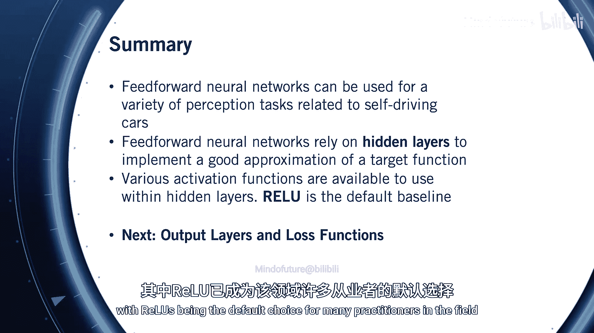

# 017：前馈神经网络 🧠

在本节课中，我们将学习一种改变了我们思考自动驾驶感知方式的技术：人工神经网络。我们将了解如何利用这些算法构建自动驾驶汽车的感知系统，并学习设计和训练深度神经网络的不同组成部分。虽然本模块无法涵盖人工神经网络的所有知识，但它将为你提供一个良好的入门介绍。

## 概述：神经网络作为函数近似器

前馈神经网络通过一个函数 **F(X, θ)** 定义了从输入 **X** 到输出 **Y** 的映射。例如，我们可以使用神经网络来输出摄像头图像中所有汽车的位置。这里的 **θ** 是一组需要学习的参数，我们并非直接使用一个完美的函数 **F**，而是通过一个通用的神经网络结构来构建对真实函数的近似。因此，神经网络可以被视为**函数近似器**。

通常，我们将前馈神经网络描述为一系列函数的组合。每一个函数 **f_i** 都建立在前一个函数 **f_{i-1}** 之上。这种层层堆叠的结构，正是“深度学习”这一名称的由来。

## 网络结构可视化

现在，让我们直观地理解这种函数组合。下图展示了一个四层前馈神经网络：

*   **输入层**：代表输入数据 **X**。**X** 可以是标量、向量、矩阵，甚至是像图像这样的N维张量。
*   **隐藏层**：第一隐藏层通过函数 **F1(x)** 处理输入。第二隐藏层处理第一隐藏层的输出，依此类推。我们可以添加任意数量的隐藏层，但每增加一层都会引入更多需要学习的参数和运行时计算量。
*   **输出层**：这是神经网络的最后一层，它将最后一个隐藏层的输出转换为我们期望的输出 **Y**。

这种网络被称为“前馈”，是因为信息从输入 **X** 开始，经过一系列中间步骤，单向地流向输出 **Y**，没有任何反馈连接。

## 在自动驾驶视觉感知中的应用

既然我们已经了解了基本结构，现在来看看如何将其应用于自动驾驶的视觉感知任务。本课程专注于视觉感知，因此我们的输入 **X** 始终是图像。

以下是几个关键应用示例：

*   **图像分类**：这是最基本的感知任务，要求神经网络通过一个标签告诉我们图像中包含什么。
*   **目标检测**：这是一个更复杂的任务，要求神经网络不仅识别图像中的物体（标签），还要估计它们的位置。
*   **像素级任务**：我们可能对每个像素进行分析。例如，**深度估计**（估计每个像素的深度值以确定物体位置）和**语义分割**（确定每个像素属于哪个类别，如汽车、行人、道路等）。

在所有这些情况下，我们都可以使用神经网络来学习从图像原始像素值到我们试图生成的感知输出之间的复杂映射，而无需显式地为这种映射关系建模。这种表示难以建模的过程的灵活性，正是神经网络如此流行的原因。

## 核心：隐藏层的构成与学习

那么，如何学习参数以创建鲁棒的感知模型呢？这个过程称为**神经网络训练**。我们通过提供输入 **X** 及其对应的真实输出 **F*(x)** 的数据对，来驱动神经网络函数 **F(X, θ)** 逼近真实函数 **F*(x)**。通过比较网络输出与真实输出，并优化网络参数以减少误差。

训练数据只指定每个样本的期望输出，并未规定网络应该用它的隐藏层做什么。网络必须自行决定如何修改这些层，以最好地实现 **F*(x)** 的近似。事实上，**隐藏单元正是神经网络区别于其他机器学习模型的独特之处**。

让我们更清晰地定义隐藏层的结构。一个隐藏层由一个**仿射变换**和一个**逐元素的非线性函数 G** 组成。这个非线性函数被称为**激活函数**。

第 **n** 个隐藏层的输入是 **H_{n-1}**（上一个隐藏层的输出）。对于第一个隐藏层，其输入就是图像 **X**。

**仿射变换**由可乘的权重矩阵 **W** 和可加的偏置矩阵 **B** 构成。这些权重和偏置就是神经网络定义中需要学习的参数 **θ**。

最后，变换后的输入会通过激活函数 **G**。大多数情况下，**G** 本身不包含需要网络学习的参数。

## 激活函数示例

目前大多数神经网络中，默认的激活函数选择是**线性整流单元**。

**ReLU** 使用仿射变换输出与0之间的最大值作为其逐元素非线性函数：`G(z) = max(0, z)`。由于它们非常接近线性单元，因此很容易优化。

让我们看一个ReLU隐藏层计算的例子。假设我们已知：
*   上一隐藏层输出 **H_{n-1}**（2x3矩阵）
*   权重矩阵 **W**（2x5矩阵）
*   偏置矩阵 **B**（5x3矩阵）

首先计算仿射变换（注意权重矩阵被转置）：
`Z = W^T * H_{n-1} + B`
结果 **Z** 是一个5x3矩阵。

然后将矩阵 **Z** 通过ReLU非线性函数。ReLU会阻止仿射变换产生的任何负值传递到下一层。

神经网络隐藏层中可以使用的逐元素非线性激活函数还有很多。事实上，隐藏单元的设计是该领域另一个非常活跃的研究方向，目前还没有很多确定性的理论指导原则。

其他常见的激活函数例子包括：
*   **Sigmoid** 非线性函数
*   **双曲正切** 非线性函数
*   **Maxout** 非线性函数（ReLU的一种泛化）

## 总结

本节课中，我们一起学习了前馈神经网络的主要构建模块，包括构成我们所使用的机器学习模型核心的**隐藏层**。我们还了解了不同类型的**激活函数**，其中ReLU是该领域许多实践者的默认选择。

在下一课中，我们将探索输出层，然后研究如何从训练数据中学习权重和偏置矩阵，为在本模块后续训练我们的第一个神经网络做好准备。

