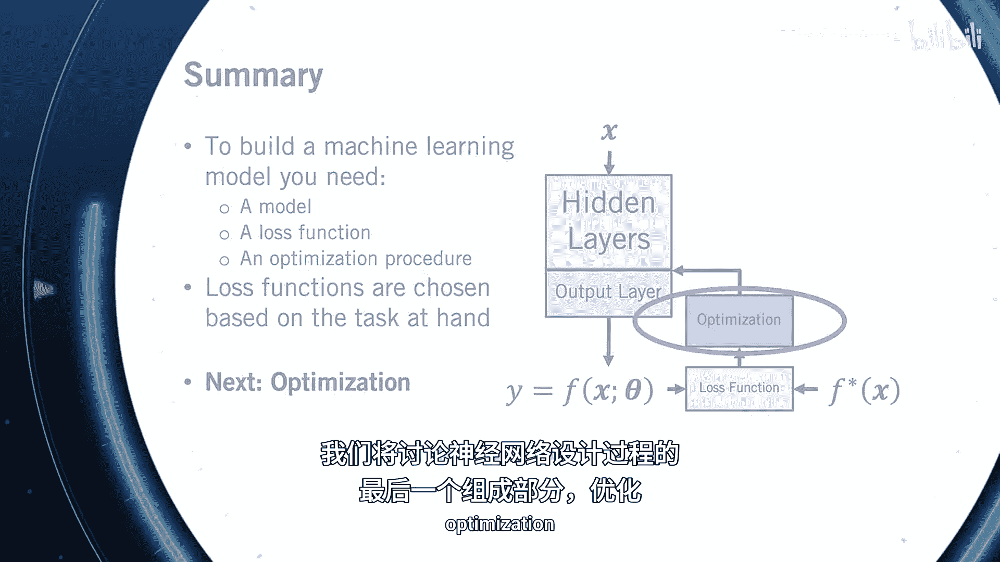

# 018：输出层与损失函数

在本节课中，我们将学习如何为特定的感知任务定义合适的神经网络。我们将回顾机器学习算法的通用设计流程，并重点介绍其中缺失的关键组件：输出层与损失函数。我们将了解如何根据任务类型（如分类或回归）来选择合适的输出层和损失函数。

## 机器学习算法设计流程回顾

上一节我们介绍了前馈神经网络这一强大的机器学习模型。本节中，我们来看看如何为特定任务设计完整的神经网络。

通常，包括神经网络在内的监督式机器学习模型有两种运行模式：**推理**和**训练**。

给定一组参数 θ，输入 X 通过模型 `F(x; θ)` 得到输出 y。这种模式称为**推理**，通常是我们将算法部署到现实世界时使用的模式。此时网络及其参数是固定的，我们用它从新的输入数据中提取感知信息。

然而，我们还需要定义如何获得参数集 θ。这就需要第二种模式：**训练**。训练的唯一目的是为当前任务生成一组令人满意的参数。

以下是训练通常如何进行的步骤：

1.  我们从一个与推理相同的工作流程开始。但在训练期间，我们拥有训练数据，因此我们知道期望的模型输出 `F*(x)` 是什么。
2.  我们通过一个**损失函数**或**成本函数**，将网络的预测输出 y 与真实输出 `F*(x)` 进行比较。
3.  损失函数以网络的预测输出 y 和真实输出 `F*(x)` 作为输入，并提供两者差异的度量。
4.  我们通常通过修改参数 θ 来最小化这个度量，使得网络的输出 y 尽可能接近 `F*(x)`。
5.  我们通过一个**优化过程**来修改 θ。这个过程接收损失函数的输出，并提供一组新的参数 θ，使得损失函数的值更低。

我们将在下一课中详细学习这个优化过程。现在，让我们将设计流程扩展到神经网络。

## 神经网络的输出层与损失函数

我们在上一课讨论的前馈神经网络，接收输入 X，将其通过一系列隐藏层，然后将隐藏层的输出传递给一个**输出层**。这就是神经网络推理阶段的终点。

对于训练，我们将预测输出传递给损失函数，然后使用优化过程来产生一组新的参数 θ，以降低损失函数的值。

传统机器学习算法设计与人工神经网络设计之间的主要区别在于，神经网络仅通过**输出层**与损失函数交互。因此，输出层和损失函数根据手头的任务一起设计是非常合理的。

让我们深入了解自动驾驶中通常遇到的主要感知任务。

## 自动驾驶中的主要感知任务

第一个重要的任务是**分类**。分类可以描述为接收一个输入 X，并将其映射到 K 个类别中的一个。例如：
*   **图像分类**：将图像映射到一个特定类别，例如判断它是否包含猫或狗。
*   **语义分割**：将图像中的每个像素映射到一个类别。

第二个常用任务是**回归**。在回归中，我们希望将输入映射到一组实数。例如：
*   **深度估计**：估计图像中每个像素的真实深度值。

我们也可以将这两个任务混合在一起。例如，**目标检测**通常包含一个回归任务（估计包含目标的边界框）和一个分类任务（识别边界框内是哪种类型的对象）。

现在，我们将描述与这些基本感知任务相关的输出层和损失函数对。

## 分类任务：Softmax 输出层与交叉熵损失

通常，对于 K 类分类任务，我们使用 **Softmax 输出层**。Softmax 输出层能够表示 K 个类别上的概率分布。

Softmax 输出层接收神经网络最后一个隐藏层的输出 H 作为输入。然后，它通过一个仿射变换，得到一个变换后的输出向量 Z。接下来，使用 **softmax** 逐元素函数将向量 Z 转换为离散概率分布。

对于每个元素 `z_i`，该函数计算 `exp(z_i)` 与 Z 所有元素 `exp` 之和的比值。结果是一个介于 0 和 1 之间的值，并且所有这些元素的总和为 1，使其成为一个合适的概率分布。

**公式**：`softmax(z_i) = exp(z_i) / Σ_j exp(z_j)`

让我们看一个数值例子来更好地解释 Softmax 输出层。在这个例子中，我们希望分类包含猫、狗或狐狸的图像。

首先，我们定义输出向量的第一个元素对应于网络认为图像是猫的概率。类别的顺序是任意的，对网络性能没有影响。

取仿射变换的输出，我们通过将输出每个元素的指数除以所有元素指数的总和来计算概率。

给定线性变换层的输出值为 13、-7 和 11，我们得到该图像是猫的概率为 88.0%，是狐狸的概率为 11.9%，是狗的概率非常低。

现在，让我们看看如何设计一个使用 Softmax 输出层输出的损失函数，以显示我们的估计有多准确。

与 Softmax 输出层一起使用的标准损失函数是**交叉熵损失**，它由取 softmax 函数的负对数形成。

交叉熵损失有两个项来控制网络的输出与真实概率的接近程度。

**公式**：`L = -z_i + log(Σ_j exp(z_j))`

其中，`z_i` 是在通过 softmax 函数之前，对应于真实类别的隐藏层输出。这通常被称为**类别 logit**。

当最小化这个损失函数时，类别 logit `z_i` 的负数鼓励网络为正确类别的概率输出一个大的值。另一方面，第二项鼓励仿射变换的输出变小。这两项共同鼓励网络最小化预测类别概率与真实类别概率之间的差异。

为了更好地理解这个损失，让我们看一个数值例子，了解如何从分类神经网络的输出计算交叉熵损失。

回顾我们之前的例子，我们首先需要选择我们的 `z_i` 是什么。`z_i` 是线性变换输出中对应于输入真实类别的元素。在这种情况下，`z_i` 是线性变换输出中对应于猫类别的元素。

一旦我们确定了 `z_i`，就使用交叉熵来计算最终的损失值。在这种情况下，网络正确预测输入是一只猫，得到的损失函数值为 0.12。

现在让我们再次计算，但使用一个错误的网络输出。网络的输入仍然是一张猫的图像。网络仍然为线性变换输出的猫条目分配值 13，但这次，狐狸条目将获得值 14。计算交叉熵损失，我们发现它的值为 1.31，是上一张幻灯片值的 10 倍多。

请注意，即使输出只差 1，损失函数也会严重惩罚错误的预测。这种差异加速了学习过程，并在训练期间迅速将网络输出引导至真实值。

## 回归任务：线性输出层与均方误差损失

到目前为止，我们已经介绍了针对分类任务的输出层和损失函数。现在让我们来看看回归任务最常用的输出层。

**线性输出层**主要用于回归任务，以对常见概率分布的统计量进行建模。线性输出层仅由一个仿射变换组成，没有任何非线性。

用线性输出层建模的统计量取决于我们选择与之搭配的损失函数。例如，为了对概率分布的**均值**进行建模，我们使用**均方误差**作为损失函数。

**公式**：`MSE = (1/n) * Σ (y_pred - y_true)^2`

## 总结

本节课中，我们一起学习了构建机器学习模型所需的关键组件。你了解到，要构建一个机器学习模型，你需要定义一个网络模型、一个损失函数以及一个学习网络参数的优化过程。

你还学会了根据神经网络模型需要完成的任务（分类或回归）来选择相应的损失函数。上面描述的线性和 Softmax 输出单元是当今神经网络中最常用的输出层，可以与各种特定任务的损失函数结合，为自动驾驶执行各种有用的感知任务。

当然，还存在许多其他输出层和损失函数，这仍然是深度学习中的一个活跃研究领域。

在下一个视频中，我们将讨论神经网络设计过程的最后一个组成部分：**优化**。这涉及到如何为特定任务获得最佳参数集 θ。下次见。