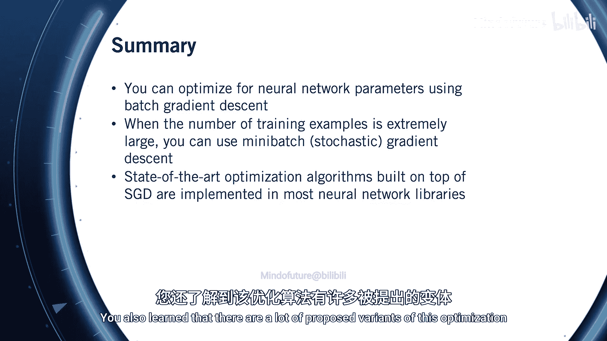

# 019：基于梯度下降的神经网络训练

## 概述
在本节课中，我们将学习如何通过训练过程为前馈神经网络找到最佳参数集。我们将重点介绍梯度下降优化算法，包括其工作原理、参数初始化方法、停止条件，以及如何通过使用小批量数据来提高训练效率。

---

## 神经网络训练流程回顾
上一节我们介绍了前馈神经网络的构成以及如何使用损失函数评估其性能。本节中，我们来看看如何通过训练过程来优化网络参数。

给定训练输入数据 **X** 和对应的正确输出 **F\*(x)**，训练流程如下：
1.  将输入 **X** 通过网络隐藏层和输出层，得到最终输出 **y**。
2.  通过损失函数 **L** 比较网络预测输出 **F(x, θ)** 与正确输出 **F\*(x)** 之间的误差。

网络输出 **y** 是参数 **θ** 的函数，而 **θ** 包含了网络中所有线性变换的权重和偏置。我们的目标是通过调整 **θ**，使整个数据集上的损失函数值最小化。

## 梯度下降优化算法
为了最小化损失函数，我们使用其梯度作为指导来更新参数 **θ**。这种优化过程称为梯度下降。

首先，我们来看神经网络的损失函数。在自动驾驶任务中，通常有数千个训练样本对 **(X, F\*(x))**。整个训练集上的损失可以计算为所有单个样本损失的平均值：

**L(θ) = (1/N) * Σ L_i(θ)**

其中，**N** 是训练样本总数，**L_i(θ)** 是第 **i** 个样本的损失。

损失函数 **L(θ)** 关于参数 **θ** 的梯度，等于每个样本损失梯度的平均值：

**∇_θ L(θ) = (1/N) * Σ ∇_θ L_i(θ)**

这里利用了梯度和求和都是线性算子这一性质。

基于上述梯度公式，我们现在可以描述批量梯度下降优化算法。批量梯度下降是一种一阶迭代优化方法。“迭代”意味着它从一个初始参数猜测 **θ** 开始，并逐步改进这些参数。“一阶”意味着该算法仅使用一阶导数（梯度）来更新参数。

以下是批量梯度下降的步骤：
1.  **初始化**：初始化神经网络的参数 **θ**。
2.  **设定停止条件**：确定一个终止算法的条件，并返回最终的参数集。
3.  **迭代循环**：
    *   **计算梯度**：计算损失函数关于参数 **θ** 的梯度 **∇_θ L(θ)**。
    *   **更新参数**：按照以下公式更新参数：
        **θ ← θ - ε * ∇_θ L(θ)**
        其中，**ε** 称为学习率，它控制每次迭代中参数沿负梯度方向调整的幅度。

让我们看一个二维情况下的批量梯度下降可视化示例。假设我们试图找到最小化函数 **J(θ)** 的参数 **θ1** 和 **θ2**，其形状像一个椭圆碗。

梯度下降迭代地寻找新的参数 **θ**，使我们在每次迭代中沿着碗向下移动一步。算法首先初始化参数 **θ**，得到一个初始损失值（图中红点）。然后计算该初始点处的梯度，并使用更新步骤获得新参数，从而到达损失函数上更低的位置。重复此过程，直到满足停止条件，最后得到的参数集 **θ1** 和 **θ2** 就是最小化损失函数的最优解。

## 参数初始化与停止条件
上述算法中还有两个关键问题：如何初始化参数 **θ**，以及如何决定何时停止算法。这两个问题的答案在很大程度上依赖于实践中效果良好的启发式方法。

对于参数初始化，我们通常使用标准正态分布来初始化权重，并将偏置设置为0。值得注意的是，文献中还有一些针对特定激活函数的其他启发式方法。

确定梯度下降的停止条件则更为复杂。主要有三种方式：
1.  **最大迭代次数**：当达到预定义的最大梯度下降迭代次数时停止。
2.  **参数变化量**：当参数 **θ** 在迭代之间的变化非常小时停止。小的变化意味着算法不再有效地更新参数，可能意味着已经达到了一个最小值。
3.  **损失值变化量**：当损失函数值在迭代之间的变化变得很小时停止。同样，这通常意味着优化可能已经收敛到一个最小值。

选择哪种停止条件很大程度上取决于具体问题的实际情况。我们将在下一课中重新讨论停止条件，研究训练过程中的一些陷阱以及如何避免它们。

## 随机/小批量梯度下降
不幸的是，批量梯度下降算法存在严重缺陷。为了计算梯度，我们需要使用反向传播，这涉及为整个训练集计算网络输出。批量梯度下降在整个训练集上评估梯度，使得执行单次更新步骤非常缓慢。

幸运的是，损失函数及其梯度都是对整个训练数据集求平均。我们知道，从 **N** 个样本中估计出的均值的标准误差为 **σ / √N**，其中 **σ** 是分布的标准差。这意味着梯度估计误差的下降速度小于样本数量的线性增长。这一观察非常重要，因为我们现在可以使用训练数据的一个小子集（即小批量）来计算梯度估计。

那么，使用小批量如何修改我们的批量梯度下降算法呢？修改实际上非常简单。基础算法中唯一的改变在于采样步骤。我们选择训练数据的一个子集 **N‘** 作为小批量，然后以与批量梯度下降相同的方式评估梯度并执行更新步骤。

这个算法被称为随机或小批量梯度下降，因为我们在每次迭代中随机选择样本组成小批量。然而，这个算法引入了一个需要确定的额外参数，即小批量的大小。

以下是选择小批量大小时需要考虑的一些因素：
*   **硬件效率**：像GPU这样的多核架构，如果使用极小的批量大小，通常无法充分利用其计算能力。因此，存在一个绝对的最小批量大小，低于此值处理一个小批量的时间不会减少。此外，使用2的幂次方作为批量大小（如32、64、128、256）通常能更好地匹配GPU的计算和内存架构，从而高效利用资源。
*   **梯度估计精度**：较大的批量大小通常能提供更准确的梯度估计，确保参数更新方向能更可靠地改善网络性能。然而，这种估计精度的提升是次线性的。
*   **正则化与收敛速度**：另一方面，较小的批量大小已被观察到具有正则化效果，通常在批量大小为1时能获得最佳的泛化能力。同时，优化算法如果能够快速计算梯度的近似估计并更频繁地迭代，通常会比计算精确梯度但迭代次数更少时收敛得更快。

权衡这些因素后，典型的2的幂次方小批量大小范围在32到256之间。对于大型模型或为了改善泛化能力，有时也会尝试更小的批量大小。

最后需要注意的一点是，在采样小批量之前，必须对数据集进行洗牌。完全不洗牌数据集可能会降低网络的有效性。

文献中存在许多随机梯度下降的变体，每种都有其优缺点。选择使用哪种变体可能很困难，有时某种变体对特定问题效果更好。作为自动驾驶应用的一个简单经验法则，**Adam** 优化方法是一个安全的选择。它对初始参数 **θ** 相当鲁棒，并且被广泛使用。

## 总结
本节课中，我们一起学习了如何使用批量梯度下降来优化神经网络的参数。我们了解到，这个优化算法有许多提出的变体，其中 **Adam** 是一个安全的默认选择。恭喜你，你已经完成了构建和训练神经网络所需的基本步骤。

在下一课中，我们将讨论如何选择一些优化参数（如学习率）来改善网络训练，以及如何使用验证集来评估神经网络的性能。下次见。