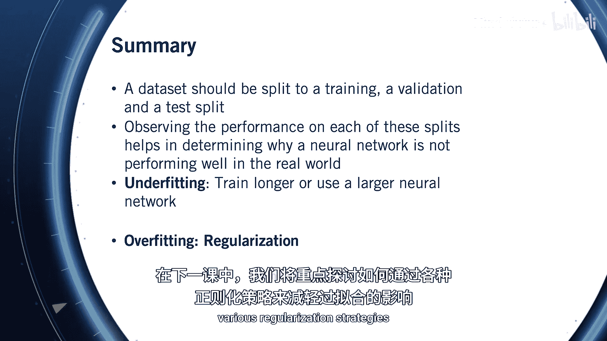

# 020：数据划分与神经网络性能评估

在本节课中，我们将学习如何划分数据以对神经网络模型进行无偏的性能评估，以及如何通过观察神经网络在不同数据划分上的表现来获取洞见。

## 概述

到目前为止，我们已经讨论了什么是神经网络，以及如何根据训练数据找到最佳权重。然而，我们仍需更深入地探讨如何高效地训练神经网络。本节将介绍如何划分数据，以及如何解读神经网络在不同数据集上的性能表现。

## 数据划分的必要性

假设我们面临一个实际问题：我们有一个包含10000张交通标志图像及其对应分类标签的数据集。我们的目标是训练一个神经网络来进行交通标志分类。

我们是否应该在所有数据上训练，然后直接部署分类器？这种方法很可能会失败。原因在于，对于一个足够大的神经网络，经过足够多的训练迭代后，它几乎总能获得非常低的训练损失。这是因为典型的深度神经网络拥有大量参数，使其在很大程度上能够“记住”训练数据。

因此，更好的方法是将数据划分为三个部分：**训练集**、**验证集**和**测试集**。

## 数据划分详解

顾名思义，**训练集**在神经网络训练期间被模型直接观察。损失函数正是在这个训练集上被直接最小化的。但如前所述，我们预期该函数在此集合上的值会非常低。

**验证集**由开发者用来测试当超参数改变时神经网络的性能。超参数是指那些修改网络结构或影响训练过程，但不属于训练期间学习的网络参数的参数。例如：学习率、层数、每层单元数以及激活函数类型。

最后的划分称为**测试集**，用于获得性能的无偏估计。在开发神经网络架构时，测试集应被严格隔离，确保神经网络在训练或超参数优化过程中从未见过这些数据。测试集的唯一用途应是在将最终架构和超参数集部署到自动驾驶汽车之前，评估其性能。

## 划分比例

在大数据时代之前，数据集通常在数千个样本的规模。在这种情况下，默认的划分比例大约是：60%用于训练，20%用于验证，20%保留用于测试。

然而，如今拥有数百万样本的数据集并不少见。在这种情况下，将20%的数据放在验证集和测试集中是不必要的，因为验证和测试所需的样本量远小于此。在这种情况下，我们可能会发现，98%的数据用于训练，1%用于验证，1%用于测试的划分方式也很常见。

回到我们的交通标志检测问题。我们假设交通标志数据集包含10000个标记样本。我们可以根据“60-20-20”的小数据集经验法则，将数据分为训练集、验证集和测试集。

## 性能评估与解读

我们现在使用损失函数来评估神经网络在每个划分上的性能。对于分类问题，损失函数定义为预测值与真实标签之间的**交叉熵**。交叉熵严格大于零，因此其值越高，分类器的性能越差。

请记住，神经网络只直接观察训练集，而开发者使用验证集来确定最佳超参数。训练的最终目标仍然是最小化测试集上的误差，因为这是对我们系统性能的无偏估计，并且网络从未见过这些数据。

让我们考虑以下几种性能表现场景。

### 场景一：良好拟合

假设我们的评估器在训练集上的交叉熵损失为0.21，在验证集上为0.25，在测试集上为0.3。此外，由于数据集中标签存在误差，我们预期可实现的最小交叉熵损失为0.18。

在这种情况下，我们拥有一个相当不错的分类器，因为三个集合上的损失相当一致，并且损失接近整个任务可实现的最小损失。

### 场景二：欠拟合

现在考虑第二种场景，训练损失现在是1.9，大约是最小损失的10倍。正如上一课所讨论的，我们预期任何合理规模的神经网络，在给定足够训练时间的情况下，几乎都能完美拟合数据。但在这种情况下，网络未能做到。我们将神经网络无法降低训练损失的这种情况称为**欠拟合**。

### 场景三：过拟合

我们可能面临的另一种情况是训练集损失低，但验证集和测试集损失高。例如，我们可能遇到验证损失大约是训练损失10倍的情况。这种情况被称为**过拟合**，是由于神经网络优化其参数以精确复现训练数据输出而导致的。当我们在验证集上部署时，网络无法很好地泛化到新数据。训练损失和验证损失之间的差距称为**泛化差距**。我们希望这个差距尽可能低，同时保持足够低的训练损失。

## 性能优化策略

接下来，我们看看如何尝试从欠拟合或过拟合状态转变为良好的评估器。

### 如何应对欠拟合

我们首先从如何补救欠拟合开始。

以下是应对欠拟合的主要方法：
*   **延长训练时间**：如果架构适合当前任务，延长训练时间通常会导致更低的训练损失。
*   **增加网络容量**：如果架构太小，延长训练时间可能没有帮助。在这种情况下，您需要向神经网络添加更多层，或为每层添加更多参数。
*   **更换架构**：如果以上选项都没有帮助，您的架构可能不适合当前任务，您需要尝试不同的架构来减少欠拟合。

### 如何应对过拟合

现在，让我们继续探讨减少过拟合的最常用方法。

以下是应对过拟合的主要方法：
*   **收集更多数据**：在过拟合的情况下，最简单的方法是收集更多数据。不幸的是，对于自动驾驶汽车，收集训练数据非常昂贵，因为它需要工程时间进行数据收集，以及大量的标注员时间来正确定义真实输出。
*   **使用正则化**：另一种解决过拟合的方法是**正则化**。正则化是指对学习算法进行的任何修改，旨在降低泛化差距，但不降低训练损失。
*   **重新审视架构**：如果其他方法都失败了，最终的解决方案是重新审视架构，检查它是否适合当前任务。

## 总结

在本节课中，我们学习了如何解读神经网络在训练集、验证集和测试集上的不同性能表现场景。如果确定我们的网络欠拟合，最简单的解决方案是训练更长时间或使用更大的神经网络。然而，在自动驾驶汽车感知中，更常遇到的情况是过拟合，即在训练数据上的良好表现并不总能转化为在实际道路上的良好表现。

在下一课中，我们将重点介绍如何通过各种正则化策略来减轻过拟合的影响。这些策略将使在标记数据集上训练出色的感知算法，能够在不断变化的世界中继续良好地工作。