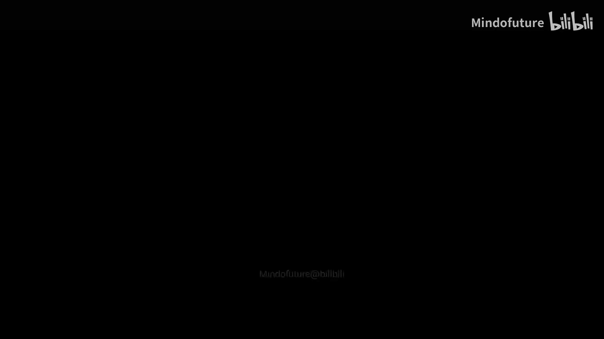
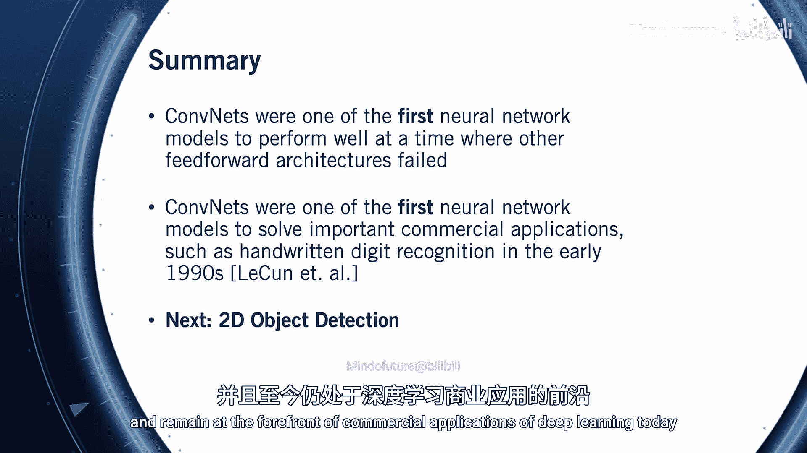

# 022：卷积神经网络

在本节课中，我们将深入学习卷积神经网络（Convolutional Neural Networks, ConvNets），理解它们为何对视觉感知任务至关重要。我们将探讨卷积层如何利用互相关运算替代全连接层的矩阵乘法，使其特别适合处理图像数据。同时，我们也会分析卷积神经网络相较于标准前馈神经网络的优势。

## 🧠 卷积神经网络简介

如果你关注过自动驾驶汽车的最新进展，那么“卷积神经网络”或简称“ConvNets”这个词你一定听过不止几次。事实上，我们目前就在自己的自动驾驶汽车Autonomous上使用卷积神经网络执行多种感知任务。

卷积神经网络是一种专门用于处理具有已知网格状拓扑结构数据的神经网络。这类数据的例子包括：在一维时间序列数据、二维图像，甚至是三维视频。卷积网络主要由两种类型的层构成：**卷积层**和**池化层**。

一个简单的卷积网络架构例子是VGG16。该网络接收图像，并将其通过一系列卷积层、池化层以及更多卷积层和池化层进行处理。目前我们无需过多担心VGG16架构的具体设计细节，在后续学习目标检测的视频中，我们会详细讨论这个架构。

接下来，让我们看看这两种层在实践中是如何工作的。

## 🔗 从全连接层到卷积层

我们之前描述的神经网络隐藏层通常被称为**全连接层**。顾名思义，全连接层将每个节点的输出连接到下一层的每一个节点输入。这意味着输入中的每个元素都会影响输出中的每个元素，这在软件中通过密集矩阵乘法实现。

虽然听起来有些反直觉，但卷积层使用**互相关**（cross-correlation）而非卷积（convolution）作为其线性算子，以此替代通用的矩阵乘法。使用互相关的逻辑在于：如果参数是通过学习得到的，那么是否翻转输出并不重要。由于我们学习的是卷积层的权重，这种翻转完全不影响最终结果。这导致了所谓的**稀疏连接**：卷积层中的每个输入元素，由于卷积操作使用了有限大小的核，只影响少数几个输出元素。

## 🖼️ 卷积层的工作原理

让我们从描述卷积层的实际工作方式开始。假设我们想对一个输入图像应用卷积层。我们将此图像称为**输入体积**，因为卷积层也可以将其他层的输出作为其输入。

输入体积的**宽度**是其水平维度，**高度**是其垂直维度，**深度**是通道数。在我们的例子中，这三个特征的值都是3。

为什么我们在计算高度或宽度时不考虑灰色像素？灰色像素是通过一个称为**填充**的过程添加到图像中的。每边添加的像素数称为填充大小，在这个例子中是1。填充对于保持执行卷积所需的形状至关重要。

我们通过一组**核**或**滤波器**来执行卷积操作。每个滤波器由一组权重和一个偏置组成。核的通道数需要与输入体积的通道数相对应。在这个例子中，每个滤波器有三个权重通道，分别对应输入图像的红、绿、蓝通道。通常，每个卷积层有多个滤波器。

让我们看看如何应用两个滤波器从输入体积得到输出体积。我们首先取滤波器的每个通道，在该通道与输入体积的对应通道之间执行互相关运算。然后，我们将所有通道互相关运算的输出与滤波器的偏置相加，得到最终的输出值。

注意，**每个滤波器产生一个输出通道**。我们稍后会回到这一点。

现在，让我们看看如何得到输出体积的其余部分。完成第一次计算后，我们将滤波器位置在水平方向上移动预设数量的像素。当到达输入体积宽度的末端时，我们将滤波器位置在垂直方向上移动预设数量的像素。垂直和水平移动的步长通常是相同的值，我们称这个值为卷积层的**步长**。

最终，我们得到一个具有自身宽度、深度和高度值的输出体积。

## 📐 输出体积尺寸计算

假设滤波器尺寸为 `M x M`，我们有 `K` 个滤波器，步长为 `S`，填充为 `P`，我们可以推导出输出体积宽度、高度和深度的表达式。

你可能会觉得这很难跟踪。但在设计卷积网络时，了解最终会得到什么尺寸的输出层非常重要。例如，如果你试图在道路场景中检测小的交通标志和交通灯，你就不希望输出体积的尺寸缩减太多，因为它们只在图像中占据少量像素，如果输出体积过于紧凑，它们的可见性可能会丢失。

以下是计算输出尺寸的公式：
*   **输出宽度** = `(输入宽度 - M + 2P) / S + 1`
*   **输出高度** = `(输入高度 - M + 2P) / S + 1`
*   **输出深度** = `K` （滤波器数量）

## 🧊 池化层的工作原理

上一节我们介绍了卷积层如何提取特征，本节中我们来看看卷积网络的另一个核心组件：池化层。

池化层使用池化函数，用附近输出的汇总统计量来替换前一层的输出。池化有助于使特征表示对输入的小幅平移具有**不变性**。如果我们对输入进行小幅平移，池化层的输出不会改变。这对于物体识别非常重要，例如，如果我们将图像中的汽车平移一小段距离，它仍然应该被识别为汽车。

让我们以最常用的池化层——**最大池化**为例。最大池化使用最大值函数来汇总输出体积的局部区域。给定灰色的输入体积，最大池化将一个 `M x M` 区域应用于最大值函数，然后以类似于卷积层的步长移动该区域。

同样，我们可以根据以下公式推导出池化层输出的宽度、高度和深度。在我们之前的例子中，滤波器大小 `M` 为2，步长为2，因此我们最终得到一个2x2的输出。

让我们看看这个池化层如何帮助我们实现平移不变性。例如，让我们将之前的输入体积平移一个像素。由于平移而添加的像素显示为蓝色，而被移除的像素显示为红色。我们可以像上一张幻灯片那样，对这个输入体积应用最大池化。当我们将新输出与原始体积输出进行比较时，我们发现只有一个元素发生了变化。

## 🚗 卷积网络在自动驾驶中的优势

到目前为止，我们已经讨论了卷积网络如何运作，但还没有说明它们在自动驾驶汽车背景下的实用性。卷积网络的有效性主要有两个重要原因。

首先，与具有类似结构的全连接网络相比，卷积网络的卷积层通常具有**少得多的参数**。这通过**参数共享**减少了过拟合的机会，并允许卷积网络处理更大的图像。

其次，也是更重要的，是**平移不变性**。通过使用相同的参数处理图像的每个区块，卷积网络能够检测物体或对像素进行分类，即使它在图像平面上发生了平移。这意味着无论汽车出现在哪里，我们都能检测到它。

## 📜 卷积神经网络简史

在结束本节课之前，我想简要介绍一下卷积神经网络的历史。卷积神经网络在深度学习历史上扮演了重要角色。事实上，卷积网络是最早表现良好的神经网络模型之一，在当时其他前馈架构（尤其是在与ImageNet数据集相关的图像分类任务上）失败的时候取得了成功。在许多方面，卷积网络为深度学习的其余部分铺平了道路，并为神经网络在总体上获得相对较新的认可做出了贡献。

最后，卷积网络是最早解决重要商业应用的神经网络之一。最著名的是Yann LeCun在90年代初的手写数字识别器，并且至今仍处于深度学习商业应用的前沿。

事实上，在本课程的下一周，我们将向你展示如何使用卷积网络检测道路场景中的一系列不同物体。二维目标检测，我们下周见。

## 📝 总结

本节课中，我们一起学习了卷积神经网络的核心概念。我们了解了卷积层如何利用互相关和稀疏连接高效处理图像数据，以及池化层如何通过下采样和提供平移不变性来增强网络的鲁棒性。我们还探讨了卷积网络参数更少、具备平移不变性这两大优势，使其特别适合自动驾驶中的视觉感知任务。最后，我们回顾了卷积网络在深度学习发展史上的重要地位。这些知识为我们后续学习目标检测等具体应用打下了坚实的基础。