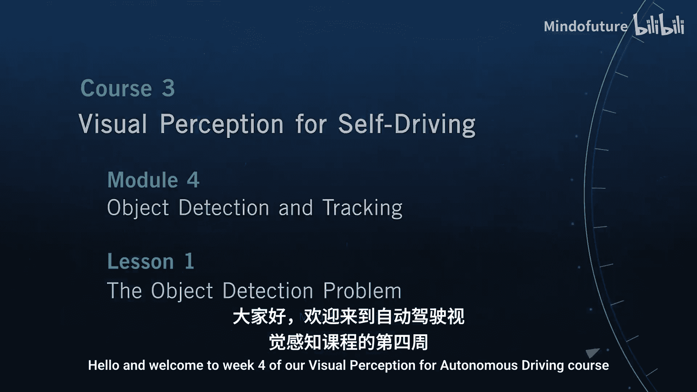
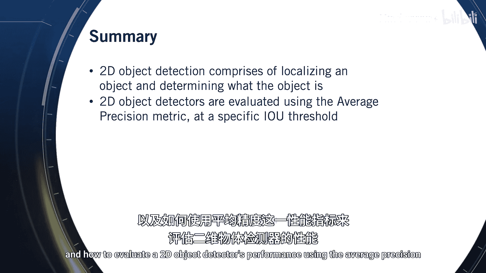

# 023：物体检测问题 🚗

## 概述

在本节课中，我们将学习自动驾驶汽车视觉感知中的一个核心模块：**2D物体检测**。我们将定义物体检测问题，了解其重要性，并学习如何评估物体检测器的性能。

---

## 2D物体检测简介

物体检测是自动驾驶汽车感知栈中的一项顶层要求，用于识别车辆、行人、标志和交通灯的位置，以便汽车知道可以在哪里以及如何行驶。

本周，我们将深入探讨如何定义2D物体检测问题，如何应用卷积神经网络来解决它，以及为何这个问题具有挑战性。我们还将解释物体检测如何作为2D物体跟踪问题的输入，并在自动驾驶汽车的背景下执行跟踪任务。

---

## 2D物体检测的历史背景

2D物体检测的历史始于2001年，当时Paul Viola和Michael Jones发明了一种非常高效的人脸检测算法。这个被称为Viola-Jones物体检测框架的算法，是第一个能够从简单网络摄像头提供可靠实时2D物体检测的框架。

下一个重大突破发生在四年后，Nevit Deal和Bill Triggs提出了方向梯度直方图特征描述符。他们的算法应用于行人检测问题，在当时超越了所有其他方法。Deal-Triggs算法一直占据榜首，直到2012年。

2012年，多伦多大学计算机科学系的Alex Krizhevsky、Ilya Sutskever和Geoffrey Hinton用他们的卷积神经网络AlexNet震撼了计算机视觉界。AlexNet以巨大优势赢得了2012年ImageNet大规模视觉识别挑战赛。当时，它是该比赛中唯一基于深度学习的参赛作品。但自那以后，所有获胜作品都基于卷积神经网络，并且最近超越了95%的人类识别率。

这种卓越性能从2D物体识别延伸到了2D物体检测，当今的检测器几乎完全基于卷积神经网络。

---

## 2D物体检测问题定义

在探讨如何使用卷积神经网络进行自动驾驶汽车的物体检测之前，让我们先正式定义一般的2D物体检测问题。

给定一个2D图像输入，我们需要估计场景中所有物体的位置（由边界框定义）和类别。通常，我们选择与自动驾驶应用相关的类别。我们通常最感兴趣的是动态物体类别，即在场景中移动的物体。这些包括车辆及其子类、行人和骑行者。

2D物体检测问题并非易事。我们需要估计的物体范围在图像空间中并不总是完全可见。例如，背景物体通常被前景物体遮挡。这要求我们使用的任何算法都必须能够“想象”物体的完整范围以正确检测它们。

此外，靠近图像边缘的物体通常会被截断。这种现象造成了边界框大小的巨大变化，估计的边界框大小取决于物体被截断的程度。

2D物体检测算法面临的另一个问题是尺度问题。物体离传感器越远，看起来就越小。我们的算法需要在不同的尺度下确定这些物体的类别。

最后，我们的算法还应该能够处理光照变化。这在自动驾驶汽车的背景下尤其重要，因为图像可能受到整体光照变化（从明亮的阳光到夜间驾驶）以及部分变化（由于反射、阴影、降水和其他干扰效应）的影响。

---

## 问题的数学形式化

现在我们已经直观地理解了物体检测是什么，让我们从数学上形式化这个问题。

物体检测可以定义为一个函数估计问题。给定一个输入图像 **X**，我们希望找到一个函数 **F(x, θ)**，它产生一个输出向量。这个向量包括：
*   边界框左上角的坐标：**X_min** 和 **Y_min**
*   边界框右下角的坐标：**X_max** 和 **Y_max**
*   类别分数：**S_class1** 到 **S_classK**

**S_classI** 指定了我们的算法认为该物体属于第 **I** 类的置信度，**I** 的范围是从 **1** 到 **K**，其中 **K** 是感兴趣的类别数量。

你能想到任何估计这个函数的方法吗？我们上周介绍的卷积神经网络是估计这类函数的绝佳工具。对于物体检测，输入数据定义在2D网格上，因此我们使用卷积神经网络作为我们选择的函数估计器来执行此任务。

我们将在下一课讨论如何使用卷积神经网络进行2D物体检测，但首先，我们需要弄清楚如何衡量我们算法的性能。

---

## 评估2D物体检测器性能

给定一个2D物体检测器的输出（通常用红色表示），我们希望能够比较它与通常由人类标注的真实输出（称为**真实边界框**）的拟合程度。

评估过程的第一步是通过**交并比**指标（简称**IOU**）将检测器的定位输出与真实框进行比较。

**IOU** 定义为两个多边形**交集**的面积除以它们**并集**的面积。

然而，计算交并比并没有考虑类别分数。为了考虑类别分数，我们定义了**真正例**。

**真正例** 是指与任何真实边界框的**IOU**大于预定义阈值，并且这些输出框的类别也应与其对应的真实框类别匹配的输出边界框。这意味着2D检测器应为正确的类别给出最高的类别分数，并且该分数应大于一个分数阈值。

另一方面，**假正例** 是指分数大于分数阈值，但与所有真实边界框的**IOU**都小于**IOU**阈值的输出框。这可以简单地计算为应用分数阈值后的检测物体总数减去真正例的数量。

我们想要估计的最后一个基本量是**假反例**的数量。**假反例** 是指通过**IOU**没有与之关联的任何检测的真实边界框。

一旦我们确定了真正例、假正例和假反例，我们就可以根据以下公式确定2D物体检测器的**精确率**和**召回率**：

*   **精确率** = 真正例数量 / (真正例数量 + 假正例数量)
*   **召回率** = 真正例数量 / 真实物体总数 = 真正例数量 / (真正例数量 + 假反例数量)

一旦我们确定了精确率和召回率，我们就可以改变物体类别分数阈值来获得一条**精确率-召回率曲线**。

最后，我们确定**平均精确率**作为精确率-召回率曲线下的面积。曲线下面积可以使用数值积分计算，但通常使用在0到1范围内11个召回点（以0.1为增量）的精确率值的平均值来近似。

我知道这些概念第一次理解起来可能有点多，但别担心，在评估练习中，你将有机会通过一个循序渐进的实践笔记本来学习如何在Python中编写所有这些方法。

---

## 性能评估示例

让我们通过一个例子来学习如何使用学到的指标评估2D物体检测网络的性能。我们只对检测道路场景中的汽车感兴趣。这意味着我们只有一个感兴趣的类别，因此只需要考虑一组分数。

我们得到了由人类标注的汽车真实边界框，用绿色显示。我们使用卷积神经网络处理图像，得到用红色显示的检测输出边界框。你可以注意到，网络错误地将一辆大卡车的前部检测为汽车。查看分数，我们看到卷积神经网络给这个错误检测赋予了相当高的汽车分数。

现在，让我们使用平均精确率来评估卷积神经网络的性能。

第一步是获取所有估计的边界框，并根据物体类别分数对它们进行排序。然后，我们继续计算每个预测框与相应真实框之间的**IOU**。如果一个框不与任何真实框相交，则其**IOU**设为零。

首先，我们设置一个类别分数阈值，比如0.9。这个阈值意味着我们只信任网络预测分数大于0.9的结果，并消除任何分数小于0.9的边界框。

接下来，我们设置一个**IOU**阈值，本例中使用0.7，然后继续消除任何**IOU**小于0.7的剩余预测。在这种情况下，两个剩余的预测的**IOU**都大于0.7，所以我们没有消除任何框。

我们现在可以计算真正例的数量，即应用分数和**IOU**阈值后剩余的边界框数量，在本例中是2。假正例的数量在这种情况下是0，因为在应用分数阈值后剩余的所有框在应用**IOU**阈值后也仍然保留。

最后，假反例的数量是在应用分数和**IOU**阈值后，没有与之关联的检测的真实边界框的数量。在本例中，假反例的数量是2。

我们神经网络的精确率计算为真正例数量除以其与假正例数量之和。在本例中，我们没有假正例，所以精确率是 2 / 2 = 1。

为了计算召回率，我们将真正例数量除以真实边界框的数量，即真正例数量与假反例数量之和。本例中的召回率是 2 / 4 = 0.5。

在这种情况下，检测器是一个高精确率、低召回率的检测器。这意味着检测器会漏掉场景中的一些物体，但当它检测到一个物体时，在类别分类和边界框定位上犯的错误很少。

让我们看看当我们将分数阈值从0.9降低到0.7时，检测器的性能如何变化。所有边界框的分数都大于0.7，因此我们不会通过分数阈值消除任何框。然而，当我们检查剩余框的**IOU**时，我们可以看到其中两个的**IOU**小于0.7。通过消除这两个框，我们得到3个真正例。

为了计算假正例的数量，我们需要查看在应用分数阈值之后、但在应用**IOU**阈值之前，有多少个检测保留下来。在本例中，假正例的数量是2。

最后，我们查看在应用**IOU**和分数阈值后，仍然没有关联检测的真实边界框的数量，得到1作为假反例的数量。

请注意，在将分数阈值从0.9降低到0.7后，精确率从1下降到了0.6，而召回率从0.5增加到了0.75。我们可以得出结论，降低分数阈值的效果是以牺牲检测结果的准确性为代价，检测到场景中更多的物体。

如果我们继续这个过程，并以0.1的递减步长估计分数阈值，我们会得到下表。然后，我们继续绘制精确率-召回率曲线，使用y轴上的精确率值和x轴上的召回率值。

请注意，我们还将精确率-召回率点 (1, 0) 作为图中的第一个点，以及 (0, 1) 作为图中的最后一个点。这允许我们通过计算在0到1之间、以0.1为增量的11个召回点下的PR曲线面积来近似平均精确率。计算这个平均值，得到汽车检测器的**AP**为0.75。

检测器的平均精确率值可以被视为在所有分数阈值上的平均性能，允许客观比较不同检测器的性能，而无需考虑生成这些检测的确切分数阈值。

---

## 总结

在本节课中，我们一起学习了如何形式化2D物体检测问题，以及如何使用平均精确率性能指标来评估2D物体检测器的性能。

下一课，你将学习如何将卷积神经网络用作自动驾驶汽车的2D物体检测器。我们下节课见。