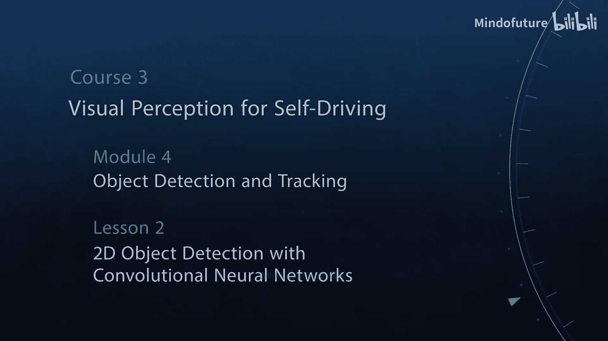

# 024：基于卷积神经网络的2D物体检测

## 概述

在本节课中，我们将学习如何使用卷积神经网络构建一个标准的单阶段2D物体检测架构。我们将回顾2D物体检测问题，并详细探讨用于此任务的卷积神经网络的基本配置，包括特征提取、先验框（锚框）的使用以及网络的输出层设计。

---

## 回顾2D物体检测问题

上一节我们介绍了通用的物体检测问题以及如何使用平均精度来评估2D物体检测器的性能。本节中，我们来看看如何使用卷积神经网络来执行2D物体检测。

给定一张输入图像，我们的目标是同时定位场景中的所有物体并确定它们所属的类别。

---

## 用于2D物体检测的卷积神经网络架构

下图展示了用于2D物体检测的基本卷积神经网络配置，我们称之为神经网络架构。

该架构以一张图像和一组手动设计的先验框作为输入。

首先，图像通过一个特征提取器进行处理。
其次，一组全连接层以特征提取器的输出作为输入，为每个2D先验框提供位置精修和分类。
最后，对全连接层的输出执行非极大值抑制，以生成最终的检测结果。

接下来，我们将深入探讨其中的每一个步骤。

---

## 特征提取阶段

特征提取器是2D物体检测器中计算成本最高的组件。通常，整个架构所需计算量的高达90%都用于此阶段。

特征提取器的输出宽度和高度通常远低于输入图像，但其深度通常比输入图像大两到三个数量级。

特征提取器的设计是一个非常活跃的研究领域，新的提取器不断涌现。最常用的特征提取器包括VGG、ResNet和Inception。在本节课的剩余部分，我们将以VGG特征提取器作为主要示例进行讲解。

VGG特征提取器基于牛津大学VGG小组提出的VGG16分类网络的卷积层。它是最早被提出用于检测的特征提取器之一，构建起来相当简单。

与大多数卷积网络一样，VGG特征提取器通过交替堆叠卷积层和池化层来构建。

所有卷积层的尺寸为 **3x3xK**，步长为 **1**，零填充为 **1**。
所有最大池化层的尺寸为 **2x2**，步长为 **2**，无填充。

这些特定的超参数是通过大量实验得出的，在广泛的问题中表现极佳，使得VGG成为一个非常流行的提取器。

让我们看看这些层如何影响输出体积的形状。

上周，我们推导了卷积层处理后，输出宽度、高度和深度的三个公式。

对于VGG特征提取器，所有卷积都是尺寸为3x3xK，步长为1，零填充为1。这意味着将输入体积通过任何卷积层只会将其深度改变为K。

另一方面，VGG提取器的池化层是2x2，步长为2，无填充。使用池化层的公式进行相同分析，我们注意到VGG提取器的最大池化层将输入体积的宽度和高度减少一半，同时保持深度不变。

现在让我们看看VGG提取器如何处理输入图像。

给定一个 **M x N x 3** 的输入图像，我们将其通过前两个深度为64的卷积层，然后是第一个池化层。此时，输出体积的宽度和高度减少了一半，而深度扩展到了64。

我们可以将VGG特征提取器分为若干个子部分，每个子部分以一个池化层结束。第一个子部分称为VGG提取器的conv1子部分。

然后，我们将输出体积通过其余五个子部分，最终得到形状为 **M/32 x N/32 x 512** 的输出体积。

例如，如果我们有一个 **1240 x 960 x 3** 的图像作为输入，我们最终的输出体积形状将是 **40 x 30 x 512**。我们将使用这个输出体积来生成最终的检测结果。

---

## 先验框（锚框）的概念

我们神经网络架构中要描述的下一个步骤是先验框（也称为锚框）的概念。

为了生成2D边界框，我们通常不会从零开始，在没有任何先验信息的情况下估计边界框的角点。我们假设我们对框在图像空间中的位置以及这些框应该有多大确实有一个先验知识。这些先验被称为锚框，是在整个图像上手动定义的，通常在一个等间距的网格上。

假设我们有一组接近我们真实标注框的锚框。在训练期间，网络学习获取每个锚框，并尝试在质心位置和框尺寸上将其移动到尽可能接近真实边界框的位置。这被称为**残差学习**，它利用了这样一个概念：将现有框微调一小段距离来改进它，比在整个图像中搜索可能的物体位置要容易得多。

在实践中，残差学习已被证明比尝试直接估计没有任何先验的边界框能提供更好的结果。

文献中提出了许多关于如何使用锚定边界框生成最终预测的不同方法。通常，锚框与特征图交互，为每个锚框生成固定大小的特征向量。

我们将解释微软研究院在其Faster R-CNN架构中提出的用于这种交互的首批方法之一。但请注意，这并不是执行这种交互的唯一方式。

Faster R-CNN的交互方法相当简单：对于特征图中的每个像素，我们关联K个锚框。然后，我们在该像素的邻域上执行一个 **3x3xD\*** 的卷积操作。这为该像素产生了一个 **1x1xD\*** 的特征向量。我们使用这个 **1x1xD\*** 的特征向量作为与该像素关联的K个锚框中每一个的特征向量。

然后，我们将提取的特征向量馈送到神经网络的输出层。

---

## 输出层：回归头与分类头

2D物体检测器的输出层通常包括一个回归头和一个分类头。

回归头通常包含多个全连接隐藏层和一个线性输出层。回归的输出通常是一个残差向量，需要将其添加到当前锚框上以获得真实边界框。

更新锚框尺寸的另一种方法是回归一个从锚框中心到真实边界框中心的残差，以及两个比例因子，当与锚框的宽度和高度相乘时，可以校正真实边界框的宽度和高度。

分类头也由多个全连接隐藏层组成，但最终是一个Softmax输出层。Softmax输出是一个向量，每个类别有一个分数。最高分数通常定义了当前锚框的类别。

---

## 冗余检测与非极大值抑制

根据我们目前的描述，你可能会注意到，对于输出特征图的每个像素，我们最终会得到K个边界框。即使我们只考虑所有感兴趣类别中分类分数高的框，图像中仍然会有许多冗余检测。

在计算平均精度时，我们只考虑每个真实边界框的一个检测。任何冗余检测都被视为误报，会导致精度降低，从而降低整体平均精度。

我们的目标是实现完美检测，这意味着我们希望图像中每个物体只输出一个框。因此，我们需要采取措施来消除网络产生的许多冗余检测。

实际上，这只是在推理时的一个问题。事实证明，在训练期间驱动网络为每个锚框输出尽可能好的残差是有益的。

---

## 总结

本节课中我们一起学习了以下内容：

首先，你学习了卷积神经网络可用于解决2D物体检测问题，并研究了VGG特征提取器架构的细节。
其次，你学习了如何使用锚框作为物体位置的先验，并通过估计边界框残差来输出最终的物体位置。

在下一课中，我们将描述如何使用分类和回归损失函数来训练2D物体检测器。为此，我们将利用大部分K个输出框。然后，我们将回到为每个物体输出单个边界框的挑战，并引入非极大值抑制的概念来解决它。

