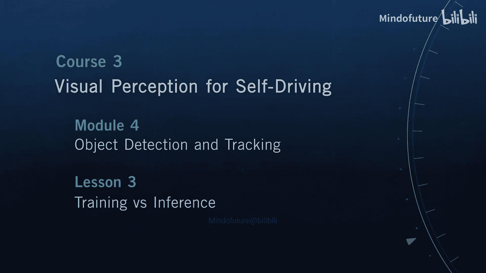
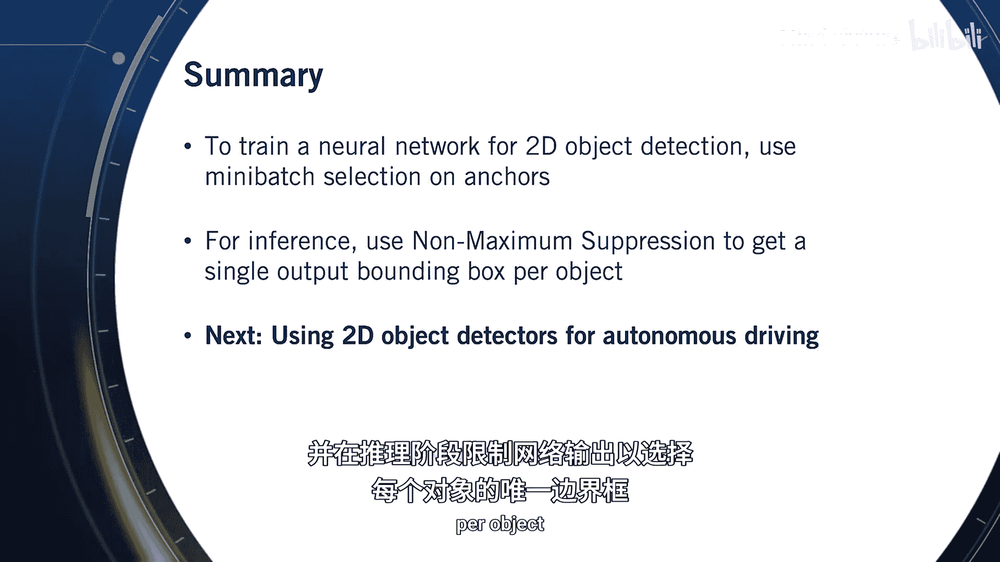

# 025：训练与推理

## 📚 概述
在本节课中，我们将学习如何训练和部署用于2D目标检测的卷积神经网络。我们将重点解决一个关键问题：如何处理每个目标对应的多个预测边界框。具体来说，我们将学习在训练阶段通过**小批量选择**，以及在推理阶段通过**非极大值抑制**来处理这些冗余的预测框。

上一节我们介绍了使用卷积网络进行目标检测的基线方法。然而，处理锚点网格中的所有锚点会导致每个物体被检测出多个边界框，而不是预期的单个框。本节中，我们来看看构建和训练用于2D目标检测的卷积神经网络所需的最后几个组件。

## 🧠 神经网络训练回顾
我们有一个卷积模型和训练数据对：输入图像 **X**，以及边界框位置和类别 **F\*(X)**。我们的目标是使用输出边界框 **Y = F(X, θ)** 来近似 **F\*(X)**。

回想一下，训练过程首先评估一个损失函数，该函数衡量我们预测的边界框与真实边界框的相似程度。然后将计算出的损失函数输入优化器，优化器会输出一组新的参数 **θ** 用于下一次迭代。请注意，特征提取器和输出层在训练过程中都会被修改。

如果 **F\*(X)** 和 **F(X, θ)** 是一一对应的，问题会很简单。然而，我们网络的输出是多个边界框，这些框可能与单个真实框相关联。让我们看看如何解决这个问题。

## 🎯 锚点的分类与回归目标
请记住，对于特征图中的每个像素，我们关联了 **K** 个锚点。这些锚点是如何映射回原始图像的呢？我们的特征提取器将初始输入的分辨率降低了32倍。这意味着，如果我们将特征图中的每个像素与一组锚点关联，这些锚点将通过放置在步长为32的网格上被转移到原始图像中。

我们可以将真实边界框与这些锚点一起可视化。你会注意到，有些锚点与真实框重叠，有些则不重叠。我们使用**交并比**来量化这种重叠，并将锚点分为两类。

我们首先指定两个IOU阈值：一个**正锚点阈值**和一个**负锚点阈值**。
*   任何IOU大于正锚点阈值的锚点被称为**正锚点**。
*   任何IOU小于负锚点阈值的锚点被称为**负锚点**。
*   任何IOU介于两个阈值之间的锚点则被完全丢弃。

那么，如何在训练中使用这些正锚点和负锚点呢？以下是分类和回归目标的分配方法：

**对于分类**：
*   我们希望神经网络预测负锚点属于**背景类**。背景类通常是我们添加到感兴趣类别中的一个额外类别，用于描述不属于这些类别的任何物体。
*   另一方面，我们希望神经网络将与真实框相交的任何正锚点分配为真实框的类别。

**对于回归**：
*   我们希望调整正锚点的参数，使其与真实边界框的参数对齐。
*   负锚点不用于边界框回归，因为它们被假定为背景。

## ⚖️ 小批量选择与难负样本挖掘
这种在训练中处理多个回归锚点的方法并非没有问题。所提出的IOU阈值机制导致大多数回归锚点都是负锚点。如果使用所有这些锚点进行训练，网络将看到远多于正样本的负样本，从而导致对负类的偏见。

解决这个问题的方法其实很简单：我们不是使用所有锚点来计算损失函数，而是按照**负锚点与正锚点3:1的比例**来采样选定的小批量样本。负样本通过一个称为**在线难负样本挖掘**的过程来选择，其中负小批量成员被选为具有最高分类损失的负锚点。这意味着我们将训练网络来修正负分类中的最大错误。

例如，如果我们的小批量大小为64个样本，负小批量将是具有最高分类损失的48个负样本，剩余的16个锚点将是正锚点。如果正样本数量少于16个，我们可以复制一些正样本来填充小批量，或者用负锚点填充剩余的位置。

## 📉 损失函数定义
正如我们上周所描述的，我们使用**交叉熵损失函数**作为卷积网络分类头的损失。总分类损失是小批量中所有锚点的交叉熵损失的平均值。

**分类损失公式**：
`L_cls = (1/N) * Σ_i [ -log(s_i) * s_i_star ]`
其中，归一化常数 **N** 是选定的小批量大小。**s_i** 是分类头的输出，**s_i_star** 是真实分类（对于负锚点设为背景，对于正锚点设为真实边界框的类别）。

对于回归，我们以类似的方式使用 **L2 范数损失**。然而，我们只尝试修改那些是正锚点的锚点。这在数学上通过 **L2 范数上的一个乘数 p_i** 来表示，如果锚点是负的，则 **p_i** 为0；如果是正的，则为1。

**回归损失公式**：
`L_reg = (1/N_pos) * Σ_i [ p_i * || b_i - b_i_star ||^2 ]`
为了归一化，我们除以正锚点的数量 **N_pos**。提醒一下，**b_i_star** 是真实边界框表示，而 **b_i** 是估计的边界框。请注意，我们不直接估计框参数，而是通过加性残差或乘性尺度来修改锚点参数，因此 **b_i** 必须从估计的残差中构造出来。

## 🎨 损失函数可视化
让我们可视化一下我们试图通过这些损失函数教会神经网络学习什么。

给定一个输入图像、一个真实边界框和来自锚点先验的一组输入锚点，我们正在教神经网络将锚点分类为包含背景（紫色）或汽车（蓝色）。这是通过最小化上面定义的交叉熵损失来实现的。

然后，我们希望神经网络仅移动那些包含感兴趣类别的锚点，使其与最接近的真实边界框匹配。这是通过最小化上面定义的L2范数损失来实现的。

到目前为止，你应该已经很好地掌握了如何在训练期间处理每个物体的多个输出框。但是，当我们在推理过程中实时运行神经网络时，我们该怎么做呢？

## 🚀 推理与非极大值抑制
请记住，在推理过程中，我们没有真实值来确定正锚点和负锚点，也不评估损失函数。我们只希望场景中每个物体有一个输出框。

这时就需要**非极大值抑制**登场了，这是一种极其强大的方法，用于改进基于锚点的神经网络的推理输出。

非极大值抑制的输入是一个预测边界框列表 **B**，每个边界框由回归坐标和类别输出分数组成。它还需要一个预定义的IOU阈值作为输入，我们称之为 **η**。

该算法如下：
1.  我们首先根据输出分数对列表 **B** 中的边界框进行排序。
2.  我们还初始化一个空集合 **D** 来保存输出边界框。
3.  然后，我们遍历排序后的框列表 **B_bar** 中的所有元素。
4.  在循环内部，我们首先确定列表 **B_bar** 中分数最高的框 **B_max**（这应该是 **B_bar** 中的第一个元素）。
5.  然后，我们将这个边界框从边界框集合 **B_bar** 中移除，并将其添加到输出集合 **D** 中。
6.  接下来，我们找到集合 **B_bar** 中剩余的所有与当前最大框 **B_max** 的IOU大于 **η** 的框。这些框与当前的 **B_max** 框显著重叠。
7.  任何满足此条件的框都会从列表 **B_bar** 中移除。
8.  我们不断迭代列表 **B_bar**，直到它为空，然后返回列表 **D**。

现在，**D** 包含了每个物体的单个边界框。

让我们通过一个视觉示例来理解非极大值抑制算法在实践中是如何工作的。

假设我们已经按降序对边界框列表进行了排序。为了更清楚地展示非极大值抑制的工作原理，我们在这里明确显示了分数列表。

**B_max** 将是排序列表 **B_bar** 的第一个边界框。然后，我们将每个边界框与 **B_max** 进行比较。在这种情况下，只有一个框 **B3** 与 **B_max** 有非零IOU。我们计算该IOU并将其与我们的IOU阈值 **η** 进行比较。在这种情况下，IOU大于阈值 **η**，因此我们将 **B3** 从列表 **B_bar** 中移除。

我们对列表中剩余的下一个最高分数重复此过程。同样，只有一个框（本例中为 **B4**）与 **B_max** 有非零IOU。计算IOU并与阈值比较后，我们从列表 **B_bar** 中消除 **B4**，并将 **B2** 添加到输出列表 **D** 中。

我们注意到初始列表 **B_bar** 现在为空，因此我们的非极大值抑制算法退出，并返回输出框列表 **D**，该列表按预期包含了每个物体的一个边界框。

## ✅ 总结
恭喜！你现在已经完成了训练和部署基于卷积神经网络的2D目标检测器以用于自动驾驶汽车所需的内容。

在本视频中，我们探讨了如何在训练期间调整网络输出以保持类别平衡，以及在推理期间限制网络输出以选择每个物体的一个输出边界框。

在下一课中，我们将讨论如何将这些2D目标检测器的输出用于对自动驾驶汽车至关重要的各种任务，包括将2D目标检测转换为3D、跟踪物体运动，以及将2D目标检测应用于交通标志和信号检测。下节课见！