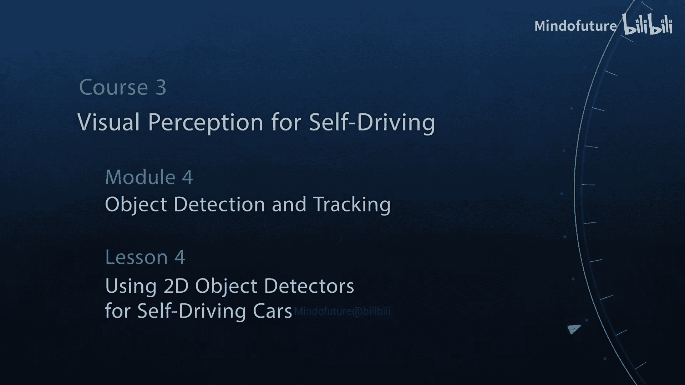
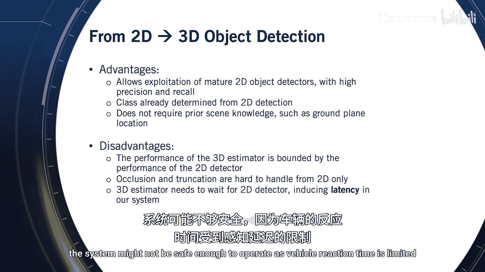
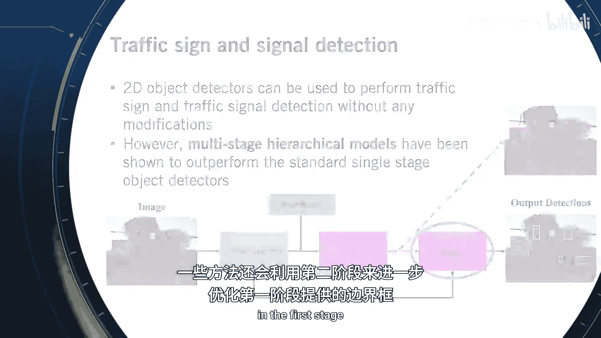
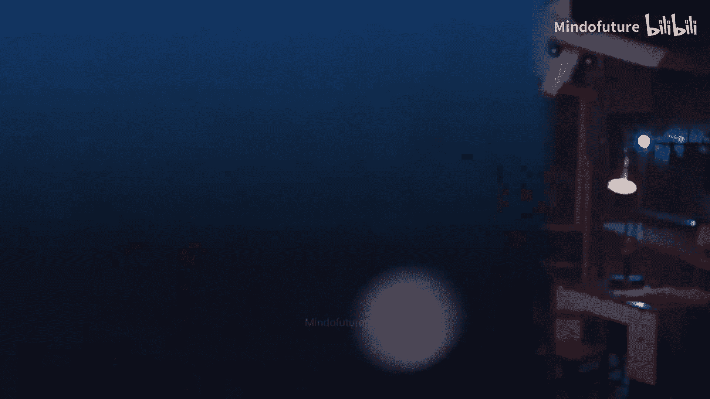
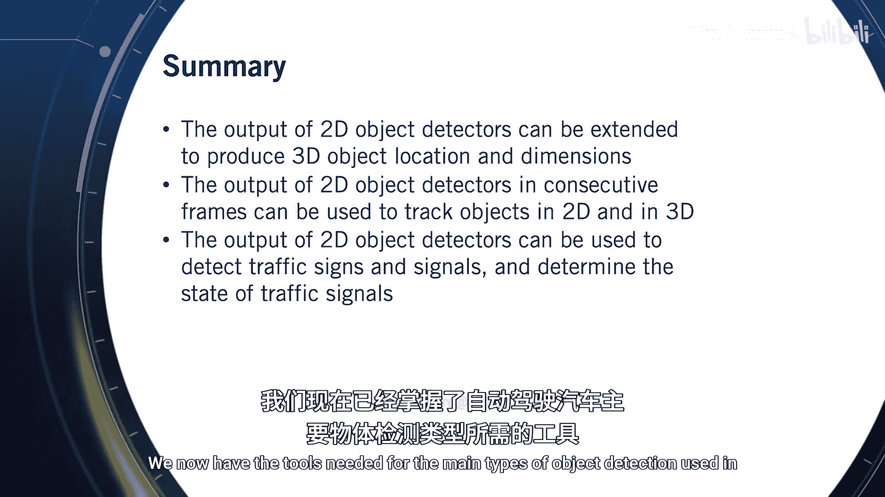

# 026：2D物体检测器在自动驾驶汽车中的应用

在本节课中，我们将探讨2D物体检测在自动驾驶汽车中的三个关键应用。我们将学习如何将2D检测扩展到3D空间，如何进行物体跟踪以建模其他道路参与者的行为，以及如何检测交通标志和信号灯。这些应用共同构成了自动驾驶汽车理解周围环境、做出安全决策的基础。

## 🚗 从2D检测到3D定位

上一节我们介绍了如何进行2D物体检测。然而，自动驾驶汽车需要在三维空间中理解场景才能安全行驶。本节中，我们来看看如何将2D检测结果扩展到3D。

自动驾驶汽车需要三维场景理解来安全地穿越环境。知道行人、汽车、车道和标志在汽车周围的位置，完全定义了自动驾驶时可以安全采取哪些行动。这意味着仅在图像平面检测物体是不够的，我们需要将问题从2D扩展到3D，并在世界坐标系中定位检测到的物体。

使用卷积神经网络进行3D物体检测是一个相对较新的课题，该领域的结果在不断变化。与2D检测类似，3D物体检测也需要类别分类。这对于跟踪物体至关重要，因为例如，汽车的运动方式与行人不同，如果知道物体类别，就可以做出更好的预测。此外，我们还需要估计物体质心在3D中的位置、3D中的范围以及3D中的方向。这些详细的状态信息都能改善运动预测和碰撞避免，并提高汽车在交通中行驶的能力。

这个物体状态可以表示为：
*   质心位置的3D向量：表示为物体的X、Y、Z位置。
*   范围的3D向量：表示为物体的长、宽、高。
*   方向角的3D向量：表示为物体的滚转角、俯仰角和偏航角。

对于道路场景，我们通常只关心偏航角，因为大多数道路参与者无法在很大程度上改变其滚转和俯仰角（地面条件决定了这些角度）。因此，只跟踪偏航角就足够了。

那么，如何从2D边界框得到物体位置和范围的准确3D估计呢？将2D物体检测结果扩展到3D最常见且最成功的方法是使用激光雷达点云。

给定图像空间中的一个2D边界框和一个3D激光雷达点云，我们可以使用相机投影矩阵的逆矩阵，将边界框的角点作为射线投影到3D空间中。这些线的多边形相交区域称为视锥体，通常包含与我们图像中物体相对应的3D点。然后，我们从激光雷达中获取此视锥体内的数据，将其转换为我们选择的表示形式，并训练一个小型神经网络来预测定义3D边界框所需的七个参数。

现在，我们应该将视锥体中激光雷达点的哪种表示输入神经网络呢？以下是一些选择：
*   直接处理原始点云数据。
*   相对于某个固定点（例如视锥体中心）对点云数据进行归一化。
*   对点进行预处理以构建固定长度的表示，例如X、Y、Z点的直方图，这使其作为卷积神经网络的输入更加方便。

无论使用哪种表示，我们都期望得到定向3D边界框形式的结果。

需要记住，上述讨论的过程只是执行3D物体检测的一种方式。那么，为什么我们选择将2D检测扩展到3D，而不是直接在3D中检测物体呢？原因如下：
*   **成熟度**：2D物体检测器比3D检测器成熟得多。我们通常能从成熟的2D物体检测器获得非常高的精确率和召回率，这在3D物体检测文献中尚不可及。
*   **分类便利**：我们可以从2D物体检测器结果中免费获得分类。无需使用激光雷达数据或将3D信息输入网络来确定我们看到的是汽车还是柱子，这在2D图像数据中非常明显。
*   **计算效率**：如果无法对物体可能出现的位置做出假设，在3D空间中搜索可能的物体计算成本相当高。将2D物体检测器扩展到3D通常允许我们限制物体实例的搜索区域，从而保持实时性能可控。

然而，将2D物体检测器扩展到3D也会带来一系列独特的问题：
*   **性能上限**：使用这种方法进行3D物体检测的一个突出问题是，我们将3D姿态估计器的性能限制在一个上限，即2D检测器的性能。
*   **遮挡与截断**：当面对严重的遮挡和从相机视角的截断时，2D到3D的方法通常会失败，而这些可能不影响激光雷达数据。
*   **延迟**：由于这种方法串行性质引起的延迟通常不可忽略。延迟表现为感知延迟，这意味着我们的汽车将在一定延迟后看到道路上的物体。如果这种延迟显著，系统可能不够安全，因为车辆反应时间受感知延迟的限制。

## 🔄 物体跟踪：连接时间序列的检测

了解了3D定位后，我们来看看2D到3D物体检测的另一个重要应用：物体跟踪。跟踪涉及将同一物体的一系列检测结果拼接成一条轨迹，该轨迹定义了物体随时间推移的运动。

我们将从描述一个既可用于2D也可用于3D的简单跟踪方法开始，希望您能从第二门课程中感到熟悉。当我们执行物体检测时，我们通常在每一帧中独立检测物体。然而，在跟踪中，我们通过已知的物体动态模型来整合预测的位置。

跟踪需要一组约束场景变化速度的假设。例如，我们假设我们的相机和被跟踪的物体不能在极短时间内传送到不同位置。同时，我们假设场景变化平滑且渐进。所有这些假设在道路场景中都是逻辑上有效的。

让我们直观地看看物体跟踪是什么样子。给定第一帧中检测到的物体及其速度向量，我们首先通过使用速度向量建模其运动来预测物体在第二帧中的位置。然后我们在第二帧中获得新的检测结果，我们称这些检测为测量值。我们将每个检测与相应的测量值关联起来，然后使用关联的测量值更新我们的物体预测。

以下是每个必要步骤的描述：
1.  **定义状态**：我们将边界框的状态定义为其在图像空间中的位置和速度。
2.  **运动模型预测**：每个物体都有一个更新其状态的运动模型。例如，这里显示的恒定速度运动模型用于将每个边界框移动到第二帧中的新位置。请注意，我们在运动模型中添加了零均值高斯噪声，因为模型并不完美。
3.  **关联测量**：在预测步骤之后，我们从2D物体检测器获得第二帧的测量值。然后，我们通过计算所有预测和所有测量值之间的交并比（IOU）来将每个测量值与一个预测相关联。如果一个测量值与某个预测具有最高的IOU，则它与该预测相关联。
4.  **状态更新**：最后一步是使用卡尔曼滤波器来融合测量值和预测更新。我们建议回顾第二门课程中介绍的卡尔曼滤波器方程，以了解此步骤是如何执行的。卡尔曼滤波器更新整个物体状态，包括位置和速度，我们可以将其用于后续的预测步骤。

需要注意的是，我们不需要跟踪物体的大小，而是可以依赖检测器。我们通常为物体分配其最后已知测量值的大小。还有一些细节需要处理，特别是如何初始化轨迹和如何终止它们。如果我们获得与任何先前预测都不相关的2D检测器结果，则初始化新轨迹。类似地，如果一个预测的物体在预设的帧数内没有与测量值相关联，则终止不一致的轨迹。最后，我们需要注意，通过在3D中定义IOU，我们可以使用相同的方法进行3D物体跟踪。

让我们看一段来自自动驾驶汽车的3D物体跟踪视频。请注意，轨迹略有抖动，因为检测结果在帧间位置估计中存在一些噪声，并且此代码中使用的运动模型不包括准确的车辆运动学或动力学模型。这是由于缺乏对其他车辆转向和加速输入信息的了解。尽管如此，我们仍然可以准确地检测到在环境中移动的多个车辆，并在此过程中就优先权和安全交互做出谨慎的决策。

## 🚦 交通标志与信号灯检测

在2D物体检测的框架内，我们将描述的最后一个概念是交通标志和交通信号灯的检测。正确检测这些道路规则指示器，可以引导自动驾驶汽车在繁忙的街道上合法行驶。然而，这项检测任务也面临其自身的一系列挑战。让我们看看最突出的几个。

以下是安装在自动驾驶汽车上的摄像头拍摄的典型行车记录仪风格图像。通常，必须在远距离检测交通标志和信号灯，汽车才能知道如何及时做出适当反应。在远距离，交通标志和信号灯在图像中占据的像素非常少，这使得检测问题特别具有挑战性。此外，交通标志变化很大，通常包括多达50个需要可靠分类的类别。另一方面，交通信号灯在世界不同地区可能呈现不同的外观，并且具有多种状态，需要自动驾驶汽车检测这些状态才能安全地通过有信号灯的交叉路口。此外，交通信号灯的状态会随着汽车的移动而改变，这可能会在尝试在图像空间中跟踪交通信号时导致一些问题，因为外观会随着交通信号灯的状态而变化。

幸运的是，我们迄今为止描述的标准物体检测器无需重大修改即可用于检测交通标志和信号。然而，当前的方法依赖于多阶段分层模型来更稳健地执行此检测任务。

让我们考虑这里显示的两阶段模型。这两个阶段共享特征提取器的输出来执行各自的任务。在此示例中，第一阶段输出与类别无关的边界框，指向图像中的所有交通标志和信号，而不指定每个框属于哪个类别。然后，第二阶段获取第一阶段的所有边界框，并将其分类为红色、黄色或绿色信号、停车标志等类别。此外，一些方法还使用第二阶段来进一步细化第一阶段提供的边界框。

这种多阶段方法并非交通标志和信号检测所独有，许多通用物体检测框架都采用多阶段方法来生成准确的物体类别和位置。如果您感兴趣，我们已提供其中一些方法作为补充阅读材料。

## 📝 总结

在本节课中，我们一起学习了2D物体检测在自动驾驶中的核心应用。

我们看到，2D物体检测器的输出可用于生成3D物体位置。我们研究了如何在连续的图像帧中对2D物体检测器输出执行跟踪，以创建贯穿环境的物体轨迹。我们还探讨了2D物体检测器如何无需重大修改即可用于检测交通标志和交通信号，不过，利用分层模型的专用方法通常比标准方法表现更好。

现在，我们已经掌握了自动驾驶汽车中使用的主要物体检测类型所需的工具。

恭喜您成功完成了关于2D物体检测的这个模块。这个模块内容相当深入，我们建议您查看我们提供的资源，以获取更多关于如何使用神经网络进行2D和3D物体检测和跟踪的信息。下周，我们将讨论视觉感知堆栈的另一个重要组成部分，它在像素级别运行：语义分割。到时见。

