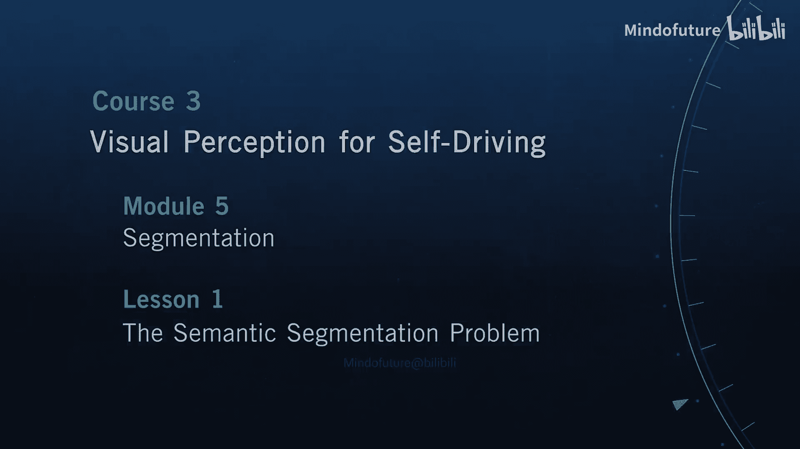

# 027：语义分割问题

## 概述

在本节课中，我们将学习自动驾驶汽车视觉感知中的一项重要任务：语义分割。我们将定义语义分割问题，并学习如何使用常见的评估指标（如类别交并比）来评估语义分割模型的性能。

---

## 语义分割的定义

上一节我们介绍了本模块的学习目标，本节中我们来看看语义分割的具体定义。

给定一张输入图像，我们希望将图像中的每个像素分类到一组预设的类别中。

这些类别可以是静态的道路元素，例如道路、人行道、电线杆、交通信号灯和交通标志。也可以是动态的障碍物，例如汽车、行人和骑自行车的人。此外，我们通常还会设置一个背景类别，用于包含所有未包含在预设类别中的内容。

与目标检测类似，我们通过一个函数估计器来实现语义分割。

那么，我们如何调整通用的神经网络以用于分割任务呢？给定一张图像，我们将每个像素作为输入，并为每个像素输出一个类别得分向量。一个像素属于得分最高的那个类别。因此，我们希望我们的估计器能为图像中的每个像素，为其正确的类别给出最高的得分。

例如，一个道路像素应该具有非常高的道路类别得分，而其他类别的得分则要低得多。当看到一个属于人行道的像素时，函数估计器应该提供比所有其他类别得分更高的人行道得分。

---

## 语义分割的挑战

在尝试进行语义分割时，我们通常会面临许多与目标检测相同的问题。因此，语义分割是一个不简单的问题。

以下是语义分割面临的主要挑战：
*   **遮挡和截断**：使得准确预测物体边界变得困难。
*   **尺度问题**：我们需要同时处理具有精细细节的近距离物体和仅由几个像素捕获的远距离物体。
*   **光照变化**：需要能够处理场景中的光照变化。

然而，语义分割还有一个自身特有的主要困难。这个困难是由图像空间中边界模糊性引起的，特别是对于细长的物体（如电线杆）、外观相似的物体（如道路和人行道）以及远处的物体。在后续课程中，我们将看到在设计语义分割算法时如何处理这个问题。

---

## 语义分割的算法基础

你认为我们可以使用什么算法来解决语义分割问题？如果你的答案是卷积神经网络，那么你是正确的。与目标检测类似，卷积神经网络已被证明是解决语义分割问题非常有效的选择。

我们将在下一课中详细讨论这种解决方案，但首先，让我们来确定如何衡量语义分割网络的性能。

---

## 语义分割的评估指标

上一节我们提到了卷积神经网络是解决方案，本节中我们来看看如何评估这些模型的性能。让我们从回顾一些基本的分类指标开始。

以下是评估所需的基础指标：
*   **真正例**：正确分类为某个特定类别X的像素数量。
*   **假正例**：不属于类别X，但被分类为该类别的像素数量。
*   **假反例**：属于类别X，但未被分类为该类别的像素数量。

这些术语与目标检测中使用的术语相同。

使用这三个指标，我们可以计算最常用的语义分割评估指标：**类别交并比**。类别交并比的计算公式为：**真正例 / (真正例 + 假正例 + 假反例)**。

让我们来看一个计算的可视化例子。地面真值分割数据表示为每个像素一个类别。同样，通过将输出得分最高的类别作为我们的预测类别，预测结果也可以放在类似的格式中。

我们首先计算用R表示的道路类别的交并比。要测量的第一个指标是真正例的数量。我们可以通过计算预测中正确分类的道路像素数来确定真正例，在本例中是3。第二个指标，假正例，在我们的例子中是0，因为我们的算法没有将任何人行道像素分类为道路。最后，我们的算法将两个道路像素分类为人行道，因此，假反例计数为2。我们最终的道路交并比是 3/5。

让我们对人行道类别遵循这个计算过程。我们可以看到我们有四个正确分类的像素，因此我们的真正例计数是四。此外，我们的算法错误地将两个像素分配给人行道类别，而实际上它们属于道路类别。因此，我们的假正例计数是二。最后，算法没有遗漏任何人行道像素，所以它的假反例计数是0。然后我们可以计算出人行道类别的交并比为 4/6。

---

## 评估注意事项

我们是在单张图像上执行了类别交并比计算。当在多张图像上执行此计算时，必须记住要在所有图像上计算真正例、假正例和假反例的总和，然后再计算交并比。先计算每张图像的交并比再求平均，实际上会得到一个不正确的类别交并比分数。

此外，通常更好的做法是独立地查看每个类别的交并比分数，而不是将它们平均。这是因为全局的交并比度量偏向于覆盖较大图像区域的物体实例。在尺度变化强烈的街景中，这可能会有问题。其他指标，如**每个实例的交并比**，通常用于弥补这个问题。

Cityscapes基准测试是评估自动驾驶汽车语义分割算法最常用的基准之一。提交到Cityscapes基准测试的语义分割模型，主要使用**每个类别的交并比**作为排名指标。虽然也会为每个模型计算实例级别的交并比。

---

## 总结

在本节课中，我们一起学习了语义分割的定义，即为一幅2D图像中的每个像素提供一个类别标签。我们还学习了如何使用每个类别的交并比来评估语义分割模型。

在下一课中，我们将学习如何使用卷积神经网络来解决语义分割问题。