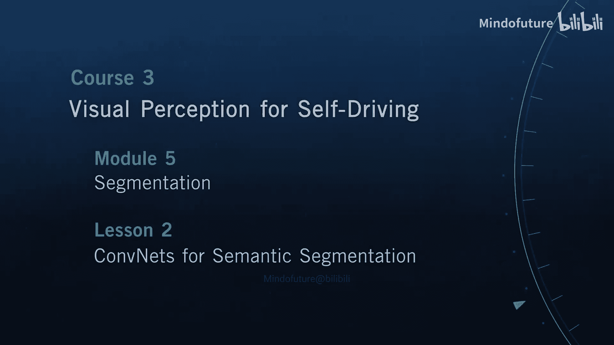
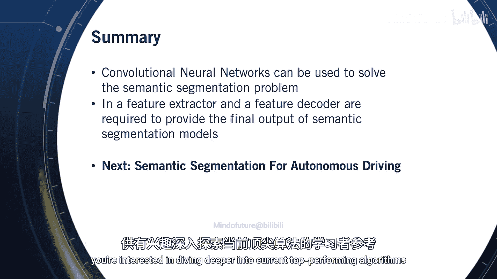

# 028：语义分割卷积网络

在本节课中，我们将学习如何使用卷积神经网络来执行语义分割任务。与用于目标检测的卷积网络相比，用于语义分割的卷积网络在训练和推理阶段几乎相同，这使得其应用相对更简单。然而，语义分割本身存在一些需要特别注意的复杂性。

## 语义分割问题回顾

上一节我们定义了语义分割问题，并学习了如何通过计算类别交并比来评估算法性能。本节中，我们来看看如何构建模型来解决这个问题。

语义分割任务接收一张相机图像作为输入，并为该图像中的每一个像素提供一个类别分类作为输出。这个问题可以被建模为一个函数逼近问题，而卷积网络再次成为逼近该函数的工具。

## 基础架构分析

我们首先分析一个直观的想法：使用与目标检测相同的卷积模型，即一个特征提取器后接一个输出层。由于我们不需要定位物体，因此这里不需要锚框。

以下是该架构的核心流程分析：
1.  **特征提取器**：我们可以使用VGG架构。输入图像尺寸为 `M x N x 3`。
2.  **分辨率变化**：每经过一个池化层，图像分辨率会减半。而卷积层会增加特征图的深度。
3.  **输出特征图**：经过特征提取器后，输出的特征图尺寸会缩小为原图的 `1/16`。

然而，我们的最终输出需要为原始图像中的每个像素提供分类。面对一个缩小了16倍的特征图，一个简单的解决方案是：
1.  将下采样后的特征图通过一个Softmax层，计算每个像素在子采样空间中的类别得分。
2.  通过取Softmax层输出的最高得分来确定每个像素的类别。
3.  最后，将下采样的输出上采样回原始图像分辨率。

## 上采样的挑战

你认为上述方法效果会如何？为了理解朴素的上采样为何可能产生不理想的结果，我们需要了解上采样如何增加图像分辨率。

以最近邻上采样一个 `2x2` 的图像块为例。上采样因子 `S=2`。该过程会生成一个初始为空的 `4x4` 网格，然后每个新像素用原始图像块中最近邻像素的值填充。

这种方法导致的问题是，上采样后的输出图像边界非常粗糙。正如上一课所提到的，语义分割中最具挑战性的问题之一就是获得物体周围平滑且准确的边界。对于细长物体（如电线杆）、外观相似的物体（如道路和人行道）以及远处的物体，边界尤其难以准确界定。

朴素上采样还会引入两个额外问题：
*   任何宽度或高度小于16像素的物体通常会在上采样后的图像中完全消失。
*   这既影响细长物体，也影响远处物体，因为它们的尺寸低于像素能从原始图像中显现所需的最小维度。

## 特征解码器

为了解决这些问题，研究人员提出了通常被称为**特征解码器**的组件。特征解码器可以看作是特征提取器的镜像：它不使用卷积-池化范式来下采样分辨率，而是使用上采样层后接卷积层来上采样特征图的分辨率。

以下是特征解码器的维度变化分析：
1.  **输入**：一个下采样了16倍、深度为512的特征图。
2.  **上采样-卷积块**：每个这样的块被称为一个“反卷积”块。经过第一个块后，输入特征图的分辨率被上采样至原来的2倍。
3.  **深度控制**：每个后续卷积层的滤波器数量控制着特征图的深度。为了降低计算复杂度，我们通常在解码过程中缩减深度，但这取决于具体应用的设计选择。
4.  **输出**：最终，我们得到一个与输入图像分辨率相似的特征图。

需要指出，这种上采样机制是众多语义分割方法中最简单的一种。请查阅补充材料，了解为语义分割提出的更高效、更强大和更复杂的上采样模型。

## 输出层与损失函数

现在我们有了与输入图像尺寸相似的特征图，接下来需要生成语义分割输出。

我们可以通过一个线性输出层，后接一个Softmax函数来执行语义分割。该层与我们之前在目标检测中描述的分类输出层非常相似。实际上，该层为每个像素提供一个K维向量，其中第k个元素表示神经网络认为该像素属于第k类的置信度。

从视觉上理解，给定一个图像块及其对应的真实标签，我们可以将每个像素表示为一个K维的独热向量。独热向量为正确类别赋值为1，其余类别赋值为0。神经网络的目标是驱动Softmax的输出，使得每个像素正确类别的得分尽可能接近1，其余类别的得分尽可能接近0。在推理时，我们取最高得分的索引来恢复所需的输出表示；而在训练时，我们直接使用Softmax输出得分。

根据定义，语义分割问题要求神经网络为每个像素分类提供一个单一类别。为了学习执行此任务，我们再次使用**交叉熵分类损失**来训练神经网络。该损失函数与我们用于目标检测分类头的损失函数相似。

交叉熵损失驱动神经网络学习每个像素的概率分布，使其最接近真实类别的概率分布。其公式可表示为：

`L = - (1/N_total) * Σ Σ s*_ij * log(s_ij)`

其中：
*   `N_total` 是一个小批次中所有图像被分类像素的总数。
*   `s_ij` 是神经网络对像素 `(i, j)` 的输出（Softmax后）。
*   `s*_ij` 是该像素的真实分类（独热编码）。

通常，一个小批次包含8到16张图像，具体数量取决于GPU的内存。

## 架构总结与展望

总结一下，我们得到了以下用于语义分割的卷积网络模型：
1.  **特征提取器**：接收图像输入，输出一个富有表现力但低分辨率的特征图。
2.  **解码器**：接收该特征图，并通过上采样得到一个与原始输入图像分辨率相同的最终特征图。
3.  **输出层**：一个线性层后接Softmax函数，为输入图像中的每个像素生成类别置信度向量。

本节课描述的架构是可用于语义分割的较简单模型之一。关于语义分割最优神经网络模型的研究已经有很多。例如，将提取器中池化层的索引传播到解码器的上采样层，已被证明可以提高语义分割模型的性能和计算速度。我们在补充材料中列出了一些描述语义分割架构的最新文献。

恭喜！你现在应该已经掌握了使用卷积网络解决语义分割问题的基础知识。大多数最先进的分割网络都共享我们在本视频中描述的结构，即以特征提取器、解码器和输出层作为主要构建块。如果你有兴趣深入了解当前性能顶尖的算法，我们提供了一些最新方法的链接作为参考。

在下节课中，我们将描述如何使用语义分割输出来帮助自动驾驶汽车感知道路场景。下次见！

