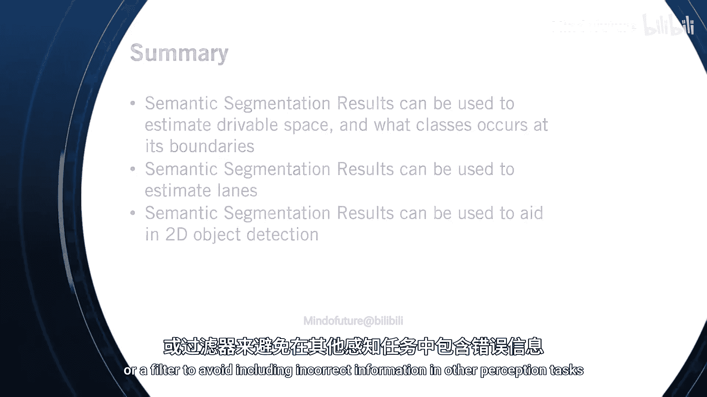

# 029：道路场景理解中的语义分割 🚗

在本节课中，我们将学习如何利用语义分割模型的输出来理解道路场景，特别是估计可行驶空间和车道边界。

## 概述

上一节我们介绍了如何使用卷积神经网络进行语义分割。本节中，我们将看看如何利用这些网络的输出进行道路场景理解。具体来说，您将学习如何利用语义分割模型的输出来估计可行驶空间和车道边界。

## 语义分割输出回顾

首先，快速回顾一下语义分割模型的预期输出。

一个语义分割模型接收一张图像作为输入，并为每个像素输出一个类别分类。

## 可行驶表面估计

现在，让我们利用这个输出来执行一些对自动驾驶汽车有用的任务。我们将讨论的第一个任务是根据语义分割输出在三维空间中估计可行驶表面。

可行驶空间定义为车辆前方可以安全行驶的区域。在语义分割的上下文中，可行驶表面包括来自道路、人行横道、车道标记、停车位，有时甚至包括铁轨的所有像素。

估计可行驶表面非常重要，因为它是从3D深度传感器构建占据栅格的主要步骤之一。您将在第4课中了解更多关于占据栅格的知识，它们将用于在避碰过程中表示环境中障碍物的位置。

以下是执行可行驶表面估计的步骤：

1.  **生成语义分割输出**：首先，我们使用卷积神经网络生成图像帧的语义分割输出。
2.  **获取3D坐标**：然后，我们通过立体数据或将激光雷达点云投影到图像平面，生成该帧中部分像素的3D坐标。通过已知的传感器间外部标定，我们可以将激光雷达点投影到图像平面，并与相应的像素匹配。
3.  **选择可行驶表面点**：接着，我们选择属于可行驶表面类别的3D点。如前所述，此类别至少应包括道路、车道标记和人行横道。在某些场景下，根据驾驶环境，也可能包括其他类别，例如铁轨。所有其他类别都被排除，即使它们的高度与可行驶表面相似。
4.  **拟合表面模型**：最后，我们使用这个3D点子集来估计一个可行驶表面模型。该模型的复杂度可以从简单的平面到更复杂的曲面模型。

### 平面模型拟合

让我们描述如何根据分割图像数据和激光雷达点稳健地拟合一个平面可行驶表面模型。

我们首先将平面模型定义为：
`A*X + B*Y + Z = D`
其中 `(X, Y, Z)` 是平面上的任意点。系数 `A`、`B` 和 `1` 定义了平面法向量，`D` 是常数偏移量。

我们可以形成一组线性方程来估计该平面模型的参数，使用每个被识别为属于可行驶表面的点作为测量值。

模型的参数现在由向量 **P** 总结，测量值被分离到矩阵 **A** 和 **B** 中。如第2课所述，我们可以使用最小二乘法找到该线性方程组的解。

因此，我们的平面参数向量 **P** 等于 **A** 的伪逆乘以 **B**。

该模型有三个待估计的自由参数。因此，我们至少需要三个非共线的3D点来拟合平面。在实践中，我们将拥有比所需多得多的点，因此我们可以再次应用最小二乘法来识别使所有点到平面的均方距离最小的参数。

当然，有些点可能被错误标记，可能并不真正属于可行驶表面。那么，我们如何避免错误的语义标签影响可行驶表面平面估计的质量呢？

幸运的是，我们在本课程的第二周学习了一种非常强大且稳健的估计方法。具体来说，我们可以使用 **RANSAC 算法** 来稳健地拟合我们的可行驶表面平面模型，即使我们的语义分割输出存在一些错误。

### RANSAC 算法步骤

以下是用于可行驶表面估计的 RANSAC 算法步骤回顾：

1.  **随机采样**：首先，我们随机选择拟合模型所需的最小数据点数。在本例中，我们随机选择 3 个 3D 点。
2.  **计算模型参数**：其次，我们使用这三个点计算模型参数 `A`、`B` 和 `D`，并使用最小二乘法求解平面参数。
3.  **确定内点**：然后，我们确定满足这些模型参数的 3D 点的数量。通常对于可行驶表面估计，大多数异常值是由于位于边界处的错误分割输出造成的。
4.  **判断与迭代**：如果异常值数量少，我们终止并返回计算出的平面参数。否则，我们随机采样三个新点并重复该过程。
5.  **最终拟合**：一旦算法满足其终止条件，我们从最大内点集中的所有内点计算道路的最终平面表面模型。

如果道路实际上是平坦的，使用平面表面模型效果很好，这在许多驾驶场景中是一个有效的假设。对于更复杂的场景，例如从平坦道路进入陡峭爬升的高速公路入口，则需要更复杂的模型。

## 语义车道估计

虽然我们估计了可行驶表面，但我们仍未确定车辆可以在该表面的哪个位置行驶。通常，车辆应保持在由其车道标记或道路边界确定的车道内。

车道估计是在给定可行驶表面的情况下，估计自动驾驶汽车可以行驶位置的任务。文献中存在许多方法来完成此任务。例如，一些方法直接从卷积神经网络估计车道标记来确定汽车可以行驶的位置。

然而，为了进行更高级的决策，我们的自动驾驶汽车还应该知道车道边界处有什么。车道边界处的类别范围可以从路缘石、对向交通所在的道路，到动态和停放的车辆。自动驾驶汽车必须根据车道边界处出现的物体来制定其操作策略，尤其是在紧急靠边停车期间。

我们将把估计车道及其边界处情况的任务称为 **语义车道估计**。请注意，如果我们使用语义分割的输出估计车道，我们会免费获得边界分类。

让我们通过一个简单的方法来阐明车道估计任务。

以下是执行语义车道估计的步骤：

1.  **提取车道分隔符掩码**：给定语义分割模型的输出，我们首先提取属于作为车道分隔符出现的类别（例如路缘石、车道标记或铁轨）的像素的二进制掩码。
2.  **应用边缘检测器**：然后，我们对二进制掩码应用边缘检测器。正如您在本课程第一周所记得的，边缘检测器可以像通过卷积估计梯度一样简单。这里我们使用著名的边缘检测器——**Canny 边缘检测器**。输出是被分类为边缘的像素，这些像素将用于估计车道边界。
3.  **选择车道模型**：最后一步是确定用于估计车道的模型。模型的选择决定了下一步将是什么。这里我们选择一个线性车道模型，其中假设每个车道由单条线组成。
4.  **检测线**：为了在输出边缘图中检测线，我们需要一个线检测器。**霍夫变换线检测算法** 被广泛使用，并且能够在边缘图中检测多条线。给定一个边缘图，霍夫变换可以生成一组连接边缘图中属于边缘的像素的线。所需线的最小长度可以设置为超参数，以强制算法仅检测足够长以成为车道标记一部分的线。
5.  **细化与分类**：可以根据当前场景应用进一步的细化。例如，如果我们的相机朝向前方运动方向，我们知道我们的车道不应该是水平线。此外，我们可以移除任何不属于可行驶表面的线，以获得最终的车道边界基元集。最后一步是确定车道两侧出现的类别，这可以通过考虑估计车道线两侧的类别轻松完成。

我们不会详细讨论边缘检测器和霍夫变换，因为这些主题值得在本课程范围之外单独讨论。然而，强大的计算机视觉库（如 OpenCV）提供了关于如何使用霍夫变换检测线以及如何使用 Canny 边缘检测器检测边缘的开源实现和教程。如果您感兴趣，请查看补充材料中提供的链接，了解这些算法在实践中是如何使用的。

## 总结

在本节课中，我们一起学习了如何利用语义分割来估计可行驶空间、确定可行驶空间边界处的情况以及估计可行驶表面上的车道。

到目前为止讨论的应用是非常活跃的研究领域，您在本课中学到的知识为语义车道检测和可行驶表面估计任务提供了坚实的起点和有竞争力的基线。此外，语义车道检测和可行驶表面估计是语义分割模型在自动驾驶汽车背景下最突出的用途。

然而，语义分割还有许多其他有用的应用，最重要的是帮助自动驾驶汽车执行 2D 物体检测和定位。通过了解哪些像素需要评估物体，或者特征是在静态还是动态物体上，感知系统的鲁棒性可以显著提高。它可以作为合理性检查或过滤器，以避免在其他感知任务中包含错误信息。

语义分割是自动驾驶汽车的强大工具，也是高级感知栈的核心组成部分。下周当我们讨论最终作业时，您将有机会验证其实用性。到时见！