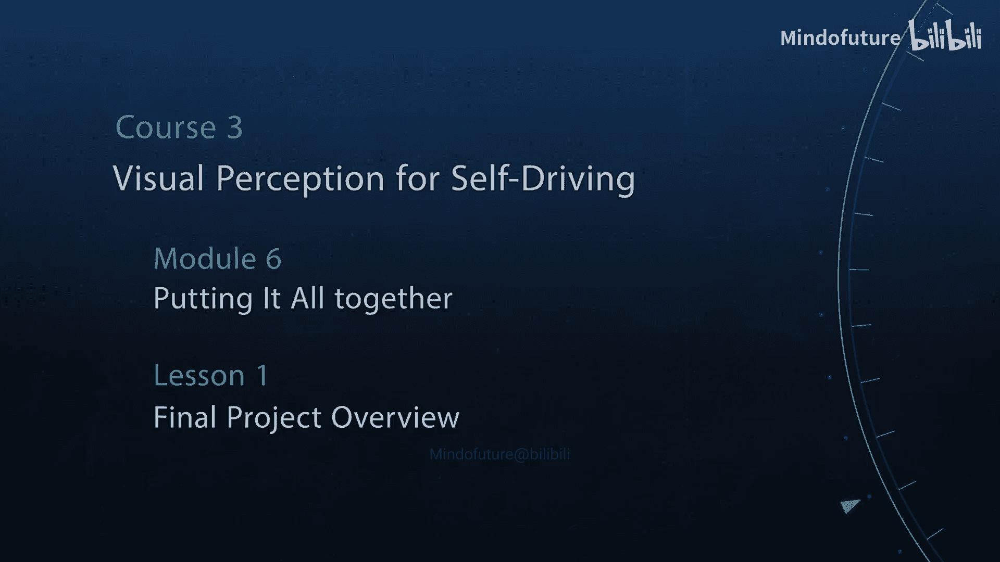
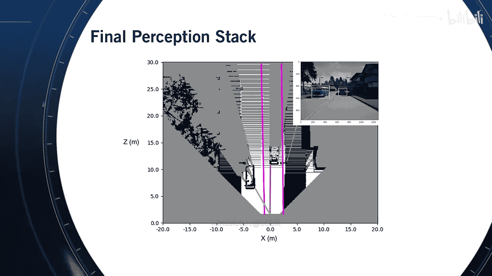

# 030：项目概述-使用CARLA进行物体检测与分割

在本节课中，我们将学习课程最终项目的具体要求。我们将概述项目目标、评分标准以及如何通过提供的YAML文件提交最终评估。

恭喜你坚持学习到课程的这个阶段。你已经接近完成。

现在是将所学知识整合起来，完成最终项目的时候了。

这个视频将为你提供完成最终课程评估所需的要求。

我们还将讨论评分方案，以及如何通过提供的YAML文件提交最终评估。

让我们从列出本次评估的目标开始。

## 项目目标

最终项目要求运用你在整个课程中学到的知识，为自动驾驶汽车实现一个环境感知栈。

具体来说，你将使用语义分割神经网络的输出来实现以下功能：

1.  在三维空间中估算可行驶区域。
2.  估算车道线。
3.  过滤掉二维物体检测器输出中不可靠的估计结果。

最后，你将使用过滤后的二维物体检测输出来确定障碍物与自动驾驶汽车的距离。

通过完成这个项目，你将能够开发基础的感知栈，使自动驾驶汽车能够了解在道路场景中可以行驶的区域、视野内可能影响其决策的障碍物，以及这些障碍物的距离。

## 参考课程

你已经在之前的课程中学习了完成本次评估所需的大部分任务。以下是处理此作业时可能有用的参考课程列表：

*   **可行驶区域估算**：可以参考**模块1第3课**来根据深度信息估算像素的XYZ坐标，以及**模块5第3课**来根据语义分割输出估算地平面。
*   **车道线估算**：可以参考**模块5第3课**来估算车道线。
*   **估算最小碰撞距离**：**模块4第4课**对于估算距离将非常有用。

## 任务详解

现在，让我们详细描述为什么这些必需任务对自动驾驶汽车很重要。

### 三维可行驶区域估算

三维可行驶区域估算对于自动驾驶汽车安全穿越环境至关重要。

利用给定的传感器输入以及来自神经网络的语义分割数据，你需要估算三维空间中的地平面方程。

然后，根据距离阈值确定属于地平面的像素。图中黄色区域标出了你的算法应标记为可行驶空间的像素。

我们将为你提供代码，将你估算的三维地平面可视化为占据栅格图，这是本专业系列下一门课程将涵盖的主题。

请注意，可行驶空间并不等同于道路。如图所示，人行道后方的一部分区域也被标记为可行驶空间。

基于地平面估算的可行驶空间，提供了汽车物理上能够行驶的三维空间。

### 车道边界估算

为了明确汽车在法律上被允许行驶的区域，你需要执行车道边界估算。

为了完成这个任务，我们为你提供了语义分割的输出。

你需要使用这个输出来估算当前车道的左右车道边界。

### 障碍物距离估算

本次评估的最后一个任务要求你估算场景中障碍物与汽车的碰撞距离，这些障碍物由物体检测神经网络提供。

问题是该神经网络模型具有较高的召回率，但精确度较低，并在其输出中提供了一些错误结果。

你需要首先使用语义分割网络的输出来过滤掉物体检测网络中的错误结果。

然后，你需要计算与场景中每个障碍物的最小碰撞距离。

## 系统最终输出

让我们看看整个系统的最终输出会是什么样子。

*   使用估算出的地平面，自动驾驶汽车将能够确定其在环境中物理上可以行驶的区域。
*   使用估算出的车道边界，自动驾驶汽车将能够遵守道路规则。
*   最后，使用过滤后的物体检测输出以及碰撞距离估算，自动驾驶汽车将能够定位道路上的障碍物，以判断是否有障碍物阻挡其路径。

## 项目提示

对于最终项目，请记住，提供的算法指南并非一成不变，在评估的每个步骤中都存在许多你可以使用的替代方法。

我们鼓励你在认为可以在结果或效率方面做得更好的地方，偏离提供的算法大纲。

如果本视频未能解答你的所有疑问，Jupyter笔记本本身还有进一步的说明。

也请不要害怕在讨论区提问。

希望你在这个最终项目中获得乐趣。待项目完成后，我们将再次见面以结束本课程。

祝你好运，并享受其中。

## 总结

本节课中，我们一起学习了最终项目的完整概述。我们明确了项目的三大核心目标：基于语义分割实现三维可行驶区域估算、车道线估算，以及过滤并计算障碍物距离。我们还回顾了完成这些任务可参考的先前课程，并理解了每个任务对于自动驾驶汽车感知系统的重要性。最后，我们了解了项目的灵活性，并获得了完成项目所需的支持渠道信息。