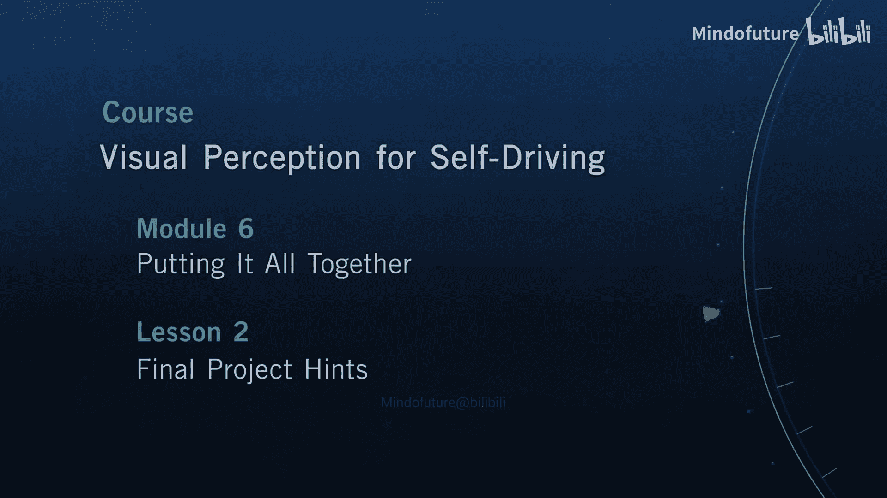
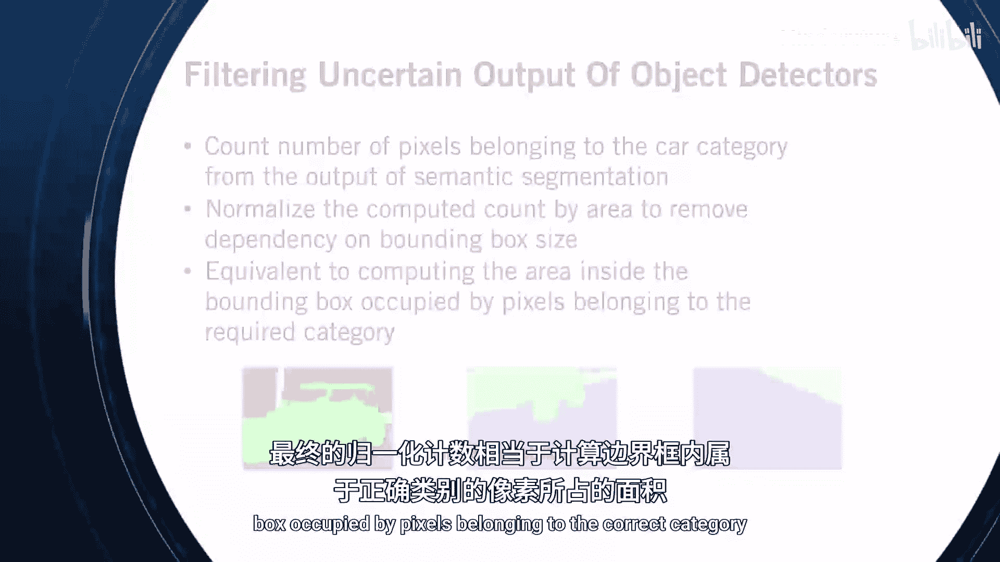
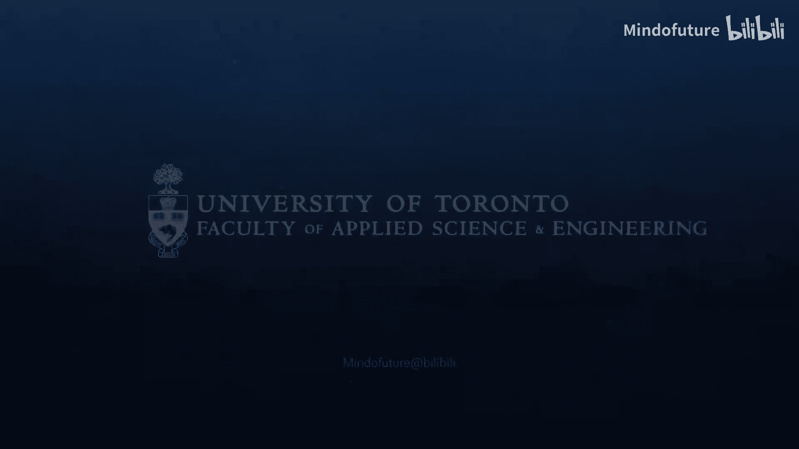

# 031：最终项目核心算法概念

在本节课中，我们将学习完成最终课程评估所需的核心算法概念。这些概念将帮助你构建自动驾驶汽车感知系统的三个主要方面。

上一节我们介绍了最终评估的整体框架，本节中我们来看看完成这些任务需要掌握的具体算法细节。

## 坐标系注意事项

首先，在开始作业时，必须明确所使用的坐标系。

所有需要的三维估计都将在**相机坐标系**中进行。这包括地面平面、碰撞距离以及其他三维量值。

然而，相机传感器通常的安装方向是使其Y轴指向下方。

这对你的作业意味着什么？

你唯一需要注意的是像素点高度的符号：**高于相机的点将具有负的高度值，而低于相机的点将具有正的高度值**。

## 平面估计：线性最小二乘法

接下来，你需要了解如何在Python中解决用于平面估计的线性最小二乘问题。

对于评估的这一部分，你有几个选择。

我们提供了一个使用**奇异值分解**的函数来为你进行平面估计。

但是，如果你想挑战自己，可以尝试通过使用NumPy原生函数 `numpy.linalg.lstsq` 求解最小二乘问题，自己解决平面估计问题。

如果你选择此路径，请注意在RANSAC的每次迭代中选择多于三个点，因为在某些系统条件不佳的边缘情况下，求解器可能无法提供有用的结果。

一个更大的挑战是从头开始实现SVD平面拟合。SVD几乎总能提供数值稳定的解。此外，它可能比NumPy的 `lstsq` 函数更快。

选择哪种路径来估计平面由你决定，只要平面估计正确，生成它的方法都将获得满分。

## 车道线检测与合并

需要执行的第二个感知任务是车道边界检测。

霍夫变换线检测的输出是任何属于车道边界的线，包括水平线和人行道远侧的线。此外，每个车道边界将有多条来自霍夫变换线估计器的关联输出线。

你需要过滤掉所有不相关的线，并合并相关的线，以**为每个车道边界生成一条线**。

以下是过滤和合并的步骤：

**1. 过滤水平线**

为了过滤掉水平线，我们可以依赖估计线的斜率。图像中的水平线往往具有非常接近0的斜率。然而，我们也希望移除倾斜严重的线，因此引入一个阈值作为此过滤步骤输出允许斜率的下限。

这个阈值的具体值需要通过实验确定，尝试在 **0.1 到 0.3** 之间的值以获得最佳效果。

**2. 聚类与合并**

从霍夫变换的输出中移除水平线后，你需要对相似的线进行聚类，然后合并它们以生成每个车道边界的一条线。

一个简单的聚类算法是：
*   首先，从剩余的过滤线中随机选择一个聚类中心。
*   然后，将任何具有与聚类中心线相似斜率或截距的线添加到该聚类中。

判断一条线是否接近聚类中心的标准是：其斜率与聚类中心斜率的差值小于特定的**斜率阈值**，并且其截距与聚类中心截距的差值也小于特定的**截距阈值**。

斜率差值阈值通常选择最大为 **0.3**，而截距差值阈值以像素为单位定义，通常在 **20 到 50 像素** 之间。你需要测试不同的值，才能为评估找到一个满意的阈值。

生成每个车道边界一条线的最后一步是合并每个聚类内的线。最简单的方法是通过**平均所有聚类成员的斜率和截距**来实现。

## 利用语义分割过滤目标检测结果

完成评估所需的最后一个概念是如何使用语义分割的输出过滤目标检测器的不确定结果。

目标检测的输出通常是可靠的，但在本次评估中，你得到的是一个**高召回率、低精确率**的检测器，它能检测场景中的所有物体，但也会产生一些误报。

你需要在估计障碍物距离之前，使用语义分割的输出消除这些误报。最终结果应该是可靠包含障碍物的边界框。

以下是执行此过滤的方法：

你需要使用语义分割输出来统计边界框内与2D目标检测器分类输出**类别相同**的像素数量。

这里的技巧在于，这个数量取决于边界框的大小。在尝试用阈值过滤检测结果之前，你需要**用边界框的面积对像素计数进行归一化**。

最终的归一化计数相当于计算边界框内由属于正确类别的像素所占据的面积比例。

至此，你应该已经准备好自信地应对最终评估了。

最后，我鼓励你思考除了建议的纲要之外，实现所需任务最终输出的不同方法。

我希望你喜欢这次评估，并发现它对学习有益。

**本节课总结**

本节课中，我们一起学习了完成自动驾驶视觉感知最终项目的核心算法概念。我们明确了在相机坐标系中处理三维估计时高度值的符号规则，探讨了使用SVD或最小二乘法进行平面估计的多种途径，详细介绍了通过斜率过滤、聚类和平均来合并霍夫变换车道线的方法，并讲解了如何利用语义分割的像素类别比例来过滤目标检测的误报，以提高障碍物距离估计的可靠性。掌握这些概念将帮助你成功构建评估所需的感知模块。